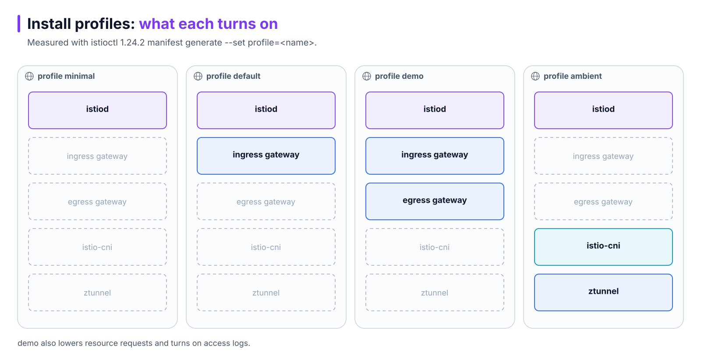
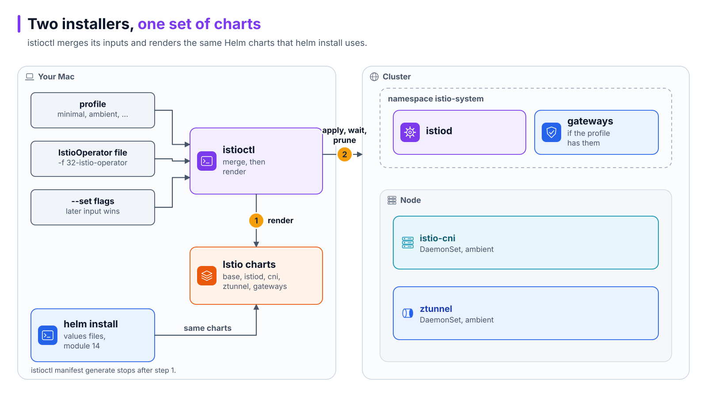

# Module 32: installing and configuring Istio with istioctl

> New to a term here, like install profile, IstioOperator or meshConfig? The [glossary](glossary.md) explains every term in this course.

**Before this module:** modules 7 and 14. Module 30 helps with step 7.

**You need:** `k3d` and Docker (the lab already uses both), internet access to download `istioctl` 1.24.2 and Istio's images, and about 800 MiB of free memory. This module never touches `k8s-lab`'s own Istio. It builds a second, throwaway cluster and deletes it at the end.

The lab installs Istio with Helm, one chart per component, the way module 14 upgrades it. Most tutorials, many teams and the Istio Certified Associate exam use the other installer, `istioctl install`. It takes a profile and an IstioOperator file and installs everything in one command. This module installs Istio that way on a fresh cluster, changes its mesh-wide settings, switches it to ambient mode and removes it again. Along the way you see that both installers render the same charts.

Time: about 40 minutes. The throwaway cluster used about 750 MiB in the test run and took 5 seconds to create.

## Concept: a profile is a starting point

Istio has many parts, and different clusters need different subsets. A test cluster wants everything with tiny resource requests. A production cluster wants istiod and its own gateways, sized for load. An ambient cluster wants ztunnel and istio-cni. Typing every component and setting by hand would be slow and error-prone.

An install profile solves that. An install profile is a named set of defaults that says which components to turn on and how to size them. You pick one and change only what differs. In Istio 1.24, a profile is a small IstioOperator file. The `demo` profile is nine lines:

```yaml
apiVersion: install.istio.io/v1alpha1
kind: IstioOperator
spec:
  components:
    egressGateways:
    - name: istio-egressgateway
      enabled: true
  values:
    profile: demo
```

It turns on the egress gateway, then passes `profile: demo` to the charts. Each chart carries its own `demo` values: lower resource requests, access logs on, 100% trace sampling.



The diagram shows four of the ten profiles, measured with `istioctl manifest generate`:

| Profile | What it installs | Use it for |
|---|---|---|
| `minimal` | istiod only | a control plane, with gateways managed separately |
| `default` | istiod and an ingress gateway | production in sidecar mode |
| `demo` | istiod, ingress and egress gateways, small requests, access logs | trying features, never production |
| `ambient` | istiod, istio-cni and ztunnel | ambient mode, like the lab |

The other profiles cover special cases: `empty` installs nothing, `remote` serves a second cluster in a multicluster mesh, `openshift` and `openshift-ambient` adjust for OpenShift, and `preview` and `stable` track feature maturity.

## Concept: the IstioOperator file

The profile sets defaults. An IstioOperator file holds your changes. The IstioOperator is a configuration format, `install.istio.io/v1alpha1`, that istioctl reads from disk. It has three main sections:

1. `meshConfig` holds settings for the whole mesh. istiod reads them and pushes them to every proxy, for example access logs, the outbound traffic policy, or `defaultConfig`, the ProxyConfig every proxy starts with.
2. `components` turns parts on or off and sets Kubernetes details per part, such as resources, replicas or node selectors.
3. `values` passes settings straight to the Helm charts underneath, for anything the first two sections don't cover.

Older Istio versions also ran an in-cluster operator that watched IstioOperator resources and installed from them. Istio 1.24 removed it. Today the file only feeds istioctl, and nothing stores it in the cluster.

istioctl merges its inputs in order. The profile comes first, then each `-f` file, then each `--set` flag. A later input wins over an earlier one. So `--set meshConfig.outboundTrafficPolicy.mode=ALLOW_ANY` beats the same field in your file.



The diagram shows the path in two steps:

1. istioctl merges profile, file and flags into one set of values and renders the Istio charts: `base`, `istiod`, `cni`, `ztunnel` and the gateways.
2. istioctl applies the result to the cluster, waits for each component, and prunes anything a previous install created that the new config drops.

`istioctl manifest generate` runs only step 1 and prints the YAML. Helm users run the same charts with values files, as module 14 does. The rendered istiod Deployment even carries the label `helm.sh/chart: istiod-1.24.2`.

## The bigger picture: istioctl, Helm and GitOps

Istio has changed its recommended installer three times. Early versions used Helm 2. Then came istioctl and the in-cluster operator, built around the IstioOperator API. Now Istio supports two paths, istioctl and Helm, and removed the operator in 1.24.

Each path suits a different team. istioctl gives one command with built-in checks, and it knows Istio's rules, such as which component goes first. Helm fits teams that already deploy everything with Helm or with a GitOps tool like ArgoCD. Each chart is a separate release, so you upgrade istiod with a canary revision while the CRDs stay put, as in module 14. The lab uses Helm for exactly that reason: ArgoCD and the upgrade module need it.

The two paths aren't exclusive. `istioctl manifest translate` turns an IstioOperator file into Helm values files, so a team moves from istioctl to Helm without retyping settings. Step 8 runs it.

## Why this way

**Why a separate cluster?** `istioctl install` and `uninstall --purge` act on the whole cluster. On `k8s-lab` they would fight with the Helm releases and ArgoCD, and `--purge` would delete the CRDs that every Istio resource in the lab depends on. A throwaway cluster costs 5 seconds and isolates every mistake.

**Why download istioctl 1.24.2 instead of using the one from module 0?** istioctl installs the Istio version it was built with. Module 0's client is 1.32, which would install 1.32 images. The 1.24.2 binary installs 1.24.2, the same version as the lab, so everything you see matches the rest of the course.

**Why minimal with a file, rather than demo?** `demo` turns on many settings at once, and you would struggle to tell which change caused which effect. Starting from `minimal` and adding three meshConfig settings makes each effect visible in step 6.

**Why does a reinstall drop settings?** `istioctl install` is declarative. Each run describes the whole desired state, and istioctl prunes what's missing. A second run without your file returns every field to the profile's default. Keep the file in Git and pass it every time.

## Do it

### 1. Create the throwaway cluster

```console
$ docker stats --no-stream --format '{{.Name}} {{.MemUsage}}' | grep k3d
k3d-k8s-lab-serverlb 25.71MiB / 11.73GiB
k3d-k8s-lab-server-0 3.237GiB / 11.73GiB

$ k3d cluster create istio-install-lab --image rancher/k3s:v1.31.5-k3s1 --no-lb \
  --k3s-arg "--disable=traefik@server:0" --kubeconfig-switch-context=false --wait
INFO[0000] Prep: Network
INFO[0000] Created network 'k3d-istio-install-lab'
INFO[0000] Created image volume k3d-istio-install-lab-images
INFO[0000] Starting new tools node...
INFO[0000] Starting node 'k3d-istio-install-lab-tools'
INFO[0001] Creating node 'k3d-istio-install-lab-server-0'
INFO[0001] Using the k3d-tools node to gather environment information
INFO[0001] HostIP: using network gateway 192.168.117.1 address
INFO[0001] Starting cluster 'istio-install-lab'
INFO[0001] Starting servers...
INFO[0001] Starting node 'k3d-istio-install-lab-server-0'
INFO[0003] All agents already running.
INFO[0003] All helpers already running.
INFO[0003] Injecting records for hostAliases (incl. host.k3d.internal) and for 1 network members into CoreDNS configmap...
INFO[0005] Cluster 'istio-install-lab' created successfully!
INFO[0005] You can now use it like this:
kubectl config use-context k3d-istio-install-lab
kubectl cluster-info

$ kubectl config current-context
k3d-k8s-lab

$ kubectl --context k3d-istio-install-lab get nodes
NAME                             STATUS   ROLES    AGE   VERSION
k3d-istio-install-lab-server-0   Ready    <none>   2s    v1.31.5+k3s1
```

The flags keep the new cluster small and out of the way:

- `--no-lb` skips k3d's load balancer container and maps no ports, so nothing clashes with the lab's 8080, 8443 or the port-forwards.
- `--disable=traefik` skips k3s's built-in ingress controller, as the lab does.
- `--kubeconfig-switch-context=false` keeps `kubectl` pointed at `k8s-lab`. Every command for the new cluster passes `--context k3d-istio-install-lab` instead.

**What you should see.** In the test run, the cluster took 5 seconds. `kubectl config current-context` still prints `k3d-k8s-lab`, and the new node shows `Ready` with `v1.31.5+k3s1`.

### 2. Download istioctl 1.24.2

```console
$ OS=$(uname -s | tr '[:upper:]' '[:lower:]' | sed 's/darwin/osx/')
$ ARCH=$(uname -m | sed 's/x86_64/amd64/;s/aarch64/arm64/')
$ mkdir -p ~/.istioctl/1.24.2
$ curl -fsSL "https://github.com/istio/istio/releases/download/1.24.2/istioctl-1.24.2-$OS-$ARCH.tar.gz" | tar xz -C ~/.istioctl/1.24.2
$ IC=~/.istioctl/1.24.2/istioctl
$ $IC version --remote=false
client version: 1.24.2

$ $IC profile list
Error: unknown command "profile" for "istioctl"
Run 'istioctl --help' for usage.

$ $IC verify-install
Error: unknown command "verify-install" for "istioctl"
Run 'istioctl --help' for usage.
```

The variable `IC` keeps the path short. It lives only in this terminal, so set it again if you open a new one.

**What you should see.** `client version: 1.24.2`, then two errors.

Many guides and older exam material use `istioctl profile dump`, `profile diff` and `verify-install`. Istio 1.24 removed all three together with the in-cluster operator. Their jobs moved:

| Old command | Replacement |
|---|---|
| `istioctl profile list` and `profile dump` | the profile files in Istio's `manifests/profiles` folder, or `istioctl manifest generate --set profile=<name>` |
| `istioctl profile diff a b` | `diff` of two `manifest generate` outputs (step 4) |
| `istioctl verify-install` | `istioctl install` itself, which waits for every component; then `istioctl x precheck` and `istioctl proxy-status` |

### 3. Check the cluster first

```console
$ $IC x precheck --context k3d-istio-install-lab
✔ No issues found when checking the cluster. Istio is safe to install or upgrade!
  To get started, check out https://istio.io/latest/docs/setup/getting-started/.
```

**What you should see.** `precheck` looks for an unsupported Kubernetes version, an existing Istio install, missing permissions and resources that conflict with Istio. On a cluster with an older Istio, it also lists upgrade problems, which is how module 14 recommends using it.

### 4. Compare the profiles without installing anything

```console
$ curl -fsSL https://raw.githubusercontent.com/istio/istio/1.24.2/manifests/profiles/demo.yaml
apiVersion: install.istio.io/v1alpha1
kind: IstioOperator
spec:
  components:
    egressGateways:
    - name: istio-egressgateway
      enabled: true
  values:
    profile: demo

$ for p in minimal default demo ambient; do
  printf '%-8s ' $p
  $IC manifest generate --set profile=$p 2>/dev/null | kubectl --context k3d-istio-install-lab create --dry-run=client -o name -f - 2>/dev/null | grep -E '^(deployment|daemonset)' | tr '\n' ' '
  echo
done
minimal  deployment.apps/istiod
default  deployment.apps/istio-ingressgateway deployment.apps/istiod
demo     deployment.apps/istio-egressgateway deployment.apps/istio-ingressgateway deployment.apps/istiod
ambient  daemonset.apps/istio-cni-node daemonset.apps/ztunnel deployment.apps/istiod

$ diff <($IC manifest generate --set profile=default 2>/dev/null) <($IC manifest generate --set profile=demo 2>/dev/null) | grep -E '^[<>] .*(accessLogFile|memory: )' | sort | uniq -c
   1 <             memory: 128Mi
   1 <             memory: 2048Mi
   1 >             memory: 100Mi
   1 >             memory: 1024Mi
   2 >             memory: 40Mi
   1 >     accessLogFile: /dev/stdout
```

The loop renders each profile and lets `kubectl create --dry-run=client` name every object, then keeps only the workloads.

**What you should see.** The nine-line `demo` profile from the first concept section, then the Deployments and DaemonSets of each profile.

The diff shows what `demo` changes beyond the components. Lines with `<` come from `default`, lines with `>` from `demo`.

Smaller memory requests and limits, and access logs on for every proxy. That's why `demo` suits a laptop and nothing else.

### 5. Install with an IstioOperator file

```console
$ cat platform-engineering/manifests/32-istio-operator.yaml
# Module 32: an IstioOperator file for `istioctl install`. It is NOT applied with kubectl:
# istioctl reads it, merges it over the profile, renders the charts and applies the result.
# Use it only on the throwaway cluster istio-install-lab, never on k8s-lab.
apiVersion: install.istio.io/v1alpha1
kind: IstioOperator
spec:
  # Start from the smallest profile: istiod only, no gateways.
  profile: minimal
  # meshConfig: settings for the whole mesh, read by istiod and pushed to every proxy.
  meshConfig:
    # Every sidecar writes one access log line per request to its stdout.
    accessLogFile: /dev/stdout
    # Unknown destinations (not in the service registry) are blocked, not passed through.
    outboundTrafficPolicy:
      mode: REGISTRY_ONLY
    # defaultConfig: the ProxyConfig every proxy starts with.
    defaultConfig:
      # Start istio-proxy before the app container, so the app's first call finds Envoy ready.
      holdApplicationUntilProxyStarts: true
  # components: which pieces to install, and Kubernetes settings for each.
  components:
    pilot:
      k8s:
        resources:
          requests:
            cpu: 50m
            memory: 128Mi
  # values: settings passed straight to the Helm charts that istioctl renders.
  values:
    pilot:
      autoscaleEnabled: false
    global:
      proxy:
        # Requests for every injected sidecar (the default is 100m CPU and 128Mi).
        resources:
          requests:
            cpu: 10m
            memory: 40Mi

$ $IC manifest generate -f platform-engineering/manifests/32-istio-operator.yaml | grep -nE 'accessLogFile|mode: REGISTRY_ONLY|holdApplicationUntilProxyStarts: true'
17627:    accessLogFile: /dev/stdout
17630:      holdApplicationUntilProxyStarts: true
17636:      mode: REGISTRY_ONLY

$ time $IC install --context k3d-istio-install-lab -f platform-engineering/manifests/32-istio-operator.yaml -y
        |\
        | \
        |  \
        |   \
      /||    \
     / ||     \
    /  ||      \
   /   ||       \
  /    ||        \
 /     ||         \
/______||__________\
____________________
  \__       _____/
     \_____/

WARNING: Istio 1.24.0 may be out of support (EOL) already: see https://istio.io/latest/docs/releases/supported-releases/ for supported releases
✔ Istio core installed ⛵️
✔ Istiod installed 🧠
✔ Installation complete

real	0m6.738s
user	0m0.357s
sys	0m0.057s

$ kubectl --context k3d-istio-install-lab -n istio-system get pods
NAME                      READY   STATUS    RESTARTS   AGE
istiod-75879f9bc6-sskj2   1/1     Running   0          6s

$ kubectl --context k3d-istio-install-lab -n istio-system get deploy istiod -o jsonpath='{.metadata.labels.helm\.sh/chart}{"\n"}'
istiod-1.24.2
```

**What you should see.** The file starts from `minimal` and changes three meshConfig settings, istiod's requests and every sidecar's requests. `manifest generate` finds the three settings in the `istio` ConfigMap it would create, around line 17,600 of about 20,000. Most of those lines are the 14 CRDs.

The install prints.

In the test run, it took 6 seconds, including a 3-second image pull. The warning is honest: Istio 1.24 left support in 2025, which is one more reason to practise upgrades in module 14. One pod, `istiod`, runs in `istio-system`. Its Deployment carries `istiod-1.24.2` as its chart label, the proof that istioctl rendered the Helm chart.

### 6. See the mesh settings take effect

```console
$ kubectl --context k3d-istio-install-lab create namespace demo
namespace/demo created

$ kubectl --context k3d-istio-install-lab label namespace demo istio-injection=enabled
namespace/demo labeled

$ kubectl --context k3d-istio-install-lab -n demo run curl --image=curlimages/curl:8.11.1 --command -- sleep infinity
pod/curl created

$ kubectl --context k3d-istio-install-lab -n demo wait --for=condition=Ready pod/curl --timeout=180s
pod/curl condition met

$ kubectl --context k3d-istio-install-lab -n demo get pod curl \
  -o jsonpath='{range .spec.initContainers[*]}init: {.name}{"\n"}{end}{range .spec.containers[*]}container: {.name} {.resources.requests}{"\n"}{end}'
init: istio-init
container: istio-proxy {"cpu":"10m","memory":"40Mi"}
container: curl

$ kubectl --context k3d-istio-install-lab -n demo exec curl -c curl -- curl -s -m 5 -o /dev/null -w "%{http_code}\n" http://example.com
000
command terminated with exit code 56

$ kubectl --context k3d-istio-install-lab -n demo logs curl -c istio-proxy --tail=1
[2026-11-15T11:19:51.366Z] "- - -" 0 UH - - "-" 0 0 0 - "-" "-" "-" "-" "-" BlackHoleCluster - 104.20.23.154:80 10.42.0.6:48620 - -
```

**What you should see.** Each line answers one setting from the file.

1. `istio-proxy` comes first, before `curl`. That's `holdApplicationUntilProxyStarts: true`: the injector puts the proxy first, and Kubernetes waits for its startup hook before it starts the next container.
2. The proxy requests 10m CPU and 40Mi, from `values.global.proxy.resources`. The lab's default is 100m and 128Mi, as module 30 showed.
3. The call to `example.com` prints `000` and `command terminated with exit code 56`: blocked by `REGISTRY_ONLY`.
4. The proxy's log holds a line although nobody created a Telemetry resource, because `accessLogFile: /dev/stdout` turns logs on for the whole mesh.

`BlackHoleCluster` is the same destination module 30 reached with a Sidecar resource. Here one meshConfig line sets it for every proxy in the mesh.

### 7. Change one setting in place

```console
$ time $IC install --context k3d-istio-install-lab -f platform-engineering/manifests/32-istio-operator.yaml \
  --set meshConfig.outboundTrafficPolicy.mode=ALLOW_ANY -y
        |\
        | \
        |  \
        |   \
      /||    \
     / ||     \
    /  ||      \
   /   ||       \
  /    ||        \
 /     ||         \
/______||__________\
____________________
  \__       _____/
     \_____/

WARNING: Istio 1.24.0 may be out of support (EOL) already: see https://istio.io/latest/docs/releases/supported-releases/ for supported releases
✔ Istio core installed ⛵️
✔ Istiod installed 🧠
✔ Installation complete

real	0m0.853s
user	0m0.375s
sys	0m0.124s

$ kubectl --context k3d-istio-install-lab -n demo exec curl -c curl -- curl -s -m 5 -o /dev/null -w "%{http_code}\n" http://example.com
200
```

**What you should see.** The same three ✔ lines, after 1 second in the test run, and then `200`. The `--set` flag won over the file. The pod didn't restart: istiod pushed the new mesh config to the running proxy within seconds. Settings that the injector writes into the pod, like the resource requests, need a restart instead.

### 8. Translate the file into Helm values

```console
$ mkdir -p /tmp/istio-helm-values
$ $IC manifest translate -f platform-engineering/manifests/32-istio-operator.yaml -o /tmp/istio-helm-values
Output written to /tmp/istio-helm-values! See the README.md for next steps

$ ls /tmp/istio-helm-values
README.md			base-values.yaml		diff-pilot-helm-output.yaml	diff-pilot-istioctl-output.yaml	install-base.sh			install-pilot.sh		pilot-values.yaml

$ cat /tmp/istio-helm-values/base-values.yaml
defaultRevision: ""
gateways:
  istio-egressgateway: {}
  istio-ingressgateway: {}
global:
  configValidation: true
  hub: docker.io/istio
  istioNamespace: istio-system
  proxy:
    resources:
      requests:
        cpu: 10m
        memory: 40Mi
  tag: 1.24.2
meshConfig:
  accessLogFile: /dev/stdout
  defaultConfig:
    holdApplicationUntilProxyStarts: true
  outboundTrafficPolicy:
    mode: REGISTRY_ONLY
pilot:
  autoscaleEnabled: false
  cni:
    enabled: false
  enabled: true
```

**What you should see.** `Output written to /tmp/istio-helm-values! See the README.md for next steps`, then a folder with `base-values.yaml`, `pilot-values.yaml`, an `install-*.sh` script per chart, a README, and two `diff-pilot-*.yaml` files. The values file holds your settings in Helm form, for example `meshConfig.outboundTrafficPolicy.mode: REGISTRY_ONLY` and `global.proxy.resources.requests.memory: 40Mi`. The README warns that the pilot rendering differs slightly between istioctl and Helm, and the two diff files show where. From here, module 14's Helm commands take over. Delete the folder when you're done: `rm -rf /tmp/istio-helm-values`.

### 9. Switch the same cluster to ambient

```console
$ BIN=$(docker exec k3d-istio-install-lab-server-0 sed -n 's/^ *bin_dir = "\(.*\)"/\1/p' /var/lib/rancher/k3s/agent/etc/containerd/config.toml)
$ echo $BIN
/bin

$ time $IC install --context k3d-istio-install-lab --set profile=ambient \
  --set values.global.platform=k3s --set values.cni.cniBinDir="$BIN" -y
        |\
        | \
        |  \
        |   \
      /||    \
     / ||     \
    /  ||      \
   /   ||       \
  /    ||        \
 /     ||         \
/______||__________\
____________________
  \__       _____/
     \_____/

WARNING: Istio 1.24.0 may be out of support (EOL) already: see https://istio.io/latest/docs/releases/supported-releases/ for supported releases
✔ Istio core installed ⛵️
✔ Istiod installed 🧠
✔ CNI installed 🪢
✔ Ztunnel installed 🔒
✔ Installation complete
The ambient profile has been installed successfully, enjoy Istio without sidecars!

real	0m16.818s
user	0m0.426s
sys	0m0.074s

$ kubectl --context k3d-istio-install-lab -n istio-system get pods
NAME                     READY   STATUS    RESTARTS   AGE
istio-cni-node-f6m9j     1/1     Running   0          10s
istiod-756568674-66xm6   1/1     Running   0          16s
ztunnel-lbr9g            1/1     Running   0          4s

$ kubectl --context k3d-istio-install-lab -n istio-system get cm istio -o jsonpath='{.data.mesh}' | grep -cE 'accessLogFile|REGISTRY_ONLY'
0
```

The first line reads the folder where the node's containerd looks for CNI plugins. istio-cni must copy its plugin there.

**What you should see.** `/bin`, then four ✔ lines (core, istiod, CNI, ztunnel) and `The ambient profile has been installed successfully, enjoy Istio without sidecars!`. In the test run, it took 17 seconds. Three pods run: `istio-cni-node`, `istiod` and `ztunnel`. The grep prints `0`: your meshConfig settings are gone, because this run didn't pass the file.

`values.global.platform=k3s` alone isn't enough on k3d. In an earlier test run without `cniBinDir`, the k3s platform default sent the plugin to `/var/lib/rancher/k3s/data/current/bin/`. containerd in a k3d node looks in `/bin`, so every new pod failed with `failed to find plugin "istio-cni" in path [/bin]`, ztunnel included. ztunnel stayed in `ContainerCreating`, and `istioctl install` waited without end. `provision.sh` reads the folder the same way for the lab, as module 14 notes.

Now start one more sidecar pod in `demo`:

```console
$ kubectl --context k3d-istio-install-lab -n demo run curl2 --image=curlimages/curl:8.11.1 --command -- sleep infinity
pod/curl2 created

$ kubectl --context k3d-istio-install-lab -n demo wait --for=condition=Ready pod/curl2 --timeout=180s
pod/curl2 condition met

$ kubectl --context k3d-istio-install-lab -n demo get pod curl2 \
  -o jsonpath='{range .spec.initContainers[*]}init: {.name} {.securityContext.capabilities}{"\n"}{end}{range .spec.containers[*]}container: {.name} {.resources.requests}{"\n"}{end}'
init: istio-validation {"drop":["ALL"]}
container: curl2
container: istio-proxy {"cpu":"100m","memory":"128Mi"}
```

**What you should see.** Three changes from step 6, all caused by the profile switch:

1. The init container is now `istio-validation` with every capability dropped. The ambient profile turns on istio-cni and also sets istiod's `pilot.cni.enabled`, so the CNI plugin writes the redirect rules and the pod needs no `NET_ADMIN`. The lab installs istiod with Helm and leaves that value off, which is why module 30 found `istio-init` there.
2. The proxy comes after the app again: `holdApplicationUntilProxyStarts` is gone.
3. The requests are back at 100m and 128Mi.

Check the memory of the whole throwaway cluster:

```console
$ docker stats --no-stream --format '{{.Name}} {{.MemUsage}}' | grep istio-install-lab
k3d-istio-install-lab-server-0 836MiB / 11.73GiB
```

**What you should see.** About 750 to 840 MiB in the test runs (`744.9MiB` and `836MiB`). That's k3s itself, CoreDNS, metrics-server, istiod, istio-cni, ztunnel and two curl pods.

### 10. Uninstall, then delete the cluster

```console
$ kubectl --context k3d-istio-install-lab delete namespace demo
namespace "demo" deleted

$ $IC uninstall --context k3d-istio-install-lab --purge -y
All Istio resources will be pruned from the cluster

  Removed apps/v1, Kind=Deployment/istiod.istio-system.
  Removed apps/v1, Kind=DaemonSet/istio-cni-node.istio-system.
...
  Removed apiextensions.k8s.io/v1, Kind=CustomResourceDefinition/workloadgroups.networking.istio.io..
✔ Uninstall complete

$ kubectl --context k3d-istio-install-lab get crd | grep -c istio.io
7

$ kubectl --context k3d-istio-install-lab get ns istio-system
NAME           STATUS   AGE
istio-system   Active   110s
```

Delete the workloads first. Their pods were set up through the istio-cni plugin, and the kubelet calls that plugin again when it tears a pod down.

**What you should see.** `✔ Uninstall complete` in under a second. The CRD count drops to `0` within a few seconds, because `--purge` also removes the CRDs. In the run above, the count ran at once and still read `7`. Run it again a few seconds later. Without `--purge`, the CRDs and your Istio resources would stay. The namespace `istio-system` survives, empty. `uninstall` never deletes namespaces, because other things might live there.

Delete the cluster and the downloaded binary:

```console
$ k3d cluster delete istio-install-lab
INFO[0000] Deleting cluster 'istio-install-lab'
INFO[0000] Deleting cluster network 'k3d-istio-install-lab'
INFO[0000] Deleting 1 attached volumes...
INFO[0000] Removing cluster details from default kubeconfig...
INFO[0000] Removing standalone kubeconfig file (if there is one)...
INFO[0000] Successfully deleted cluster istio-install-lab!

$ rm -rf ~/.istioctl/1.24.2 && rmdir ~/.istioctl 2>/dev/null
$ k3d cluster list
NAME      SERVERS   AGENTS   LOADBALANCER
k8s-lab   1/1       0/0      true
```

**What you should see.** `Successfully deleted cluster istio-install-lab!` after about a second, and `k3d cluster list` shows only `k8s-lab`.

## Investigate

1. Your file sets `meshConfig.accessLogFile: /dev/stdout`, and a colleague runs `istioctl install --set profile=default -y` for a quick fix. What happens to access logs, and why?
2. Without installing anything, how do you find out which Kubernetes objects the `ambient` profile would create that `minimal` doesn't?
3. A team wants `REGISTRY_ONLY` for one namespace only, not the whole mesh. Which resource from module 30 does that, and why is meshConfig the wrong place?
4. Step 9's sidecar pod got `istio-validation`, the lab's pods get `istio-init`. Which Helm value would give the lab's sidecars the CNI behaviour, and what changes for running pods when you set it?

<details>
<summary>Answers</summary>

1. Access logs stop. `istioctl install` describes the whole desired state, so the run without `-f` renders the `default` profile with `accessLogFile` unset and applies it. istiod pushes the new mesh config, and proxies stop logging within seconds. Step 9 showed the same with `grep -c` printing `0`. The fix is to keep the IstioOperator file in Git and always pass it.
2. `diff <($IC manifest generate --set profile=minimal) <($IC manifest generate --set profile=ambient)`, or step 4's loop with `kubectl create --dry-run=client -o name`. The ambient profile adds two DaemonSets (`istio-cni-node`, `ztunnel`), three more ClusterRoles and ClusterRoleBindings, two more ServiceAccounts and one more ConfigMap. Step 4's counts showed 6 ClusterRoles against 3.
3. A Sidecar resource in that namespace with `outboundTrafficPolicy.mode: REGISTRY_ONLY`, like `30-sidecar-registry-only.yaml`. meshConfig applies to every proxy in the mesh, so one team's lockdown would break every other team's calls to outside hosts. In ambient mode, which has no Sidecar resource, the same goal needs an egress waypoint and AuthorizationPolicy, as in module 12.
4. `pilot.cni.enabled=true` on the istiod chart. The injector reads it, so only pods created afterwards get `istio-validation` instead of `istio-init`. Running pods keep their `istio-init` rules until they restart, the same rule as every injection change. The node already runs istio-cni for ambient, so you add no new component.

</details>

## Clean up

Step 10 deletes everything this module created: the `istio-install-lab` cluster, its kubeconfig entry and the downloaded `istioctl`. If you stopped early, run:

```console
$ k3d cluster delete istio-install-lab
INFO[0000] No nodes found for cluster 'istio-install-lab', nothing to delete.
INFO[0000] No clusters found

$ rm -rf ~/.istioctl/1.24.2 /tmp/istio-helm-values
```

Step 9 already removed both, so here k3d finds nothing to delete.

`./platform-engineering/reset.sh` has nothing to do for this module, because `k8s-lab` never changed.
