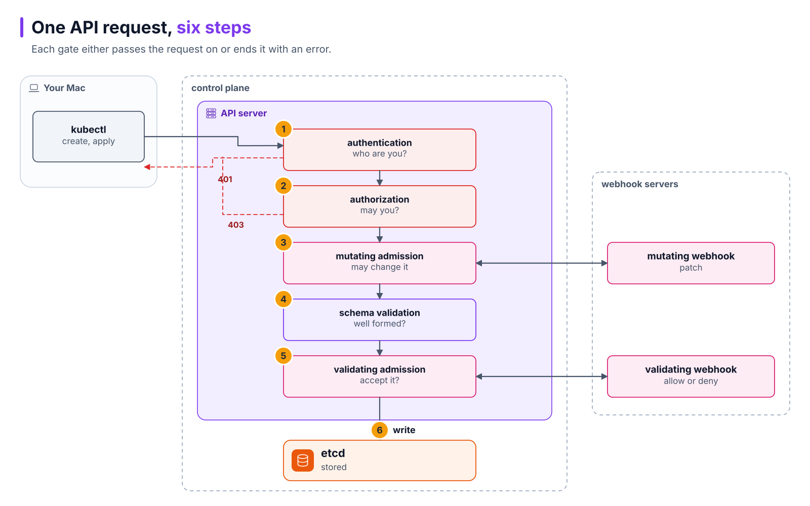
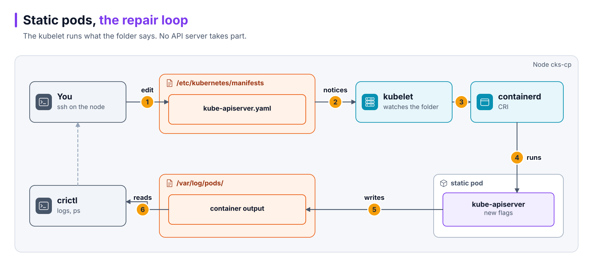

# Module 4.2: Hardening access to the API

> New to a term here, like resourceNames or AuthenticationConfiguration? The [glossary](../glossary.md#the-practice-cluster-and-the-security-modules) explains every term the security modules use.

**Before this module:** the [practice cluster](../practice-cluster.md) at v1.37.1, so run `./lab.sh practice reset` after module 4.1. The course's [module 3.15](../3-istio/15-life-of-a-request.md#concept-inside-the-api-server) walks one request through authentication, authorization and admission. Read it first, because this module changes each of those gates.

Every attack on a cluster ends at the API server, because nothing changes the cluster's state any other way. A stolen service account token, a forgotten anonymous binding or a known bug in an old version all turn into API calls that change something. This module shrinks what each caller may do, repairs a control plane that a bad edit broke, and keeps the API server patched. It has 12 tasks and takes about 2 hours.

## The module in one table

Every request to the API server passes the same gates, and this module changes each of them, so the tasks map onto the gates like this:

| Gate or job | Tasks |
|---|---|
| Authentication: who may log in, with which token | 2, 3, 7, 8 |
| Authorization: what each caller may do | 1, 5, 6, 12 |
| Admission, and a control plane that runs at all | 9, 10, 11 |
| A patched API server | 4 |

The sections below follow one request through the gates, and then look at the identities that pods carry, the static pods that run the control plane, and the upgrades that keep it patched.

## Concept: one request, six steps

The API server is the only door into the cluster's state. kubectl, controllers, kubelets and your own pods all go through it, and nothing writes to etcd any other way, which means every security control for the API sits somewhere on the path of a single request.



A request that changes something passes six steps, always in this order:

1. **Authentication** finds out who the caller is. It fails with `401 Unauthorized`.
2. **Authorization** decides whether that caller may do this verb on this resource. It fails with `403 Forbidden`.
3. **Mutating admission** may change the object, for example add a default or inject a sidecar.
4. **Schema validation** checks that the object is a well-formed object of its kind.
5. **Validating admission** accepts or refuses the final object, but never changes it.
6. The API server writes the object to etcd and answers the client.

An airport works the same way. Passport control checks who you are, the boarding pass decides whether you may board this flight, and security screening looks inside your bag and may take something out before you board. A read such as `get` or `list` skips the admission steps, because it changes nothing that screening would need to inspect.

### Step 1: authentication

Kubernetes has no user database, so a "user" is simply whatever name a trusted credential carries. The API server tries each configured method in turn, and the first one that recognizes the credential decides who the caller is:

| Method | What the caller shows | Typical caller |
|---|---|---|
| Client certificate | a certificate signed by the cluster's CA. The common name (CN) becomes the user name, and each organization (O) becomes a group | kubelets, admins with a kubeconfig |
| Service account token | a signed token (a JWT) for a ServiceAccount | pods |
| OIDC token | a token from a company identity provider | people in a company with single sign-on |
| Webhook | any token, checked by an outside service | special setups |

When a request carries no credential at all and **anonymous authentication** is on, the API server names the caller `system:anonymous` in the group `system:unauthenticated`. A request with a wrong credential never becomes anonymous, because the API server answers it with `401` at once.

kubeadm leaves anonymous authentication on, because its health probes call `/livez`, `/readyz` and the startup endpoint without credentials. Out of the box, RBAC lets anonymous callers read only those health and version endpoints, but one careless ClusterRoleBinding to `system:anonymous` opens the cluster to everybody who reaches port 6443.

Turning anonymous access off completely breaks the cluster, and it breaks it slowly, which makes the cause hard to spot. The test run measured the sequence:

1. The kubelet restarts the API server, and the new process starts serving within seconds.
2. The startup probe keeps failing with `HTTP probe failed with statuscode: 401`, so the pod stays `Ready: False`.
3. After 24 failures, 10 seconds apart, the kubelet kills the API server. In the test run, that took 4 minutes, and the loop repeats forever.

The **AuthenticationConfiguration** file solves this by keeping anonymous access only for named paths, such as the health endpoints, and refusing it everywhere else. The API server reads the file from the `--authentication-config` flag. A shop works the same way when anyone reads the opening hours on the door but nobody walks in without a badge.

**What this stops.** A narrow anonymous rule stops a forgotten binding to `system:anonymous` from turning into a public read of the whole cluster. In the test run, the setup's binding gave an anonymous caller `200` on a list of pods, and after the fix the same request got `401`.

**Exam traps.** Never set `--anonymous-auth` together with an `anonymous` block in the file, because the API server then exits at once with `--anonymous-auth flag cannot be set when anonymous field is configured in authentication configuration file`. The file also lives on the node, so the API server pod needs a `hostPath` volume and a mount for its folder.

### Step 2: authorization

Once the API server knows who is calling, authorization takes the user, the groups, the verb, the resource and the namespace, and returns a verdict. The `--authorization-mode` flag lists **authorizers** in order, and each one answers allow, deny or "no opinion":

| Authorizer | What it decides |
|---|---|
| `Node` | requests from kubelets: a kubelet may read only what its own pods need. [Module 4.3](03-hardening-nodes.md#concept-a-stolen-kubelet-identity) explains it |
| `RBAC` | everything else, from Roles and bindings stored in the cluster |
| `Webhook` | asks an outside service with a SubjectAccessReview |
| `ABAC` | an old file of policies, read at start. Nobody uses it any more |
| `AlwaysAllow` | says yes to everything |
| `AlwaysDeny` | says no to everything, for tests |

The first authorizer with an opinion decides, and when every authorizer says "no opinion" the answer is `403`. kubeadm sets `Node,RBAC`. RBAC never says "deny", because it either finds a rule that allows the request or has no opinion, so in practice a request passes when some rule allows it and fails otherwise.

`AlwaysAllow` has an opinion on everything, and the opinion is yes, so every authenticated caller does anything. Task 12 finds it on the practice cluster, where the setup printed `may the default ServiceAccount list every Secret? yes`.

**What this stops.** Authorization stops an authenticated caller from doing more than its job. A stolen CI token that may only update one Deployment stays a stolen CI token, not a stolen cluster.

**Exam traps.** Under `AlwaysAllow` alone, the API server turns anonymous access off by itself. In the test run, an anonymous request got `401`, kubeadm's health probes got `401` too, the pod stayed `0/1`, and the kubelet restarted the API server after its 24 failed probes. So `AlwaysAllow` shows up as a restart loop as well as an open door.

### Steps 3 to 5: admission

Authorization looks only at the request's verb, resource and name, and never inside the object. A user who may create pods therefore creates a privileged pod with the node's root folder mounted, and RBAC has nothing to say about it. **Admission control** closes that gap, and an **admission controller** is a piece of code that sees the full object after authorization and before storage.

Admission runs in two phases with a schema check between them, so that the final checks see the final object:

1. Mutating controllers run first. They change the object: set a default ServiceAccount, add a toleration, inject a sidecar.
2. Schema validation checks the result.
3. Validating controllers run last. They accept or refuse, and never change anything. Because they run after every mutation, they judge exactly what etcd will store.

Kubernetes compiles some admission controllers into the API server, and `--enable-admission-plugins` turns them on. kubeadm adds `NodeRestriction`, and Kubernetes turns on a default set that includes `ServiceAccount` and `PodSecurity`. Others live outside the API server as **admission webhooks**, which means the API server sends the object to an HTTPS service and waits for its verdict. Kyverno works this way, and so does the back end behind the ImagePolicyWebhook of [module 4.5](05-supply-chain-security.md#concept-admission-the-clusters-front-door), and the course's [module 2.7](../2-observability/07-kyverno-policy-as-code.md#concept-where-kyverno-sits) shows one in action. A ValidatingAdmissionPolicy is a third kind, a rule written in the CEL expression language that the API server runs itself, with no webhook to call.

**What this stops.** Admission stops dangerous objects that a caller may legally create, such as privileged pods, images from unknown registries or objects without required labels, because it is the only gate that reads the object itself.

## Concept: RBAC, the permission model

**RBAC** (role-based access control) answers one question for the authorization step: may this subject do this verb on this resource? A subject is a user, a group or a ServiceAccount, and RBAC builds its answers from four objects:

| Object | Scope | Job |
|---|---|---|
| Role | one namespace | lists permissions |
| ClusterRole | the whole cluster | lists permissions, for cluster-wide resources or for reuse in many namespaces |
| RoleBinding | one namespace | hands a Role or a ClusterRole to subjects, inside that namespace |
| ClusterRoleBinding | the whole cluster | hands a ClusterRole to subjects, everywhere |

Permissions only add, and no rule ever takes a right away. A RoleBinding that points to a ClusterRole grants that role's rules only inside the binding's namespace, which lets one `pod-reader` ClusterRole serve fifty namespaces without fifty copies.

A rule has three parts, and each part narrows the grant further:

| Part | Example | Too broad |
|---|---|---|
| `verbs` | `get`, `list`, `watch` | `*`, which includes `delete`, `escalate` and `impersonate` |
| `resources` | `pods` | `*`, which includes Secrets |
| `resourceNames` | `report-key` | missing, which means every object of that kind |

Three verbs deserve their own warning, because each one leads to every other right. `escalate` lets a subject write a Role with rights it doesn't hold itself, `bind` lets it bind roles it doesn't hold, and `impersonate` lets it act as another user. RBAC refuses role edits that grant more than the editor holds unless the editor has `escalate` or `bind`, which makes those two verbs keys to the whole cluster.

**What this stops.** Narrow RBAC stops a compromised workload or a leaked credential from reading Secrets, creating privileged pods or deleting namespaces it never needed.

**Exam traps.** `list` on Secrets returns their contents and not only their names, so "may list secrets" means "may read every secret". `resourceNames` covers `get`, `update` and `delete` on the named object, but it never covers `create`, and it covers neither a plain `list` nor `watch`, because those requests name no single object. In task 1, the setup's Role failed three of seven checks, among them listing Secrets.

### Aggregated ClusterRoles

Some ClusterRoles collect their rules from other ClusterRoles instead of holding their own. Such a role has an `aggregationRule` with a label selector and an empty rule list, and a controller in the controller manager finds every ClusterRole with a matching label and copies their rules in. The built-in `admin`, `edit` and `view` roles work this way, so a ClusterRole labelled `rbac.authorization.k8s.io/aggregate-to-view: "true"` adds its rules to `view`. That is how a CRD installer gives every viewer read access to its new resource without touching `view` itself.

That design has two consequences that the exam tests:

1. To extend an aggregated role, create a new labelled ClusterRole. A rule written straight into the aggregated role disappears, because the controller overwrites the list.
2. A permission leaks through the label. An over-broad rule in any labelled role reaches everybody bound to the aggregated role. To take it away, fix the source role.

### Finding out who may do what

When you investigate a permission, you want to know what a caller may do without logging in as that caller. `kubectl auth can-i` gives exactly that answer, because it asks the API server's own authorizers on the caller's behalf. Two forms help in an investigation:

```console
root@practice-control-plane:~# k auth can-i get secrets -n kube-system --as=system:serviceaccount:apps:cleaner   # one verb, one caller
yes
root@practice-control-plane:~# k auth can-i --list -n apps --as=system:serviceaccount:apps:viewer                 # everything one caller may do
Resources                                       Non-Resource URLs                      Resource Names   Verbs
selfsubjectreviews.authentication.k8s.io        []                                     []               [create]
selfsubjectaccessreviews.authorization.k8s.io   []                                     []               [create]
selfsubjectrulesreviews.authorization.k8s.io    []                                     []               [create]
pods                                            []                                     []               [get list watch]
services                                        []                                     []               [get list watch]
clustertrustbundles.certificates.k8s.io         []                                     []               [get list watch]
...
```

`--list` prints a table of resources, resource names, non-resource URLs and verbs, built from every Role and ClusterRole that applies in the namespace you name. It doesn't say which binding grants a right, so search the bindings for the subject next: `k get rolebinding,clusterrolebinding -A -o wide | grep apps/cleaner`. In task 6, the culprit was a ClusterRoleBinding named `log-cleanup`, a harmless name for a role that may get, list and delete every Secret in the cluster.

## Concept: the identity every pod carries

Every pod runs as a **service account**, an identity for software instead of a person. Unless told otherwise, the kubelet mounts a token for that account into `/var/run/secrets/kubernetes.io/serviceaccount/`, so even an application that never calls the Kubernetes API carries a key to it. An attacker who gets a shell in the pod picks up that key and calls the API with the account's rights.

### How tokens evolved

Kubernetes has issued service account tokens in two ways over the years, and both still appear in the exam, so you need to recognise each one.

The old way was the **legacy token**. A controller created a Secret of type `kubernetes.io/service-account-token` for every ServiceAccount, and pods mounted that Secret. The token had no audience and no expiry, so anybody who read the Secret once, from etcd, a backup or a `kubectl get secret -o yaml`, held a key that worked forever.

The new way is the **bound token**, issued by the **TokenRequest API**. The API server mints a token on demand, signs it, and writes three limits into it:

1. An **audience**: the service that should accept the token. The Kubernetes API server accepts only tokens whose audience is its own.
2. An **expiry**: a time after which the token stops working.
3. A **binding** to one pod: when somebody deletes the pod, the token stops working too, even before it expires.

Since 1.22, every pod gets a bound token through a **projected volume**, a volume that the kubelet fills with a fresh token and renews before the token expires. The kubelet renews it once it is older than 80 percent of its lifetime, or older than 24 hours. Kubernetes stopped creating legacy token Secrets by itself in 1.24, and since 1.30 a controller labels, invalidates and finally deletes legacy tokens that nobody used for a year.

`kubectl create token <sa> --audience=vault --duration=2h` asks for a bound token by hand. A pod asks for an extra token, for another audience, with a `serviceAccountToken` source in a projected volume:

```yaml
  volumes:
  - name: vault-token
    projected:
      sources:
      - serviceAccountToken:
          audience: vault
          expirationSeconds: 3600
          path: token
```

The audience protects you from a replay, which means reusing a stolen token against a different service. A token minted for Vault carries `aud: ["vault"]`, so the Kubernetes API server refuses it, and a thief who steals the Vault token gets nothing in the cluster. In task 7, the claims held `"aud":["vault"]`, and `exp` minus `iat` was exactly 7200 seconds.

### Two settings that shrink the risk

`automountServiceAccountToken: false` on the ServiceAccount stops the mount for every pod that uses the account, and the same field on a pod spec overrides the account's setting for that pod. Give each application its own account as well, so that a permission granted to one app never leaks to the others through the shared `default` account.

**What this stops.** No token in the pod means nothing for an attacker to steal. Bound tokens mean that a stolen token dies with its pod or its expiry, and never works against a service it wasn't minted for.

**Exam traps.** A legacy token keeps working until somebody deletes its Secret. In task 8, the setup's legacy token answered `200`, and after the delete it got `401` 8 seconds later, once the API server's token cache expired. `k get secrets -A --field-selector type=kubernetes.io/service-account-token` finds them all. The API server's `--service-account-extend-token-expiration`, on by default, stretches the tokens that pods get to a year, which kube-bench flags in [module 4.1](01-setting-up-a-secure-cluster.md#concept-a-checklist-for-the-control-plane).

## Concept: static pods and control plane repair

A kubeadm cluster runs its own control plane as pods, which raises a puzzle: pods need the API server, and the API server is itself a pod. **Static pods** solve it, because a static pod is a pod that the kubelet starts from a YAML file on its own disk, with no API server involved.



An edit to a static pod travels through a loop of six steps, and the repair tools follow the same loop:

1. You edit a file in `/etc/kubernetes/manifests`, for example `kube-apiserver.yaml`.
2. The kubelet watches that folder and notices the change.
3. The kubelet stops the old container and asks containerd, the container runtime, to start a new one.
4. containerd runs the container with the new flags.
5. The container writes its output to `/var/log/pods/`.
6. You read that output with `crictl`, a command-line tool that talks to the container runtime directly.

The kubelet also creates a **mirror pod** in the API server for each static pod, so `kubectl get pods -n kube-system` shows it. The mirror is only a reflection of the file, which means deleting it with `kubectl` leaves the container running and `kubectl edit` on it changes nothing. To stop a static pod, move its file out of the folder, and to restart it without a change, move the file out and back.

This design explains how control plane repair works. When the API server is down, `kubectl` fails as well, so every tool comes from the node itself:

1. `crictl ps -a --name kube-apiserver` lists the containers, the exited ones too. A container that keeps exiting points to a bad flag or a missing file.
2. `crictl logs <container id>` prints that container's last words. They name the problem almost every time.
3. `/var/log/pods/kube-system_kube-apiserver-practice-control-plane_<uid>/kube-apiserver/` holds the same logs as files, which survive the container's removal.
4. `journalctl -u kubelet` shows what the kubelet thinks: a manifest it fails to parse never becomes a container, and only the kubelet's log mentions it.

The test run met each case. A misspelled admission plugin made the API server exit with `enable-admission-plugins plugin "AlwaysPullImage" is unknown`, a wrong certificate path made etcd exit with `open /etc/kubernetes/pki/etcd/server.cert: no such file or directory`, and a misspelled flag made the controller manager exit with `unknown flag: --cluster-signing-keyfile`. When etcd is down, the API server fails as well, and its log says `dial tcp 127.0.0.1:2379: connect: connection refused`. So always fix the lowest broken layer first: etcd, then the API server, then the scheduler and controller manager.

A broken scheduler or controller manager hides better, because `kubectl` keeps working and only the symptoms give it away:

| Component down | What you notice |
|---|---|
| kube-scheduler | new pods stay `Pending` with no events |
| kube-controller-manager | a new Deployment gets no ReplicaSet, so no pods appear at all |

**Exam traps.** Back up a manifest outside the folder, never as `kube-apiserver.yaml.bak` inside it, because the kubelet reads every file there. A new flag that names a file needs a `volumeMount` and a `hostPath` volume as well, or the API server exits with "no such file". Give the kubelet up to a minute after each change, because in the test run the API server answered again within a minute of a manifest change.

## Concept: upgrades and version skew

A known security bug in the API server gets a CVE number, a fix and a public write-up. From that day on, attackers know exactly what to try against clusters that didn't upgrade, which makes keeping up with patch releases a security control rather than housekeeping.

Each Kubernetes minor release, such as 1.37, gets patches for about 14 months. A patch release such as 1.37.2 fixes bugs and security holes without changing APIs, so patch upgrades are cheap and urgent. Minor upgrades go one minor at a time, from 1.36 to 1.37, and never from 1.35 straight to 1.37.

During an upgrade the components run different versions for a while, and the **version skew** rules say how far apart they may drift:

| Component | Allowed versions, compared with the API server |
|---|---|
| kube-controller-manager, kube-scheduler | the same, or one minor older |
| kubelet, kube-proxy | the same, or up to three minors older. Never newer |
| kubectl | one minor older, the same, or one minor newer |

Those rules allow a newer API server with older kubelets but never the other way round, which is why kubeadm upgrades the control plane first.

kubeadm then upgrades one node at a time, in the same order on each node:

1. Upgrade the `kubeadm` package.
2. Run `kubeadm upgrade apply` on the first control plane node, or `kubeadm upgrade node` on every other node. `kubeadm upgrade plan` shows the target versions first.
3. Drain the node, so its pods move elsewhere.
4. Upgrade the `kubelet` and `kubectl` packages and restart the kubelet.
5. Uncordon the node, so it accepts pods again.

`kubeadm upgrade apply` rewrites every static pod manifest and renews the control plane certificates. Before a minor upgrade, also point the package source at the new minor's repository on `pkgs.k8s.io`, because each minor has its own.

**What this stops.** Patching stops attacks that use published bugs, which are the cheapest attacks there are, because the attacker only follows a public write-up.

**Exam traps.** The test run found the biggest trap of this module. `kubeadm upgrade apply` rewrites every static pod manifest from the cluster's stored kubeadm configuration, so flags you added by hand disappear. After the upgrade, `--profiling=false` from module 4.1 and `--authentication-config` from task 3 were gone, and an anonymous request for pods got `403` again instead of `401`. To make a flag survive upgrades, add it to the `kubeadm-config` ConfigMap in `kube-system` under `apiServer.extraArgs`, with `extraVolumes` for any file it reads. Keep the packages on hold with `apt-mark hold` as well, so that a routine `apt-get upgrade` never moves the kubelet past the API server.

## The bigger picture: the API is the cluster

Every attack on a cluster ends at the API server. A stolen token, a forgotten anonymous binding, a pod that may create privileged pods, or a known bug in an old version all turn into API calls that change something, and the gates in this module give defenders four separate chances to stop such a call:

1. Authentication rejects credentials that are fake, expired or minted for another audience.
2. Authorization rejects callers who hold a real credential with too little right.
3. Admission rejects objects that are dangerous even for a caller with the right.
4. Patching removes bugs that would skip all three.

Real platform teams rarely hand out client certificates to people, because a certificate stays valid after its owner leaves. They connect the API server to the company's identity provider with OIDC, so a person who leaves the company loses access the same day. They give each workload its own ServiceAccount with a narrow Role, review RBAC with tools that list who may read Secrets, and upgrade on a schedule with the flags stored in the kubeadm configuration rather than in the manifests.

## Why this way

**Why does Kubernetes have no user database?** Companies already have one. Kubernetes trusts certificates and tokens from the systems that manage people and only stores what those people may do, because a user database inside every cluster would drift out of date the day somebody leaves.

**Why does RBAC have no deny rule?** An allow-only model gives one simple answer to "why may this caller do this?", which is the rule that allows it. Deny rules create order problems, where the outcome depends on which rule wins, so Kubernetes keeps deny decisions for admission and for authorizer webhooks.

**Why does admission run after authorization?** Admission reads the whole object, which costs more than reading the verb and resource. Running it only for callers who may make the request saves that work and keeps strangers from probing admission webhooks.

**Why do static pods exist at all?** Something has to start the API server before there is an API server. The kubelet already knows how to run pods, so kubeadm hands it files instead of objects, and the price is that the files on the node, not the API, hold the truth about the control plane.

**Why bound tokens instead of a better Secret?** A Secret is a stored value, and stored values leak through backups, logs and over-broad RBAC. The API server mints a bound token for one pod and one audience, and the token expires on its own, so a leak has a short life.

## Task 1: Trim an over-broad Role

**Time budget:** 6 minutes. **Host:** `practice-control-plane`.

```console
$ ./lab.sh task setup 4.2.1
== setup task 4.2.1
serviceaccount/reporter created
secret/report-key created
secret/db-password created
role.rbac.authorization.k8s.io/reporter-role created
rolebinding.rbac.authorization.k8s.io/reporter-binding created
```

> In namespace `finance`, ServiceAccount `reporter` is bound to Role `reporter-role`, which allows every verb on every resource.
>
> 1. Change `reporter-role` so it allows only `get`, `list` and `watch` on pods.
> 2. `reporter` must also read the Secret `report-key`, and no other Secret. Create a Role `secret-reader` and a RoleBinding `secret-reader` for that.

<details>
<summary>Solution</summary>

`kubectl create role ... --dry-run=client -o yaml | kubectl replace -f -` rewrites the existing Role in one line, so you never open an editor:

```console
root@practice-control-plane:~# k -n finance create role reporter-role --verb=get,list,watch --resource=pods $do | k replace -f -
role.rbac.authorization.k8s.io/reporter-role replaced
root@practice-control-plane:~# k -n finance create role secret-reader --verb=get --resource=secrets --resource-name=report-key
role.rbac.authorization.k8s.io/secret-reader created
root@practice-control-plane:~# k -n finance create rolebinding secret-reader --role=secret-reader --serviceaccount=finance:reporter
rolebinding.rbac.authorization.k8s.io/secret-reader created
```

Then ask the API server, as the account, whether each right is now present or gone:

```console
root@practice-control-plane:~# for q in "list pods" "delete pods" "get secret/report-key" "get secret/db-password" "list secrets"; do
  echo "$q: $(k auth can-i $q --as=system:serviceaccount:finance:reporter -n finance)"
done
list pods: yes
delete pods: no
get secret/report-key: yes
get secret/db-password: no
list secrets: no
```

`list secrets` must say `no`, because with `--resource-name` the Role allows `get` on one Secret only, and a `list` request never matches a rule that names a single object.

</details>

```console
$ ./lab.sh task check 4.2.1
== check task 4.2.1
  PASS  reporter lists pods
  PASS  reporter watches pods
  PASS  reporter does not delete pods
  PASS  reporter does not create deployments
  PASS  reporter gets the Secret report-key
  PASS  reporter does not get the Secret db-password
  PASS  reporter does not list Secrets
== task 4.2.1: 7 passed, 0 failed
```

In the test run, the setup's Role failed three of the seven checks, because it allowed deleting pods, reading `db-password` and listing Secrets.

## Task 2: Service account tokens

**Time budget:** 5 minutes. **Host:** `practice-control-plane`.

```console
$ ./lab.sh task setup 4.2.2
== setup task 4.2.2
deployment.apps/checkout created
Waiting for deployment "checkout" rollout to finish: 0 of 1 updated replicas are available...
deployment "checkout" successfully rolled out
```

> In namespace `payments`, Deployment `checkout` runs with the `default` ServiceAccount and never calls the Kubernetes API.
>
> 1. Stop the `default` ServiceAccount in `payments` from mounting tokens.
> 2. Create a ServiceAccount `checkout` that mounts no token either, and make the Deployment use it.

<details>
<summary>Solution</summary>

```console
root@practice-control-plane:~# k -n payments patch sa default -p '{"automountServiceAccountToken": false}'
serviceaccount/default patched
root@practice-control-plane:~# k -n payments create sa checkout
serviceaccount/checkout created
root@practice-control-plane:~# k -n payments patch sa checkout -p '{"automountServiceAccountToken": false}'
serviceaccount/checkout patched
root@practice-control-plane:~# k -n payments set serviceaccount deploy checkout checkout
deployment.apps/checkout serviceaccount updated
root@practice-control-plane:~# k -n payments rollout status deploy checkout
Waiting for deployment "checkout" rollout to finish: 1 old replicas are pending termination...
Waiting for deployment "checkout" rollout to finish: 1 old replicas are pending termination...
deployment "checkout" successfully rolled out
root@practice-control-plane:~# k -n payments exec deploy/checkout -- ls /var/run/secrets/kubernetes.io/serviceaccount/
ls: /var/run/secrets/kubernetes.io/serviceaccount/: No such file or directory
command terminated with exit code 1
```

`set serviceaccount` changes the pod template, so the Deployment rolls out new pods. The old pods keep their token until they stop, because a ServiceAccount change never reaches running pods. The last command fails with `No such file or directory`, which is exactly the goal.

</details>

```console
$ ./lab.sh task check 4.2.2
== check task 4.2.2
  PASS  ServiceAccount default in payments has automountServiceAccountToken: false
  PASS  ServiceAccount checkout exists, also without automount
  PASS  Deployment checkout runs as ServiceAccount checkout
  PASS  the running pod has no API token mounted
== task 4.2.2: 4 passed, 0 failed
```

## Task 3: Restrict anonymous access to the API

**Time budget:** 8 minutes. **Host:** `practice-control-plane`.

```console
$ ./lab.sh task setup 4.2.3
== setup task 4.2.3
clusterrolebinding.rbac.authorization.k8s.io/anonymous-view created
anonymous list of pods: 200
```

The setup creates a binding and prints what an anonymous caller gets, which in the test run was `anonymous list of pods: 200`.

> Somebody bound the ClusterRole `view` to `system:anonymous`.
>
> 1. Remove that ClusterRoleBinding.
> 2. Configure the API server so that anonymous requests work only for `/livez`, `/readyz` and `/healthz`. Use the file `/etc/kubernetes/auth/auth-config.yaml`.
> 3. The API server must stay healthy.

<details>
<summary>Solution</summary>

Start by finding and deleting the binding that opened the door:

```console
root@practice-control-plane:~# k get clusterrolebinding -o wide | grep system:anonymous
anonymous-view                                                          ClusterRole/view                                                                    1s      system:anonymous                                                                   
root@practice-control-plane:~# k delete clusterrolebinding anonymous-view
clusterrolebinding.rbac.authorization.k8s.io "anonymous-view" deleted
```

Then write the configuration that keeps anonymous access for the health endpoints only:

```console
root@practice-control-plane:~# mkdir -p /etc/kubernetes/auth
root@practice-control-plane:~# vim /etc/kubernetes/auth/auth-config.yaml
```

The transcript leaves out the editor session.

```yaml
apiVersion: apiserver.config.k8s.io/v1
kind: AuthenticationConfiguration
anonymous:
  enabled: true
  conditions:
  - path: /livez
  - path: /readyz
  - path: /healthz
```

The API server runs in a container, so it sees the file only through a volume. Edit `/etc/kubernetes/manifests/kube-apiserver.yaml` after a backup, in three places:

```yaml
  - command:
    - kube-apiserver
    - --authentication-config=/etc/kubernetes/auth/auth-config.yaml
...
    volumeMounts:
    - mountPath: /etc/kubernetes/auth
      name: auth-config
      readOnly: true
...
  volumes:
  - hostPath:
      path: /etc/kubernetes/auth
      type: DirectoryOrCreate
    name: auth-config
```

Don't also set `--anonymous-auth`, because with both the API server exits at once with `--anonymous-auth flag cannot be set when anonymous field is configured in authentication configuration file`.

Wait for the API server to come back, then test with curl, which sends no credentials and so arrives as an anonymous caller:

```console
root@practice-control-plane:~# watch crictl ps --name kube-apiserver
CONTAINER           IMAGE               CREATED             STATE               NAME                ATTEMPT             POD ID              POD                     NAMESPACE
45dc14a403141       98d6e75e244ec       3 seconds ago       Running             kube-apiserver      0                   4bce357ebe11e       kube-apiserver-practice-control-plane   kube-system
root@practice-control-plane:~# IP=$(hostname -I | cut -d' ' -f1)
root@practice-control-plane:~# curl -sk -o /dev/null -w '%{http_code}\n' https://$IP:6443/api/v1/namespaces/default/pods   # 401
401
root@practice-control-plane:~# curl -sk -o /dev/null -w '%{http_code}\n' https://$IP:6443/livez                            # 200
200
```

`watch` redraws its screen every 2 seconds until you press Ctrl-C, and the transcript shows one screen.

In the test run, the API server answered again within a minute of the manifest change.

</details>

```console
$ ./lab.sh task check 4.2.3
== check task 4.2.3
  PASS  ClusterRoleBinding anonymous-view is gone
  PASS  an anonymous request for pods gets 401
  PASS  an anonymous request for /livez still gets 200
  PASS  the API server uses --authentication-config
  PASS  the API server pod is Ready
== task 4.2.3: 5 passed, 0 failed
```

`401` means "I don't know who you are". Before the fix, an anonymous caller without the binding got `403`, which means "I know you're anonymous, and anonymous may not". Both refuse the request, but `401` refuses it earlier, at the authentication gate.

## Task 4: Upgrade the cluster with kubeadm

**Time budget:** 12 minutes. **Hosts:** `practice-control-plane`, then `practice-worker`.

```console
$ ./lab.sh task setup 4.2.4     # prints the node versions; both must say v1.37.1
== setup task 4.2.4
NAME     STATUS   ROLES           AGE     VERSION
practice-control-plane   Ready    control-plane   2m12s   v1.37.1
practice-worker   Ready    <none>          77s     v1.37.1
  the cluster must run v1.37.1 for this task; ./lab.sh practice reset puts it back there
```

> Upgrade the control plane and the worker from v1.37.1 to v1.37.2. Drain each node before you upgrade its kubelet, and make it schedulable again afterwards. Keep the packages on hold.

<details>
<summary>Solution</summary>

Start on `practice-control-plane`, which carries the control plane and therefore goes first:

```console
root@practice-control-plane:~# apt-mark unhold kubeadm
Canceled hold on kubeadm.
root@practice-control-plane:~# apt-get update && apt-get install -y kubeadm=1.37.2-1.1
Hit:1 http://ports.ubuntu.com/ubuntu-ports noble InRelease
Hit:2 http://ports.ubuntu.com/ubuntu-ports noble-updates InRelease
Hit:4 http://ports.ubuntu.com/ubuntu-ports noble-security InRelease
Hit:3 https://prod-cdn.packages.k8s.io/repositories/isv:/kubernetes:/core:/stable:/v1.37/deb  InRelease
...
The following packages will be upgraded:
  kubeadm
...
1 upgraded, 0 newly installed, 0 to remove and 6 not upgraded.
...
Unpacking kubeadm (1.37.2-1.1) over (1.37.1-1.1)…
Setting up kubeadm (1.37.2-1.1)…
root@practice-control-plane:~# apt-mark hold kubeadm
kubeadm set on hold.
root@practice-control-plane:~# kubeadm upgrade plan v1.37.2
...
[upgrade] Running cluster health checks
[upgrade] Fetching available versions to upgrade to
[upgrade/versions] Cluster version: 1.37.1
[upgrade/versions] kubeadm version: v1.37.2
[upgrade/versions] Target version: v1.37.2
[upgrade/versions] Latest version in the v1.37 series: v1.37.2
...
Components that must be upgraded manually after you have upgraded the control plane with 'kubeadm upgrade apply':
COMPONENT   NODE      CURRENT   TARGET
kubelet     practice-control-plane    v1.37.1   v1.37.2
kubelet     practice-worker    v1.37.1   v1.37.2

Upgrade to the latest version in the v1.37 series:

COMPONENT                 NODE      CURRENT   TARGET
kube-apiserver            practice-control-plane    v1.37.1   v1.37.2
kube-controller-manager   practice-control-plane    v1.37.1   v1.37.2
kube-scheduler            practice-control-plane    v1.37.1   v1.37.2
kube-proxy                          1.37.1    v1.37.2
CoreDNS                             v1.14.6   v1.14.6
etcd                      practice-control-plane    3.7.0-0   3.7.0-0

You can now apply the upgrade by executing the following command:

	kubeadm upgrade apply v1.37.2
...
root@practice-control-plane:~# kubeadm upgrade apply v1.37.2 -y --ignore-preflight-errors=SystemVerification
[upgrade] Reading configuration from the "kubeadm-config" ConfigMap in namespace "kube-system"...
[upgrade] Use 'kubeadm init phase upload-config kubeadm --config your-config-file' to re-upload it.
...
[upgrade] Running cluster health checks
...
[upgrade/versions] Cluster version: v1.37.1
[upgrade/versions] kubeadm version: v1.37.2
...
[upgrade/control-plane] Upgrading your static Pod-hosted control plane to version "v1.37.2" (timeout: 5m0s)...
...
[upgrade/staticpods] Component "etcd" upgraded successfully!
...
[upgrade/staticpods] Component "kube-apiserver" upgraded successfully!
...
[upgrade/staticpods] Component "kube-controller-manager" upgraded successfully!
...
[upgrade/staticpods] Component "kube-scheduler" upgraded successfully!
[upgrade/control-plane] The control plane instance for this node was successfully upgraded!
...
[upgrade] Backing up kubelet config file to /etc/kubernetes/tmp/kubeadm-kubelet-config-2026-11-14-23-38-14/config.yaml
...
[upgrade] SUCCESS! A control plane node of your cluster was upgraded to "v1.37.2".
...
[upgrade] Now please proceed with upgrading the rest of the nodes by following the right order.
root@practice-control-plane:~# k drain practice-control-plane --ignore-daemonsets --delete-emptydir-data
node/practice-control-plane cordoned
Warning: ignoring DaemonSet-managed Pods: kube-system/calico-node-j6xqr, kube-system/kube-proxy-qltk8
evicting pod kube-system/coredns-559f6c778d-t5mx4
evicting pod kube-system/calico-kube-controllers-7dd56c9f7-xl84h
evicting pod kube-system/coredns-559f6c778d-p78fz
pod/calico-kube-controllers-7dd56c9f7-xl84h evicted
pod/coredns-559f6c778d-t5mx4 evicted
pod/coredns-559f6c778d-p78fz evicted
node/practice-control-plane drained
root@practice-control-plane:~# apt-mark unhold kubelet kubectl
Canceled hold on kubelet.
Canceled hold on kubectl.
root@practice-control-plane:~# apt-get install -y kubelet=1.37.2-1.1 kubectl=1.37.2-1.1
...
The following packages will be upgraded:
  kubectl kubelet
...
2 upgraded, 0 newly installed, 0 to remove and 4 not upgraded.
...
Unpacking kubectl (1.37.2-1.1) over (1.37.1-1.1)…
...
Unpacking kubelet (1.37.2-1.1) over (1.37.1-1.1)…
Setting up kubectl (1.37.2-1.1)…
Setting up kubelet (1.37.2-1.1)…
root@practice-control-plane:~# apt-mark hold kubelet kubectl
kubelet set on hold.
kubectl set on hold.
root@practice-control-plane:~# systemctl daemon-reload && systemctl restart kubelet
root@practice-control-plane:~# k uncordon practice-control-plane
node/practice-control-plane uncordoned
root@practice-control-plane:~# k drain practice-worker --ignore-daemonsets --delete-emptydir-data --force
node/practice-worker cordoned
Warning: ignoring DaemonSet-managed Pods: kube-system/calico-node-hfg7l, kube-system/kube-proxy-l5p8f
evicting pod kube-system/coredns-559f6c778d-sg722
evicting pod kube-system/calico-kube-controllers-7dd56c9f7-69xkx
evicting pod ingress-nginx/ingress-nginx-controller-8464654b6c-fdnh8
evicting pod kube-system/coredns-559f6c778d-dlj47
pod/calico-kube-controllers-7dd56c9f7-69xkx evicted
pod/coredns-559f6c778d-sg722 evicted
pod/coredns-559f6c778d-dlj47 evicted
pod/ingress-nginx-controller-8464654b6c-fdnh8 evicted
node/practice-worker drained
```

The flag `--ignore-preflight-errors=SystemVerification` matters on a Linux machine. kubeadm's preflight check reads the kernel's configuration, and a kind node there has neither `/proc/config.gz` nor `/boot`, so the check fails and stops the upgrade. The flag skips only that check, and on a real node you leave it out. `--force` lets the drain delete bare pods that no controller owns, such as the ones earlier tasks created. Then upgrade the worker on `practice-worker`:

```console
root@practice-worker:~# apt-mark unhold kubeadm kubelet kubectl
Canceled hold on kubeadm.
Canceled hold on kubelet.
Canceled hold on kubectl.
root@practice-worker:~# apt-get update && apt-get install -y kubeadm=1.37.2-1.1
Hit:2 http://ports.ubuntu.com/ubuntu-ports noble InRelease
Hit:4 http://ports.ubuntu.com/ubuntu-ports noble-updates InRelease
Hit:1 https://d20hasrqv82i0q.cloudfront.net/packages/deb stable InRelease
Hit:5 http://ports.ubuntu.com/ubuntu-ports noble-security InRelease
Hit:3 https://prod-cdn.packages.k8s.io/repositories/isv:/kubernetes:/core:/stable:/v1.37/deb  InRelease
...
The following packages were automatically installed and are no longer required:
...
The following packages will be upgraded:
  kubeadm
...
1 upgraded, 0 newly installed, 0 to remove and 7 not upgraded.
...
Unpacking kubeadm (1.37.2-1.1) over (1.37.1-1.1)…
Setting up kubeadm (1.37.2-1.1)…
root@practice-worker:~# kubeadm upgrade node
[upgrade] Reading configuration from the "kubeadm-config" ConfigMap in namespace "kube-system"...
[upgrade] Use 'kubeadm init phase upload-config kubeadm --config your-config-file' to re-upload it.
[upgrade/preflight] Running pre-flight checks
...
[upgrade/kubelet-config] The kubelet configuration for this node was successfully upgraded!
[upgrade/addon] Skipping the addon/coredns phase. Not a control plane node.
[upgrade/addon] Skipping the addon/kube-proxy phase. Not a control plane node.
root@practice-worker:~# apt-get install -y kubelet=1.37.2-1.1 kubectl=1.37.2-1.1
...
The following packages were automatically installed and are no longer required:
...
The following packages will be upgraded:
  kubectl kubelet
...
2 upgraded, 0 newly installed, 0 to remove and 5 not upgraded.
...
Unpacking kubectl (1.37.2-1.1) over (1.37.1-1.1)…
...
Unpacking kubelet (1.37.2-1.1) over (1.37.1-1.1)…
Setting up kubectl (1.37.2-1.1)…
Setting up kubelet (1.37.2-1.1)…
root@practice-worker:~# apt-mark hold kubeadm kubelet kubectl
kubeadm set on hold.
kubelet set on hold.
kubectl set on hold.
root@practice-worker:~# systemctl daemon-reload && systemctl restart kubelet
```

Finally, back on `practice-control-plane`, run `k uncordon practice-worker` so the worker accepts pods again, then `k get nodes`.

`apt-cache madison kubeadm` lists the exact package versions when you don't know the `-1.1` suffix. In the test run, the whole upgrade took 2 minutes 39 seconds, and `kubeadm` left backups of the old manifests and etcd data in `/etc/kubernetes/tmp/`.

</details>

```console
$ ./lab.sh task check 4.2.4
== check task 4.2.4
  PASS  practice-control-plane kubelet reports v1.37.2
  PASS  practice-worker kubelet reports v1.37.2
  PASS  the API server runs image v1.37.2
  PASS  both nodes are schedulable
  PASS  kubeadm, kubelet and kubectl stay on hold on practice-worker
== task 4.2.4: 5 passed, 0 failed
```

## Task 5: Aggregated ClusterRoles

**Time budget:** 6 minutes. **Host:** `practice-control-plane`.

```console
$ ./lab.sh task setup 4.2.5
== setup task 4.2.5
serviceaccount/prom created
clusterrole.rbac.authorization.k8s.io/monitoring-reader created
clusterrole.rbac.authorization.k8s.io/monitoring-pods created
clusterrolebinding.rbac.authorization.k8s.io/prom created
  ["pods"] ["get","list","watch"]
  ["pods/exec"] ["create"]
```

> ServiceAccount `prom` in namespace `monitoring` is bound to the aggregated ClusterRole `monitoring-reader`.
>
> 1. `prom` must also get, list and watch `endpoints` and `services` in every namespace. Create a ClusterRole `monitoring-endpoints` for that, and don't edit `monitoring-reader`.
> 2. `prom` may exec into pods today. Take that right away.

<details>
<summary>Solution</summary>

Read how the aggregated role collects its rules, because the fix depends on where each rule comes from:

```console
root@practice-control-plane:~# k get clusterrole monitoring-reader -o yaml | grep -A4 aggregationRule
aggregationRule:
  clusterRoleSelectors:
  - matchLabels:
      rbac.cks.io/aggregate-to-monitoring: "true"
apiVersion: rbac.authorization.k8s.io/v1
--
      {"aggregationRule":{"clusterRoleSelectors":[{"matchLabels":{"rbac.cks.io/aggregate-to-monitoring":"true"}}]},"apiVersion":"rbac.authorization.k8s.io/v1","kind":"ClusterRole","metadata":{"annotations":{},"name":"monitoring-reader"},"rules":[]}
  creationTimestamp: "2026-11-14T23:38:49Z"
  name: monitoring-reader
  resourceVersion: "1633"
  uid: 40dad1a7-ffa0-464c-9b5f-462b77b5ec68
root@practice-control-plane:~# k get clusterrole -l rbac.cks.io/aggregate-to-monitoring=true
NAME              CREATED AT
monitoring-pods   2026-11-14T23:38:49Z
```

Create the new role with the same label, so the controller copies its rules into the aggregated role:

```console
root@practice-control-plane:~# k create clusterrole monitoring-endpoints --verb=get,list,watch --resource=endpoints,services $do > me.yaml
root@practice-control-plane:~# vim me.yaml        # add the label under metadata
root@practice-control-plane:~# k apply -f me.yaml
clusterrole.rbac.authorization.k8s.io/monitoring-endpoints created
```

The transcript leaves out the editor session, which adds the label under `metadata`.

```yaml
metadata:
  name: monitoring-endpoints
  labels:
    rbac.cks.io/aggregate-to-monitoring: "true"
```

The `pods/exec` rule comes from the labelled role `monitoring-pods`, so remove it there with `k edit clusterrole monitoring-pods`. Editing `monitoring-reader` instead would last only until the controller copies the rules again.

```console
root@practice-control-plane:~# k auth can-i list endpoints -A --as=system:serviceaccount:monitoring:prom      # yes
yes
root@practice-control-plane:~# k auth can-i create pods --subresource=exec -A --as=system:serviceaccount:monitoring:prom    # no
no
```

</details>

```console
$ ./lab.sh task check 4.2.5
== check task 4.2.5
  PASS  ClusterRole monitoring-endpoints carries the aggregation label
  PASS  prom lists endpoints in every namespace
  PASS  prom watches services in every namespace
  PASS  prom still lists pods
  PASS  prom may no longer exec into pods
  PASS  monitoring-reader still aggregates, with no rules of its own written by hand
== task 4.2.5: 6 passed, 0 failed
```

In the test run, the check failed four of six items before the solution.

## Task 6: Who may read the Secrets?

**Time budget:** 6 minutes. **Host:** `practice-control-plane`.

```console
$ ./lab.sh task setup 4.2.6
== setup task 4.2.6
serviceaccount/builder created
serviceaccount/deployer created
serviceaccount/viewer created
serviceaccount/cleaner created
role.rbac.authorization.k8s.io/builder created
rolebinding.rbac.authorization.k8s.io/builder created
role.rbac.authorization.k8s.io/deployer created
rolebinding.rbac.authorization.k8s.io/deployer created
role.rbac.authorization.k8s.io/viewer created
rolebinding.rbac.authorization.k8s.io/viewer created
clusterrole.rbac.authorization.k8s.io/log-cleanup created
clusterrolebinding.rbac.authorization.k8s.io/log-cleanup created
```

> Namespace `apps` has four ServiceAccounts: `builder`, `deployer`, `viewer` and `cleaner`.
>
> 1. One of them may read Secrets in `kube-system`. Write its name to `/root/cks/secret-reader.txt`, and remove the binding that grants the right. Keep the ServiceAccount.
> 2. Write everything `viewer` may do in `apps`, as `kubectl auth can-i --list` prints it, to `/root/cks/viewer-perms.txt`.

<details>
<summary>Solution</summary>

Ask the API server once per account, because `can-i` answers for one caller at a time:

```console
root@practice-control-plane:~# for sa in builder deployer viewer cleaner; do
  echo "$sa: $(k auth can-i get secrets -n kube-system --as=system:serviceaccount:apps:$sa)"
done
builder: no
deployer: no
viewer: no
cleaner: yes
root@practice-control-plane:~# echo cleaner > /root/cks/secret-reader.txt
root@practice-control-plane:~# k get rolebinding,clusterrolebinding -A -o wide | grep apps/cleaner
            clusterrolebinding.rbac.authorization.k8s.io/log-cleanup                                                             ClusterRole/log-cleanup                                                             1s                                                                                         apps/cleaner
root@practice-control-plane:~# k delete clusterrolebinding log-cleanup
clusterrolebinding.rbac.authorization.k8s.io "log-cleanup" deleted
root@practice-control-plane:~# k auth can-i --list -n apps --as=system:serviceaccount:apps:viewer > /root/cks/viewer-perms.txt
```

The right came from a ClusterRoleBinding named `log-cleanup`, a harmless name for a role that may get, list and delete every Secret in the cluster. In the test run, `viewer-perms.txt` held these lines among the default ones every account has:

```
Resources                                       Non-Resource URLs   Resource Names   Verbs
pods                                            []                  []               [get list watch]
services                                        []                  []               [get list watch]
```

</details>

```console
$ ./lab.sh task check 4.2.6
== check task 4.2.6
  PASS  /root/cks/secret-reader.txt names cleaner
  PASS  cleaner may no longer read Secrets in kube-system
  PASS  ServiceAccount cleaner still exists
  PASS  deployer keeps its rights
  PASS  /root/cks/viewer-perms.txt holds viewer's can-i list
== task 4.2.6: 5 passed, 0 failed
```

## Task 7: A bound token for another audience

**Time budget:** 7 minutes. **Host:** `practice-control-plane`.

```console
$ ./lab.sh task setup 4.2.7
== setup task 4.2.7
serviceaccount/vault-auth created
```

> In namespace `vault-client`, ServiceAccount `vault-auth` logs in to a Vault server.
>
> 1. Create a token for `vault-auth` with the audience `vault`, valid for 2 hours, and save it to `/root/cks/vault-token.txt`.
> 2. Create pod `client` (image `busybox:1.36`, command `sleep 1d`) that runs as `vault-auth`, mounts no default API token, and gets a token with audience `vault`, valid for 3600 seconds, at `/var/run/secrets/vault/token`.

<details>
<summary>Solution</summary>

```console
root@practice-control-plane:~# k -n vault-client create token vault-auth --audience=vault --duration=2h > /root/cks/vault-token.txt
```

The pod asks for its Vault token with a projected volume, as in the theory:

```yaml
apiVersion: v1
kind: Pod
metadata:
  name: client
  namespace: vault-client
spec:
  serviceAccountName: vault-auth
  automountServiceAccountToken: false
  containers:
  - name: client
    image: busybox:1.36
    command: [sleep, 1d]
    volumeMounts:
    - {name: vault-token, mountPath: /var/run/secrets/vault, readOnly: true}
  volumes:
  - name: vault-token
    projected:
      sources:
      - serviceAccountToken:
          audience: vault
          expirationSeconds: 3600
          path: token
```

`automountServiceAccountToken: false` stops only the default token, so a projected `serviceAccountToken` that you spell out still arrives. To read a token's claims, decode its middle part, which is plain base64-encoded JSON:

```console
root@practice-control-plane:~# cut -d. -f2 /root/cks/vault-token.txt | tr '_-' '/+' | base64 -d 2>/dev/null; echo
{"aud":["vault"],"exp":1794705542,"iat":1794698342,"iss":"https://kubernetes.default.svc.cluster.local","jti":"5f257a59-860e-4cae-be2f-d51fc14230a4","kubernetes.io":{"namespace":"vault-client","serviceaccount":{"name":"vault-auth","uid":"cc64eef3-41e6-43c0-a53f-b0daf18e0e8a"}},"nbf":1794698342,"sub":"system:serviceaccount:vault-client:vault-auth"}
```

In the test run, the claims held `"aud":["vault"]`, and `exp` minus `iat` was exactly 7200 seconds, which matches the two hours the task asked for.

</details>

```console
$ ./lab.sh task check 4.2.7
== check task 4.2.7
  PASS  /root/cks/vault-token.txt is a token for vault-auth with audience vault, valid 2 hours
  PASS  pod client runs as vault-auth without the default token
  PASS  a projected token with audience vault and 3600 seconds sits at /var/run/secrets/vault/token
== task 4.2.7: 3 passed, 0 failed
```

## Task 8: Clean up legacy token Secrets

**Time budget:** 4 minutes. **Host:** `practice-control-plane`.

```console
$ ./lab.sh task setup 4.2.8
== setup task 4.2.8
serviceaccount/old-ci created
secret/old-ci-token created
serviceaccount/old-batch created
secret/old-batch-token created
secret/app-config created
  old-ci's legacy token against the API: 200
  label legacy-token-last-used: 2026-11-14
```

The setup creates two legacy token Secrets and uses one of them, and in the test run it printed `old-ci's legacy token against the API: 200` and `label legacy-token-last-used: 2026-11-14`.

> Namespace `legacy` still holds Secrets of type `kubernetes.io/service-account-token`. Delete all of them, so that their tokens stop working. Keep the ServiceAccounts and every other Secret.

<details>
<summary>Solution</summary>

A field selector finds Secrets by their type, and the same selector deletes them:

```console
root@practice-control-plane:~# k get secrets -A --field-selector type=kubernetes.io/service-account-token
NAMESPACE   NAME              TYPE                                  DATA   AGE
legacy      old-batch-token   kubernetes.io/service-account-token   3      63s
legacy      old-ci-token      kubernetes.io/service-account-token   3      63s
root@practice-control-plane:~# k -n legacy delete secret --field-selector type=kubernetes.io/service-account-token
secret "old-batch-token" deleted from legacy namespace
secret "old-ci-token" deleted from legacy namespace
```

Secret `app-config` has type `Opaque`, so the selector leaves it alone. In the test run, the deleted token got `401` 8 seconds after the delete, once the API server's token cache had expired.

</details>

```console
$ ./lab.sh task check 4.2.8
== check task 4.2.8
  PASS  no Secret of type kubernetes.io/service-account-token is left in legacy
  PASS  old-ci's old token no longer authenticates (401)
  PASS  both ServiceAccounts and Secret app-config still exist
== task 4.2.8: 3 passed, 0 failed
```

## Task 9: Repair the API server

**Time budget:** 8 minutes. **Host:** `practice-control-plane`.

```console
$ ./lab.sh task setup 4.2.9
== setup task 4.2.9
  a colleague edited the API server manifest at 23:38:55
```

> A colleague enabled the `AlwaysPullImages` admission plugin, and the API server never came back. Get it running with `NodeRestriction` and `AlwaysPullImages` enabled. Change nothing else that worked before.

<details>
<summary>Solution</summary>

`kubectl` fails while the API server is down, so look on the node, as the theory describes:

```console
root@practice-control-plane:~# crictl ps -a --name kube-apiserver
CONTAINER           IMAGE               CREATED             STATE               NAME                ATTEMPT             POD ID              POD                     NAMESPACE
02b4d931b9b58       a6d02e64d4827       11 seconds ago      Exited              kube-apiserver      2                   317638bcd0558       kube-apiserver-practice-control-plane   kube-system
root@practice-control-plane:~# crictl logs <id of the newest exited container>
...
E1114 23:39:49.860527       1 run.go:72] "command failed" err="enable-admission-plugins plugin \"AlwaysPullImage\" is unknown"
```

The transcript ran `crictl logs` with the ID of the newest exited container.

The setup broke two lines, and the API server reports only the first problem it meets. The transcript above met the plugin name first, while another test run met the CA path first, and its first log ended with:

```
"command failed" err="error creating storage factory: open /etc/kubernetes/pki/etcd/ca.cert: no such file or directory"
```

After that path was fixed, the next container failed on the plugin name:

```
"command failed" err="enable-admission-plugins plugin \"AlwaysPullImage\" is unknown"
```

So fix one problem, wait, and read the log again until the container stays up. `ls /etc/kubernetes/pki/etcd/` shows the real file name, which is `ca.crt`.

Fix both lines in `/etc/kubernetes/manifests/kube-apiserver.yaml`:

```yaml
    - --enable-admission-plugins=NodeRestriction,AlwaysPullImages
    - --etcd-cafile=/etc/kubernetes/pki/etcd/ca.crt
```

Then `watch crictl ps --name kube-apiserver` until a container stays up, and run `k get nodes`. AlwaysPullImages sets `imagePullPolicy: Always` on every new pod, so a pod on a shared node never starts from an image that somebody else pulled with their own credentials:

```console
root@practice-control-plane:~# k run pull-test --image=busybox:1.36 --image-pull-policy=IfNotPresent --dry-run=server -o yaml -- sleep 1 | grep imagePullPolicy
    imagePullPolicy: Always
```

</details>

```console
$ ./lab.sh task check 4.2.9
== check task 4.2.9
  PASS  the API server answers and its pod is Ready
  PASS  the admission plugins are NodeRestriction and AlwaysPullImages
  PASS  --etcd-cafile points to the etcd CA
  PASS  AlwaysPullImages sets imagePullPolicy Always on a new pod
== task 4.2.9: 4 passed, 0 failed
```

## Task 10: Repair etcd

**Time budget:** 8 minutes. **Host:** `practice-control-plane`.

```console
$ ./lab.sh task setup 4.2.10
== setup task 4.2.10
configmap/cks-canary created
  someone edited etcd's manifest at 23:40:55
```

> Somebody edited etcd's manifest, and now the whole control plane is down. Repair it without losing any data.

<details>
<summary>Solution</summary>

Start at the bottom layer, because the API server depends on etcd and fails whenever etcd fails:

```console
root@practice-control-plane:~# crictl ps -a --name etcd
CONTAINER           IMAGE               CREATED             STATE               NAME                ATTEMPT             POD ID              POD                 NAMESPACE
692ac1801f589       c2e426bbd1cd6       20 seconds ago      Exited              etcd                2                   a097efbb04db6       etcd-practice-control-plane         kube-system
root@practice-control-plane:~# crictl logs <id of the newest etcd container>
...
{"level":"fatal","ts":"2026-11-14T23:42:58.103816Z","caller":"etcdmain/etcd.go:172","msg":"listener failed","error":"open /etc/kubernetes/pki/etcd/server.cert: no such file or directory","stacktrace":"go.etcd.io/etcd/server/v3/etcdmain.startEtcdOrProxyV2\n\tgo.etcd.io/etcd/server/v3/etcdmain/etcd.go:172\ngo.etcd.io/etcd/server/v3/etcdmain.Main\n\tgo.etcd.io/etcd/server/v3/etcdmain/main.go:40\nmain.main\n\tgo.etcd.io/etcd/server/v3/main.go:31\nruntime.main\n\truntime/proc.go:290"}
```

The transcript ran `crictl logs` with the ID of the newest exited container.

In the test run, etcd exited with the `server.cert` error that the last line of the transcript shows.

Fix the path in `/etc/kubernetes/manifests/etcd.yaml` to `server.crt`. etcd then starts, but the API server still fails, and its log says why:

```
Error while dialing: dial tcp 127.0.0.1:2379: connect: connection refused
```

The API server talks to etcd at `https://127.0.0.1:2379`, the value of its `--etcd-servers` flag, so compare that address with etcd's own flags:

```console
root@practice-control-plane:~# grep etcd-servers /etc/kubernetes/manifests/kube-apiserver.yaml
    - --etcd-servers=https://127.0.0.1:2379
root@practice-control-plane:~# grep -E 'listen-client-urls|advertise-client-urls' /etc/kubernetes/manifests/etcd.yaml
    kubeadm.kubernetes.io/etcd.advertise-client-urls: https://192.168.117.2:2379
    - --advertise-client-urls=https://192.168.117.2:2379
    - --listen-client-urls=https://127.0.0.1:2378,https://192.168.117.2:2379
root@practice-control-plane:~# ss -tlnp | grep etcd
LISTEN 0      4096   192.168.117.2:2380       0.0.0.0:*    users:(("etcd",pid=84124,fd=4))           
LISTEN 0      4096   192.168.117.2:2379       0.0.0.0:*    users:(("etcd",pid=84124,fd=8))           
LISTEN 0      4096         127.0.0.1:2378       0.0.0.0:*    users:(("etcd",pid=84124,fd=7))           
LISTEN 0      4096         127.0.0.1:2381       0.0.0.0:*    users:(("etcd",pid=84124,fd=13))          
```

`--listen-client-urls` says `https://127.0.0.1:2378`. Put the port back to 2379, and the API server connects on its next restart.

Never change `--data-dir` or the `etcd-data` volume to make etcd start, because etcd pointed at an empty folder starts happily as a brand-new cluster with nothing in it.

</details>

```console
$ ./lab.sh task check 4.2.10
== check task 4.2.10
  PASS  the API server answers again
  PASS  etcd uses its server certificate
  PASS  etcd listens for clients on 127.0.0.1:2379
  PASS  the cluster's data survived: ConfigMap cks-canary still exists
  PASS  the etcd pod is Ready
== task 4.2.10: 5 passed, 0 failed
```

## Task 11: No pods for a new Deployment

**Time budget:** 7 minutes. **Host:** `practice-control-plane`.

```console
$ ./lab.sh task setup 4.2.11
== setup task 4.2.11
deployment.apps/canary created
```

> Deployment `canary` in namespace `default` gets no pods. Find out why and fix the control plane.

<details>
<summary>Solution</summary>

```console
root@practice-control-plane:~# k get deploy,rs,pods -l app=canary      # a Deployment, no ReplicaSet: the controller manager
NAME                     READY   UP-TO-DATE   AVAILABLE   AGE
deployment.apps/canary   0/1     0            0           2m50s
root@practice-control-plane:~# k -n kube-system get pods -l tier=control-plane
NAME                             READY   STATUS             RESTARTS        AGE
etcd-practice-control-plane                      1/1     Running            0               20m
kube-apiserver-practice-control-plane            1/1     Running            4 (3m44s ago)   7m8s
kube-controller-manager-practice-control-plane   0/1     CrashLoopBackOff   5 (18s ago)     3m
kube-scheduler-practice-control-plane            0/1     CrashLoopBackOff   4 (87s ago)     3m1s
```

In the test run, both `kube-controller-manager-practice-control-plane` and `kube-scheduler-practice-control-plane` showed `CrashLoopBackOff`. The API server runs, so `k logs` works here:

```console
root@practice-control-plane:~# k -n kube-system logs kube-scheduler-practice-control-plane
I1114 23:26:39.133846       1 serving.go:411] Generated self-signed cert in-memory
E1114 23:26:39.133939       1 run.go:72] "command failed" err="stat /etc/kubernetes/scheduler.config: no such file or directory"
root@practice-control-plane:~# k -n kube-system logs kube-controller-manager-practice-control-plane
...
Error: unknown flag: --cluster-signing-keyfile
```

The scheduler said `"command failed" err="stat /etc/kubernetes/scheduler.config: no such file or directory"`, and the controller manager said `Error: unknown flag: --cluster-signing-keyfile`. Fix `--kubeconfig=/etc/kubernetes/scheduler.conf` in `kube-scheduler.yaml` and `--cluster-signing-key-file=` in `kube-controller-manager.yaml`. The controller manager comes first, because it creates the ReplicaSet and the pod, and only then does the scheduler have something to place. In the test run, the Deployment rolled out 36 seconds after both fixes.

</details>

```console
$ ./lab.sh task check 4.2.11
== check task 4.2.11
  PASS  kube-scheduler runs and is Ready
  PASS  kube-controller-manager runs and is Ready
  PASS  Deployment canary has a ready pod
  PASS  the manifests use scheduler.conf and --cluster-signing-key-file
== task 4.2.11: 4 passed, 0 failed
```

## Task 12: An API server that allows everything

**Time budget:** 5 minutes. **Host:** `practice-control-plane`.

```console
$ ./lab.sh task setup 4.2.12
== setup task 4.2.12
  may the default ServiceAccount list every Secret? yes
```

The setup prints what the cluster allows now, which in the test run was `may the default ServiceAccount list every Secret? yes`.

> Every authenticated caller may do anything on this cluster. Restore the authorizers kubeadm sets, in the right order.

<details>
<summary>Solution</summary>

```console
root@practice-control-plane:~# grep authorization-mode /etc/kubernetes/manifests/kube-apiserver.yaml     # AlwaysAllow
    - --authorization-mode=AlwaysAllow
```

Change the flag to this value:

```yaml
    - --authorization-mode=Node,RBAC
```

Node comes first, so a kubelet's requests get the Node authorizer's narrow answer before RBAC looks at them.

The setup's message shows the danger, because every ServiceAccount token, and so every pod, may read every Secret. Anonymous callers are the one group the mode doesn't open up. In the test run, an anonymous request under `AlwaysAllow` got `401`, because the API server turns anonymous access off by itself when `AlwaysAllow` is the only authorizer. After the fix, the same request got `403`, the normal answer for an anonymous caller without a binding.

The same switch has a side effect that shows within minutes. kubeadm's health probes for the API server send no credentials, so under `AlwaysAllow` they get `401` too. In the test run, `k -n kube-system describe pod kube-apiserver-practice-control-plane` showed `Startup probe failed: HTTP probe failed with statuscode: 401`, the pod stayed `0/1`, and the kubelet restarted the API server after its 24 failed probes, the same loop the theory describes for anonymous access. An API server that keeps restarting is therefore a hint to read its authorization flags.

</details>

```console
$ ./lab.sh task check 4.2.12
== check task 4.2.12
  PASS  the API server uses --authorization-mode=Node,RBAC
  PASS  an anonymous request for kube-system Secrets gets 403
  PASS  the default ServiceAccount may not list Secrets
  PASS  the nodes stay Ready
== task 4.2.12: 4 passed, 0 failed
```

## Clean up

Tasks 9 to 12 change static pods, and each solution puts them back as kubeadm wrote them. Task 4 is one-way, because the packages stay at 1.37.2, so `./lab.sh practice reset` puts both nodes back at 1.37.1 and rebuilds the cluster.
