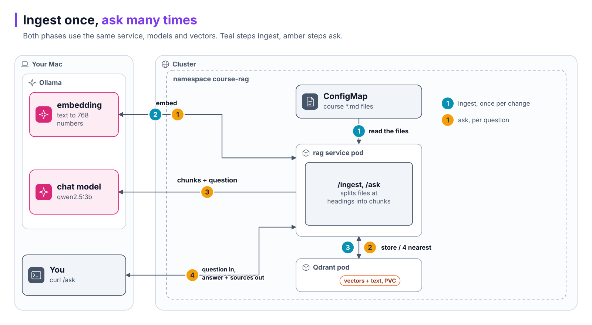
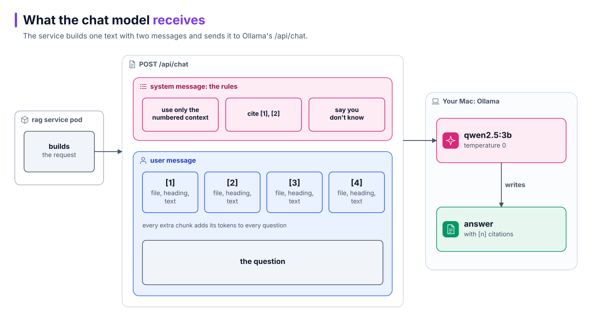

# Module 5.4: RAG on Kubernetes

> New to a term here, like embedding or vector database? The [glossary](../glossary.md) explains every term in this course.

**Before this module:** [module 5.1](01-llm-in-the-shop.md) helps, because it introduced RAG with a handful of orders. No Istio needed.

**You need:** the lab running (`./lab.sh start` starts or repairs it), `helm`, Ollama with `nomic-embed-text` and `qwen2.5:3b`, and internet access for the Qdrant chart. [What you need](#what-you-need) below has the details.

The most common AI system in companies today isn't a chatbot that knows everything but a model that answers from *your* documents, such as runbooks, policies, tickets and wikis. A plain chat model has never seen those documents, so the system answers in two moves:

1. The system finds the passages that match the question.
2. The system gives those passages to the model as the only thing it may answer from.

Engineers call this pattern **retrieval-augmented generation (RAG)**. In this module you build one on Kubernetes with this course as the documents: you install a vector database, build and ship the service, load the course into it, and then find out where RAG goes wrong.

Time: about 45 minutes. The module adds about 200 MB to the cluster. The two models in Ollama on your Mac take 2.2 GB on disk, and the chat model takes about 2 GB of memory while it answers.

## What you need

- Another Ollama model, or Claude through the Anthropic API, also works. [Choosing the model for the AI modules](../../docs/ai-models.md) shows how to switch.
- Ollama on your Mac, with two models:

  ```bash
  ollama pull nomic-embed-text     # 274 MB: turns text into vectors
  ollama pull qwen2.5:3b           # 1.9 GB: writes the answers
  ```

  The module uses a 3-billion-parameter chat model on purpose, because it fits next to the lab on a 24 GB Mac. Bigger models answer better, but step 6 shows why that matters less than you'd think.

### On Linux (Ubuntu 24.04)

Pods reach Ollama under the name `host.docker.internal`, which plain Docker Engine on Linux doesn't answer. If you already did the Ollama setup for module 5.1 in [Ollama on Linux](../../README.md#ollama-on-linux), you need nothing more, and otherwise do those two steps first.

## Concept: two phases

A RAG system works in two phases. Ingest runs once each time the documents change:

1. The service splits the course files at their headings, into chunks.
2. The embedding model turns each chunk into 768 numbers.
3. Qdrant stores each list of numbers together with its text.

Ask runs once for every question:

1. The embedding model turns the question into 768 numbers too.
2. Qdrant finds the 4 nearest chunks.
3. The chat model answers only from those chunks.
4. The service returns the answer with its sources.



An **embedding** is a list of numbers that stands for the meaning of a text, here 768 numbers, which people call a vector. Think of it as a position on a map of meanings, where texts about the same thing sit close together, so "Roll back a bad release" and "git revert brings the app back" share almost no words, yet their vectors sit near each other.

A **vector database** stores millions of these vectors and finds the nearest ones to a new vector in milliseconds. Qdrant, the vector database in this module, measures closeness as **cosine similarity**, where a score of 1 means the same direction and 0 means unrelated.

## Concept: where RAG goes wrong

A RAG answer goes wrong in one of four places, each with its usual fix:

| Failure | What happens | Fix |
|---|---|---|
| Retrieval miss | The passage with the answer isn't among the top results, so the model never sees it | better chunking, more results (`TOP_K`), better embedding model, a reranker |
| Model ignores the context | The model answers from what it learned in training, or makes something up | strict prompt, `temperature: 0`, a better model, checking citations |
| Nothing relevant exists | The question is off-topic, and the model answers anyway | refuse below a similarity threshold, a prompt that allows "I don't know" |
| Stale index | The documents changed, but the vectors didn't | re-ingest on every change, ideally from CI |

## The bigger picture: RAG in production

Every big AI platform sells RAG as a feature, yet many teams still build it themselves, because their data mustn't leave the company. On Kubernetes the pieces are ordinary workloads:

- a vector database, such as Qdrant, Weaviate, Milvus, or Postgres with pgvector, as a StatefulSet with a volume
- an ingestion Job or pipeline, which loads the documents
- a stateless query service, which answers the questions

The model either runs in the cluster (module 5.2) or sits behind an API (module 5.1).

Teams also learn that the hard part is the content rather than the vector database, because they must decide how to split it, how to keep it fresh, and how to check that the answers are right. Running an evaluation set, a list of questions with known answers, on every change, like unit tests, is becoming standard practice.

## Why this way

**Why split at headings?** A chunk is one piece of a document that the service stores and finds on its own, and it should hold one idea. The course's `##` and `###` headings already mark ideas, so each step and concept becomes one chunk, capped at 1,500 characters, whereas fixed-size chunks would cut sentences and tables in half.

**Why does the service talk plain HTTP to Qdrant and Ollama?** To keep every step visible in about 150 lines of `apps/rag/main.py`, while frameworks like LangChain or LlamaIndex wrap the same calls.

**Why `temperature: 0`?** The model then always picks its most likely next word, so the same question gets the same answer. In the test run, the same question at the default temperature got a wrong answer once and a right one later, and for answers from documents you want repeatable answers, not creative ones.

**Why the docs in a ConfigMap?** It's the simplest way to put files into a pod, and the course still fits below the 1 MiB limit, as step 3 shows. Real systems load documents from Git, object storage or a wiki API in an ingestion job.

**Why point ids from a hash of the text?** A point is one stored vector in Qdrant, with its text, and each point's id comes from a hash of the chunk's text, so ingesting the same chunk twice overwrites it instead of adding a duplicate, which makes it safe to re-run ingestion.

## Do it

### 1. Install Qdrant

```console
$ helm repo add qdrant https://qdrant.github.io/qdrant-helm && helm repo update qdrant
"qdrant" already exists with the same configuration, skipping
Hang tight while we grab the latest from your chart repositories...
...Successfully got an update from the "qdrant" chart repository
Update Complete. ⎈Happy Helming!⎈

$ cat platform-engineering/manifests/5.4-qdrant-values.yaml
# Qdrant, a vector database, as one replica with a 1 GiB volume from k3s' local-path storage.
replicaCount: 1
persistence:
  size: 1Gi
resources:
  requests: {cpu: 20m, memory: 64Mi}
  limits: {memory: 512Mi}

$ helm install qdrant qdrant/qdrant --version 1.20.0 -n course-rag --create-namespace \
  -f platform-engineering/manifests/5.4-qdrant-values.yaml --wait
NAME: qdrant
LAST DEPLOYED: Sat Nov 21 05:38:57 2026
NAMESPACE: course-rag
STATUS: deployed
REVISION: 1
DESCRIPTION: Install complete
NOTES:
Qdrant v1.20.0 has been deployed successfully.
...

$ kubectl -n course-rag get pods,pvc
NAME           READY   STATUS    RESTARTS   AGE
pod/qdrant-0   1/1     Running   0          14s

NAME                                            STATUS   VOLUME                                     CAPACITY   ACCESS MODES   STORAGECLASS   VOLUMEATTRIBUTESCLASS   AGE
persistentvolumeclaim/qdrant-storage-qdrant-0   Bound    pvc-bc1e1f87-dbd2-499c-9842-f03794bbf051   1Gi        RWO            local-path     <unset>                 14s
```

**What you should see.** In the test run the install took 15 seconds. Qdrant runs as a StatefulSet pod, `qdrant-0`, with a `Bound` 1 GiB volume from k3s' `local-path` storage, so the vectors survive a pod restart.

### 2. Build the service and give it to the cluster

```console
$ less apps/rag/main.py
"""Course RAG: answers questions about this course from its own Markdown files.

Ingest: split every .md file in DOCS_DIR into chunks at its headings, turn each chunk
into a vector with an Ollama embedding model, and store vectors plus text in Qdrant.
Ask: embed the question, fetch the closest chunks from Qdrant, and give them to a chat
model as the only context it may answer from.

Talks to Qdrant and Ollama over plain HTTP, so every step is visible in the code.
"""

import hashlib
import os
import re
import time
from pathlib import Path
...

$ docker build -t k8s-lab/rag:1.3.0 apps/rag
...
#13 exporting config sha256:f9d5918a19794c5aa9ec03600b1fb5280597b876bdec04524bf6bf270250111a done
#13 exporting attestation manifest sha256:3473c69361eaa825e6915fe725bf1001cfa2b005d6eee2fa21bd908bd9ade287 0.0s done
#13 exporting manifest list sha256:e7f8a170f3cc4ed1ab5dfa42b1dd911dabf7d8f525ca80b1491d8b9a37a09c55 0.0s done
#13 naming to docker.io/k8s-lab/rag:1.3.0 done
#13 unpacking to docker.io/k8s-lab/rag:1.3.0 0.0s done
#13 DONE 0.1s

$ k3d image import k8s-lab/rag:1.3.0 -c k8s-lab
INFO[0000] Importing image(s) into cluster 'k8s-lab'
INFO[0000] Starting new tools node...
INFO[0000] Starting node 'k3d-k8s-lab-tools'
INFO[0000] Saving 1 image(s) from runtime...
INFO[0001] Importing images into nodes...
INFO[0001] Importing images from tarball '/k3d/images/k3d-k8s-lab-images-20261115110105.tar' into node 'k3d-k8s-lab-server-0'...
INFO[0002] Removing the tarball(s) from image volume...
INFO[0003] Removing k3d-tools node...
INFO[0003] Successfully imported image(s)
INFO[0003] Successfully imported 1 image(s) into 1 cluster(s)
```

`less` opens the file in a pager, where you scroll with the arrow keys and press `q` to quit, and the transcript shows the first lines of the file and the last lines of the build.

**What you should see.** Docker built a 310 MB image in about 10 seconds, and then k3d printed `Successfully imported 1 image(s)`, because the lab has no registry, so `k3d image import` copies the image straight into the node, like the shop's images. Read `main.py` top to bottom: it defines the functions `chunks_of`, `embed` and `search`, and then the `/ingest`, `/search` and `/ask` endpoints.

### 3. Give it the documents, and start it

```console
$ kubectl -n course-rag create configmap course-docs \
    $(printf -- '--from-file=%s ' README.md platform-engineering/{glossary,start-here}.md platform-engineering/1-applications/01-*.md platform-engineering/[235]-*/[0-9][0-9]-*.md)
configmap/course-docs created

$ cat platform-engineering/manifests/5.4-rag-app.yaml
# Module 5.4: the RAG service. It reads the course's Markdown from the course-docs
# ConfigMap (created in step 3), stores vectors in Qdrant, and calls Ollama on your Mac
# for embeddings and answers.
apiVersion: apps/v1
kind: Deployment
metadata:
  name: rag
  namespace: course-rag
spec:
  replicas: 1
  selector:
    matchLabels: {app: rag}
  template:
    metadata:
      labels: {app: rag}
    spec:
      containers:
        - name: rag
          image: k8s-lab/rag:1.3.0
          imagePullPolicy: IfNotPresent
          ports: [{name: http, containerPort: 8000}]
          env:
            - {name: OLLAMA_URL, value: "http://host.docker.internal:11434"}
            - {name: QDRANT_URL, value: "http://qdrant.course-rag.svc.cluster.local:6333"}
            - {name: EMBED_MODEL, value: nomic-embed-text}
            - {name: CHAT_MODEL, value: "qwen2.5:3b"}
            - {name: DOCS_DIR, value: /docs}
            - {name: EXCLUDE_FILES, value: 04-rag-on-kubernetes.md}
          # Your AI settings from lab.env, once ./lab.sh ai has stored them.
          envFrom:
            - configMapRef: {name: llm-settings, optional: true}
            - secretRef: {name: llm-api-key, optional: true}
          volumeMounts:
            - {name: docs, mountPath: /docs, readOnly: true}
          readinessProbe:
            httpGet: {path: /healthz, port: http}
          resources:
            requests: {cpu: 20m, memory: 64Mi}
            limits: {memory: 256Mi}
      volumes:
        - name: docs
          configMap:
            name: course-docs
---
apiVersion: v1
kind: Service
metadata:
  name: rag
  namespace: course-rag
spec:
  selector: {app: rag}
  ports: [{name: http, port: 8000}]

$ kubectl apply -f platform-engineering/manifests/5.4-rag-app.yaml
deployment.apps/rag created
service/rag created

$ kubectl -n course-rag rollout status deploy/rag
Waiting for deployment "rag" rollout to finish: 0 of 1 updated replicas are available...
deployment "rag" successfully rolled out

$ kubectl -n course-rag port-forward svc/rag 8090:8000 >/dev/null 2>&1 &
```

**What you should see.** The modules sit in one folder per track below `platform-engineering/`, so the `printf` builds one `--from-file` flag for the README, the glossary, the Istio picture, module 1.1 and every module of the lab tracks 2, 3 and 5, and each file becomes one key in the ConfigMap. The ConfigMap holds 38 files and about 960 KiB. A ConfigMap holds at most 1 MiB, so the lab modules still fit with about 70 KiB to spare, while the practice cluster modules of tracks 1 and 4, with their long transcripts, would push it over, so the glob leaves them out, and most of the space goes to the terminal transcripts in the modules. The app leaves one file out on purpose, this module itself, because the manifest sets `EXCLUDE_FILES: 04-rag-on-kubernetes.md`.

This module quotes its own test questions and the answers they got, so if the index held them, a question like "What is the capital of Denmark?" would find step 6's table, and the model would repeat what it read there. The test would leak into the data, like exam answers left inside the textbook, and teams keep evaluation questions out of the index for the same reason.

The app reaches Ollama on your Mac as `host.docker.internal:11434`, the same way module 5.1's assistant does.

### 4. Ingest the course

```console
$ curl -s -X POST localhost:8090/ingest; echo
{"files":36,"chunks":818,"dimensions":768,"embed_model":"nomic-embed-text","embed_prefixes":true,"embed_seconds":13.7,"total_seconds":14.1}

$ kubectl get --raw /api/v1/namespaces/course-rag/services/qdrant:6333/proxy/collections/course | python3 -m json.tool | grep -E "points_count|status"
        "status": "green",
        "optimizer_status": "ok",
        "points_count": 818,
    "status": "ok",
```

**What you should see.** `"files":36,"chunks":818,"dimensions":768,"embed_prefixes":true`, because 37 files went into the ConfigMap and the app left this module out. The embedding took 13 to 14 seconds on the Mac's GPU, and Qdrant reports the same number as `points_count`, with `"status": "green"`. Your counts drift a little whenever the course text changes.

### Concept: task prefixes

`nomic-embed-text` learned with a short label in front of every text, where stored passages start with `search_document: ` and questions start with `search_query: `. The label tells the model which side of a search the text is on, so a short question and a long passage that answer each other land closer together.

The app adds both labels for you, which is what `"embed_prefixes":true` means. To see their effect, the test run ingested the course twice, once with `EMBED_PREFIXES=off`:

| Question | Prefixes off | Prefixes on |
|---|---|---|
| What does ztunnel do? | first hit: module 3.19's "Upgrade ztunnel in place", 0.698 | first hit: module 3.2's "Concept: HBONE, the tunnel between nodes", 0.719 |
| Which Kyverno chart version does module 2.7 install? | first hit: module 2.7's install step, 0.677 | first hit: module 2.7's opening section, 0.731 |
| Synced and Degraded at the same time? | module 2.6's sync concept first, 0.675 | the same section first, 0.679 |
| Capital of Denmark (off-topic) | best score 0.476 | best score 0.535 |

The prefixes put the passage that explains a thing ahead of one that only mentions it, but they also raise every score, including off-topic ones, so a score threshold tuned with prefixes off is wrong with prefixes on. Read the model's documentation before you embed anything, because other models have their own conventions.

### Concept: what a vector search does

Think of each embedding as an arrow from the origin in a space with 768 directions instead of two or three, where texts with similar meaning point in similar directions. A search runs in three moves:

1. The service embeds the question with the same model it used for the chunks, because vectors from another model would live in a different space, and the distances would mean nothing.
2. Qdrant compares the question's arrow with the stored arrows by cosine similarity, the cosine of the angle between two arrows, which is 1 for the same direction and 0 for a right angle. That's why the collection says `"distance": "Cosine"`.
3. Qdrant returns the `k` closest chunks with their scores and stored text.

With about 800 chunks, comparing the question against every chunk costs little, but with millions of chunks that gets too slow. So Qdrant uses an **HNSW** index, short for Hierarchical Navigable Small World, a graph that links each vector to its near neighbours, and walks the graph toward the question instead of checking everything, like asking for directions in a city where each neighbour points you a bit closer to the address. The result is approximate, so now and then the walk misses a close chunk, but answers come back in milliseconds.

Read the score as a ranking, not a probability: 0.70 doesn't mean "70% right" but "closer than the chunks below it". Each embedding model gives different scores, so you measure what counts as a good score on your own questions, as step 6 does.

### 5. Look at retrieval on its own

```console
$ curl -s -G localhost:8090/search --data-urlencode "q=how do I roll back a bad release with ArgoCD" | python3 -m json.tool
{
    "question": "how do I roll back a bad release with ArgoCD",
    "results": [
        {
            "score": 0.714,
            "file": "06-gitops-with-argocd.md",
            "heading": "Investigate"
        },
        {
            "score": 0.696,
            "file": "06-gitops-with-argocd.md",
            "heading": "6. Ordered deploys: hooks and waves"
        },
        {
            "score": 0.685,
            "file": "06-gitops-with-argocd.md",
            "heading": "5. A bad release, and `git revert`"
        },
        {
            "score": 0.683,
            "file": "README.md",
            "heading": "Git and ArgoCD"
        }
    ]
}

$ curl -s -G localhost:8090/search --data-urlencode "q=Why is my pod stuck in Pending?" --data-urlencode k=10 | python3 -m json.tool
{
    "question": "Why is my pod stuck in Pending?",
    "results": [
        {
            "score": 0.694,
            "file": "09-k3s-lifecycle.md",
            "heading": "Concept: how a pod gets its network, and how one missing file stops it"
        },
        {
            "score": 0.691,
            "file": "08-nodes-and-cleanup.md",
            "heading": "Concept: PodDisruptionBudgets"
        },
        {
            "score": 0.688,
            "file": "01-prometheus-and-alerting.md",
            "heading": "4. Break it, get paged"
        },
        {
            "score": 0.682,
            "file": "16-life-of-an-outbound-request.md",
            "heading": "1. Start a client in its own ambient namespace"
        },
...
        {
            "score": 0.666,
            "file": "02-grafana-as-code.md",
            "heading": "4. A Grafana-managed alert"
        }
    ]
}
```

**What you should see.** For the rollback question, all four results come from the right place: three from module 2.6 and one from the guide's section on Git and ArgoCD. The step that does the rollback, `5. A bad release, and git revert`, came third with 0.685, close behind module 2.6's Investigate section with 0.714, so the search found it although the question shares few words with it, which is the strength of embeddings.

The second question shows the weakness. The section that answers it best is module 3.15's `4. Make the scheduler say no`, which makes two pods stay Pending and reads the scheduler's reasons, yet it is missing from the top 10. With `k=30` it shows up in **19th** place, with 0.654. Ahead of it were passages that mention pods and problems, such as a network failure in module 2.9, PodDisruptionBudgets in module 2.8 and an alert in module 2.1, so with the default of 4 results the model never sees the right section, which is a retrieval miss.

### Concept: what the chat model actually receives

The chat model never talks to Qdrant. Instead the service builds one text with two messages and sends it to Ollama's `/api/chat`:

- The system message sets the rules: the model must use only the numbered context, cite sources as [1], [2], and say when it doesn't know.
- The user message holds the numbered chunks, each with its file and heading, and then the question.



Everything the model knows about your documents sits in that one message, so if retrieval missed the right chunk, no prompt and no bigger model brings it back.

The chunks also make up most of the input. Models count their input in tokens, pieces of words, and every extra result in `TOP_K` adds its full text, and so its tokens, to every question, which step 7 measures.

### 6. Ask

```console
$ ask() { curl -s -X POST localhost:8090/ask -H 'content-type: application/json' -d "{\"question\":\"$1\"}" | python3 -m json.tool; }
$ ask "Why is my pod stuck in Pending?"
{
    "answer": "A pod is stuck in the Pending state if there is a missing file or configuration that is required for its initialization. This can happen if the configuration file for the pod is not present or if the file is corrupted. In the context provided, it is mentioned that a missing plugin can cause a pod to be stuck in the Pending state.",
    "sources": [
        {
            "n": 1,
            "score": 0.694,
            "file": "09-k3s-lifecycle.md",
            "heading": "Concept: how a pod gets its network, and how one missing file stops it"
        },
        {
            "n": 2,
            "score": 0.691,
            "file": "08-nodes-and-cleanup.md",
            "heading": "Concept: PodDisruptionBudgets"
        },
...
    "chat_model": "qwen2.5:3b",
    "input_tokens": 837,
    "output_tokens": 68,
    "retrieve_seconds": 0.06,
    "total_seconds": 3.4
}

$ ask "Which Kyverno chart version does module 2.7 install?"
{
    "answer": "Module 2.7 installs the Kyverno chart version 3.8.2. This is indicated in the command `helm install kyverno kyverno/kyverno --version 3.8.2`.",
    "sources": [
        {
            "n": 1,
            "score": 0.731,
            "file": "07-kyverno-policy-as-code.md",
            "heading": "Module 2.7: Kyverno, policy as code"
        },
        {
            "n": 2,
            "score": 0.717,
            "file": "07-kyverno-policy-as-code.md",
            "heading": "1. Install Kyverno"
        },
...
    "chat_model": "qwen2.5:3b",
    "input_tokens": 1857,
    "output_tokens": 47,
    "retrieve_seconds": 0.03,
    "total_seconds": 2.2
}

$ ask "What is the capital of Denmark?"
{
    "answer": "I don't know.",
    "sources": [
        {
            "n": 1,
            "score": 0.535,
            "file": "01-llm-in-the-shop.md",
            "heading": "On Linux (Ubuntu 24.04)"
        },
        {
            "n": 2,
            "score": 0.532,
            "file": "16-life-of-an-outbound-request.md",
            "heading": "2. DNS: how the pod finds example.com"
        },
...
    "chat_model": "qwen2.5:3b",
    "input_tokens": 1071,
    "output_tokens": 6,
    "retrieve_seconds": 0.03,
    "total_seconds": 0.8
}
```

**What you should see.** In the test run:

| Question | Answer | Notes |
|---|---|---|
| Pod stuck in Pending | "a missing plugin can cause a pod to be stuck in the Pending state" | wrong for this question, and confident. A missing CNI plugin is a rare node failure, while the usual cause, a scheduler that finds no node, never reached the model, which had only the four related passages from step 5 |
| Kyverno chart version | "3.8.2" | right, from module 2.7 |
| Capital of Denmark | "I don't know." | right. The best match scored 0.535, against about 0.68 to 0.73 for course questions |

Answers took 0.8 to 3.4 seconds, nearly all of it the chat model, while retrieval took 0.03 to 0.06 seconds. The first question used 837 input tokens, mostly the four chunks. In earlier runs, with less course text in the index, the same question drew a PodDisruptionBudget into the answer instead, just as wrong and just as confident.

Look at the first answer's sources. Retrieval found *related* text, about pods and things that go wrong, and the model built a plausible answer from it while following its rules, using only the context and citing it, so the context was simply the wrong context. That's the most common way RAG fails, and no better prompt fixes it.

### 7. Trade tokens for recall

The new setting starts a new pod, while the port-forward from step 3 still holds port 8090 for the old pod, so the third line stops it before it opens a new one.

```console
$ kubectl -n course-rag set env deploy/rag TOP_K=8
deployment.apps/rag env updated

$ kubectl -n course-rag rollout status deploy/rag
deployment "rag" successfully rolled out

$ kill %1 2>/dev/null; kubectl -n course-rag port-forward svc/rag 8090:8000 >/dev/null 2>&1 &
$ ask "Why is my pod stuck in Pending?"
{
    "answer": "A pod is stuck in the Pending status if the node on which it is scheduled cannot be assigned a pod IP address. This can happen due to several reasons such as the node not being ready, missing CNI (Container Networking Interface) plugins, or the node not having enough available IP addresses. In the context provided, it is mentioned that in k3d, a k3s restart restarts the whole node container, so every pod on that node needs a new sandbox at once. This can cause pods to remain in the Pending state until the node is ready again.",
    "sources": [
        {
            "n": 1,
            "score": 0.694,
            "file": "09-k3s-lifecycle.md",
            "heading": "Concept: how a pod gets its network, and how one missing file stops it"
        },
...
        {
            "n": 8,
            "score": 0.672,
            "file": "13-outlier-detection-and-retries.md",
            "heading": "Investigate"
        }
    ],
    "chat_model": "qwen2.5:3b",
    "input_tokens": 2136,
    "output_tokens": 116,
    "retrieve_seconds": 0.06,
    "total_seconds": 3.2
}
```

**What you should see.** The eight sources are the first eight from step 5, so `4. Make the scheduler say no`, in 19th place, is still missing. The answer grows longer and lists more causes, yet every one of them is about networks and nodes, because that is all the model received. The input grows from 837 to 2,136 tokens for the same question, more than double, and buys nothing here. In an earlier run with less course text, the scheduler section ranked 8th, so the same setting fixed the answer, which shows how much a fixed `TOP_K` depends on the documents around it.

More results means fewer misses only when the right section ranks just below the cut, and it always means a higher bill per question, because with a hosted model input tokens cost money and with a local one they cost time. Put it back with `kubectl -n course-rag set env deploy/rag TOP_K-`.

## Investigate

1. You edit module 2.6 and push. A colleague asks the RAG service about the change, and it answers with the old text. Why, and how would you fix it for good?
2. The off-topic question scored 0.535 and course questions 0.68 to 0.73. How would you use that, and what's the risk?
3. Your company wants to swap `nomic-embed-text` for a better embedding model. What must happen to the data in Qdrant, and why?
4. Step 7 raised `TOP_K` for one question and paid more tokens without a better answer, while an earlier run with less text saw the same change fix it. How would you know, across 200 questions, whether a change to chunking or `TOP_K` made things better or worse?

<details>
<summary>Answers</summary>

1. The ConfigMap and the vectors are snapshots: `kubectl create configmap` copied the files once, and `/ingest` embedded them once, so changing Git changes neither. For a quick fix, re-create the ConfigMap and call `/ingest` again, and to fix it for good, run ingestion from CI on every merge, or from a CronJob that pulls from Git. The hashed point ids make repeated ingestion safe, but deleted sections stay in Qdrant unless ingestion also removes points that no longer exist, which this service handles by recreating the collection.
2. Refuse to answer when the best score falls below a threshold, say 0.62, and reply "I don't know" without calling the chat model, which runs faster and cheaper and gives the model no chance to invent something. The risk is that a badly phrased real question also scores low and gets refused, so pick the threshold from measured scores of real questions rather than a guess, and log the refusals so you see them.
3. Re-embed everything, because each model places texts in its own space, often with a different number of dimensions, so vectors from two models aren't comparable and the collection's vector size changes. The service recreates the collection on ingest, so a re-ingest after changing `EMBED_MODEL` does the job, while in production with millions of chunks teams build the new collection next to the old one and switch when it's ready.
4. Build an evaluation set, where each entry holds a question, the expected source section and the key facts of the answer, and before and after each change measure two things:
   - whether retrieval puts the expected section in the top k, and at which rank
   - whether the answer contains the expected facts

   Running the set like a test suite turns "it feels better" into a number, and it catches changes that fix one question and break ten.

</details>

## Clean up

```console
$ kill %1 %2 2>/dev/null
$ ./platform-engineering/reset.sh
Removing course rules from the shop namespace
Applying the baseline Istio config from manifests/istio
Turning off the backend experiment settings
Asking ArgoCD to sync istio-config from Git
Done. Baseline: 100% of backend traffic to v1, no faults, no extra rules.
```

This uninstalls Qdrant and deletes `course-rag`, and the volume with it, while the `k8s-lab/rag` image stays in Docker and the two models stay in Ollama. Remove them with `ollama rm nomic-embed-text qwen2.5:3b` if you need the disk space.
