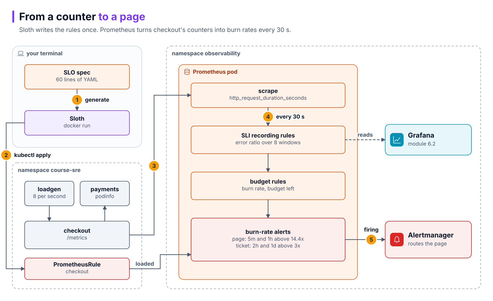

# Module 6.1: SLIs, SLOs and error budgets

> New to a term here, like error budget or burn rate? The [glossary](../glossary.md#reliability-engineering) explains every term in this course.

**Before this module:** the lab from the [quick start](../../README.md#quick-start). This is the first module of the track, and it needs no other track and no Istio. If you took [module 2.1](../2-observability/01-prometheus-and-alerting.md), you met one SLO with hand-written rules; this module builds the full production version for a service outside the mesh.

**You need:** the lab running (`./lab.sh start` starts or repairs it), `./lab.sh shell` for the commands, and `./lab.sh ui` in a spare terminal for Prometheus (http://localhost:9090).

A team that promises "the shop is always up" has promised something nobody keeps, so every outage becomes a crisis and every release becomes a risk that someone must argue about. Site reliability engineering replaces the promise with a number: the share of requests that must go right over 30 days, which leaves a small, agreed amount of failure that the team may spend on releases and experiments. This module measures a checkout service that is not in the mesh, writes two such targets for it, turns them into alerts with a generator called Sloth, and then ships a bad release to watch the budget burn and the right alert fire.

Time: about 60 minutes. Memory: the three small apps add about 100 MiB.

## Concept: SLI, SLO and error budget

Suppose checkout answers 1,000,000 orders in a month and 600 of them fail with a server error. Whether that month went well depends on what the business needs, so the team first writes down what "went right" means for one order, and then how many orders must go right.

The first number is the **SLI**, the service level indicator: good events divided by valid events. A valid event is every order request, and a good event is one answered without a 5xx. For the month above the SLI is 999,400 / 1,000,000, or 99.94%.

The second number is the **SLO**, the service level objective, the target for that SLI over a period, here 99.9% over 30 days. Everything the target leaves over is the **error budget**: 0.1% of the orders, or, because traffic runs all day, 0.1% of 30 days, which is 43.2 minutes of full outage. The month above used 600 of its 1,000 allowed failures, so the team still had 40% of its budget left and kept shipping.

| SLO over 30 days | Allowed failures per million | Full outage it allows |
|---|---|---|
| 99% | 10,000 | 7.2 hours |
| 99.5% | 5,000 | 3.6 hours |
| 99.9% | 1,000 | 43.2 minutes |
| 99.99% | 100 | 4.3 minutes |

Each extra nine cuts the room for mistakes by ten, which is why a team picks the lowest target its users accept. Checkout gets two SLOs in this module: availability at 99.9%, and latency at 99%, where a good order is one answered within 250 ms.

## Concept: from burn rate to a page



The budget only helps if someone hears when it drains, and the question is how fast. **Burn rate** answers it: the error ratio right now divided by the budget ratio. At a burn rate of 1 the budget lasts exactly 30 days, and at 14.4 it lasts about two days, because 30 days divided by 14.4 is just over 50 hours.

An alert on one window has two faults. A short window, such as 5 minutes, pages for every 30-second blip, so people learn to ignore it. A long window, such as 1 hour, pages only for real trouble, but it keeps paging for most of an hour after the fix, because it still remembers the errors. Google's SRE workbook solves both with a **multi-window, multi-burn-rate alert**: it pages only when a long window and a short window both burn too fast, so the long window proves the trouble is big and the short window proves it is still happening.

| Severity | Long window | Short window | Burn rate | Budget spent before it fires |
|---|---|---|---|---|
| page | 1 hour | 5 minutes | 14.4 | 2% |
| page | 6 hours | 30 minutes | 6 | 5% |
| ticket | 1 day | 2 hours | 3 | 10% |
| ticket | 3 days | 6 hours | 1 | 10% |

A burn rate needs an error ratio over each of those windows, eight in all, for every SLO, so writing the rules by hand means about 30 rules per SLO that must all agree. That is where the diagram starts:

1. You write a short spec per service, and **Sloth** generates the rules from it.
2. `kubectl apply` hands the generated PrometheusRule to the Prometheus operator.
3. Prometheus scrapes checkout's `/metrics` every 15 seconds.
4. Every 30 seconds it turns the counters into an error ratio for each window, then into burn rates and the budget left.
5. A burn-rate alert that holds goes to Alertmanager, which routes the page.

## The bigger picture: SLOs as a contract between teams

The SLO started inside Google as a way to settle the old fight between developers, who want to ship, and operators, who want nothing to change. With a budget, the data settles it: while budget remains, the team ships; when it runs out, the team spends its time on reliability until the budget recovers. Many companies write this down as an **error budget policy**, signed by both sides.

The tooling has converged on the same pattern this module uses. SLOs live as code next to the service, generators such as Sloth, Pyrra or Google's own SLO generator write the rules, and the OpenSLO project defines a vendor-neutral spec format. The hard part was never the PromQL; it is choosing SLIs that match what users feel, and targets that users actually need.

## Why this way

**Why measure inside checkout, not with the mesh?** Most services in the world run without a mesh, and the app itself knows things a proxy does not, such as which path is an order and how long the order took inside the code. Checkout counts its own requests in one histogram, labelled by path and status, the same names podinfo uses, so one query shape serves both services. Module 6.4 shows what this view misses.

**Why Sloth and not hand-written rules?** Eight windows, two severities and several helper series per SLO add up to over 200 lines of YAML for checkout's two SLOs, and one typo in a window makes an alert that never fires. Sloth writes them from 60 lines, most of them comments and names, the same way for every service, and the spec reads like the SLO itself.

**Why run Sloth with `docker run`?** Sloth also runs as a controller in the cluster, but the generated file then never shows up in review. Generating in your terminal keeps the output as a file you diff and commit, and the toolbox already has Docker.

**Why `or vector(0)` in the error query?** Before the first 5xx, the error series does not exist, so the ratio would be empty instead of 0, and every rule built on it would be empty too. `or vector(0)` turns "no errors yet" into a real zero.

**Why an extra budget rule next to Sloth's?** Sloth's own "budget remaining" averages the history Prometheus holds, which is 6 hours in this lab and a few minutes for a fresh checkout, so a single bad release looks like a disaster there. The extra rule counts minutes of full outage and treats the time Prometheus never saw as clean, which is what a 30-day SLO means. Production keeps 30 days of data, and the two numbers agree.

## Do it

### 1. Deploy checkout, payments and a client

Read the app first: `less platform-engineering/manifests/6.1-checkout.yaml` shows the whole checkout program in its ConfigMap, about 90 lines of Python, with the histogram it counts every order into. Then deploy it with payments and the client:

```console
$ kubectl apply -f platform-engineering/manifests/6.1-checkout.yaml
namespace/course-sre created
configmap/checkout-code created
deployment.apps/checkout created
service/checkout created
podmonitor.monitoring.coreos.com/checkout created
deployment.apps/payments created
service/payments created
podmonitor.monitoring.coreos.com/payments created
deployment.apps/loadgen created

$ kubectl -n course-sre rollout status deploy/checkout
Waiting for deployment "checkout" rollout to finish: 0 of 2 updated replicas are available...
Waiting for deployment "checkout" rollout to finish: 1 of 2 updated replicas are available...
deployment "checkout" successfully rolled out

$ kubectl -n course-sre get pods
NAME                        READY   STATUS    RESTARTS   AGE
checkout-6d84f69455-h9mkz   1/1     Running   0          2s
checkout-6d84f69455-q6v2b   1/1     Running   0          2s
loadgen-7bc7f7b9fb-nk6wd    1/1     Running   0          2s
payments-d57f5dccc-bg97p    1/1     Running   0          2s
payments-d57f5dccc-kvbxx    1/1     Running   0          2s
```

Give the client 20 seconds, then read what checkout writes and counts:

```console
$ kubectl -n course-sre logs deploy/checkout --tail=3
Found 2 pods, using pod/checkout-6d84f69455-h9mkz
{"level": "info", "path": "/api/checkout", "code": 200, "duration_ms": 1.5, "msg": "order placed"}
{"level": "info", "path": "/api/checkout", "code": 200, "duration_ms": 1.7, "msg": "order placed"}
{"level": "info", "path": "/api/checkout", "code": 200, "duration_ms": 1.1, "msg": "order placed"}

$ kubectl -n course-sre exec deploy/checkout -- wget -q -O - 127.0.0.1:8080/metrics | grep -E 'status="200",le="0.025"|_count|payments_calls'
http_request_duration_seconds_bucket{method="GET",path="/api/checkout",status="200",le="0.025"} 86
http_request_duration_seconds_count{method="GET",path="/api/checkout",status="200"} 86
# HELP checkout_payments_calls_total Calls from checkout to payments, by result.
# TYPE checkout_payments_calls_total counter
checkout_payments_calls_total{result="ok"} 86
```

**What you should see.** Five pods, all `Running`. checkout logs one JSON line per order, and its metrics page holds one histogram per status code with a `_bucket` line per latency bound, plus a counter of its calls to payments. The client sends an order about every 0.15 seconds, so in the test run Prometheus counted about 5.1 orders a second.

### 2. Measure the SLIs by hand

A new PodMonitor may take up to four minutes to reach Prometheus. Then open Prometheus (http://localhost:9090) and run these one at a time:

```text
sum by (status) (rate(http_request_duration_seconds_count{namespace="course-sre", app="checkout"}[1m]))
(sum(rate(http_request_duration_seconds_count{namespace="course-sre", app="checkout", status=~"5.."}[5m])) or vector(0)) / sum(rate(http_request_duration_seconds_count{namespace="course-sre", app="checkout"}[5m]))
sum(rate(http_request_duration_seconds_bucket{namespace="course-sre", app="checkout", le="0.25"}[5m])) / sum(rate(http_request_duration_seconds_count{namespace="course-sre", app="checkout"}[5m]))
```

In the test run, Prometheus answered:

```text
sum by (status) (...)                    {status="200"}  7.58
(... status=~"5.." ...) / (...)          0
(... le="0.25" ...) / (...)              1
```

**What you should see.** The first query gives one line per status code, only `200` for now. The second is the availability SLI turned upside down, the error ratio, and it reads `0`. The third is the latency SLI, the share of orders within 250 ms, and it reads `1`, because every order took a few milliseconds. These two ratios are everything the SLOs build on; the rest of the module only computes them over more windows.

### 3. Write the SLOs and let Sloth generate the rules

```console
$ cat platform-engineering/manifests/6.1-checkout-slos.yaml | sed -n '15,25p'
  slos:
    # Availability: 99.9% of orders get an answer that is not a 5xx, over 30 days.
    # "or vector(0)" turns "no 5xx series yet" into a real zero, so the ratio exists from the start.
    - name: availability
      objective: 99.9
      description: "Orders that checkout answers without a server error."
      sli:
        events:
          errorQuery: sum(rate(http_request_duration_seconds_count{namespace="course-sre", app="checkout", path="/api/checkout", status=~"5.."}[{{.window}}])) or vector(0)
          totalQuery: sum(rate(http_request_duration_seconds_count{namespace="course-sre", app="checkout", path="/api/checkout"}[{{.window}}]))
      alerting:

$ docker run --rm -v "$PWD:$PWD" -w "$PWD" ghcr.io/slok/sloth:v0.16.0 generate -i platform-engineering/manifests/6.1-checkout-slos.yaml > /tmp/checkout-rules.yaml 2>/dev/null

$ wc -l platform-engineering/manifests/6.1-checkout-slos.yaml /tmp/checkout-rules.yaml
   60 platform-engineering/manifests/6.1-checkout-slos.yaml
  428 /tmp/checkout-rules.yaml
  488 total

$ grep -E '^  - name:|record:|alert:' /tmp/checkout-rules.yaml | sort | uniq -c
      2       record: slo:current_burn_rate:ratio
      2       record: slo:error_budget:ratio
      2       record: slo:objective:ratio
      2       record: slo:period_burn_rate:ratio
      2       record: slo:period_error_budget_remaining:ratio
      2       record: slo:sli_error:ratio_rate1d
      2       record: slo:sli_error:ratio_rate1h
      2       record: slo:sli_error:ratio_rate2h
      2       record: slo:sli_error:ratio_rate30d
      2       record: slo:sli_error:ratio_rate30m
      2       record: slo:sli_error:ratio_rate3d
      2       record: slo:sli_error:ratio_rate5m
      2       record: slo:sli_error:ratio_rate6h
      2       record: slo:time_period:days
      2       record: sloth_slo_info
      2     - alert: CheckoutAvailabilityBudgetBurn
      2     - alert: CheckoutLatencyBudgetBurn
      1   - name: sloth-slo-alerts-checkout-availability
      1   - name: sloth-slo-alerts-checkout-latency
      1   - name: sloth-slo-meta-recordings-checkout-availability
      1   - name: sloth-slo-meta-recordings-checkout-latency
      1   - name: sloth-slo-sli-recordings-checkout-availability
      1   - name: sloth-slo-sli-recordings-checkout-latency

$ diff <(grep -v '^#' /tmp/checkout-rules.yaml) <(grep -v '^#' platform-engineering/manifests/6.1-checkout-slo-rules.yaml) && echo "same rules as the committed file"
same rules as the committed file
```

**What you should see.** The spec names the service, the objective and two PromQL queries per SLO, with `{{.window}}` where the window goes. Sloth turned its 60 lines into a PrometheusRule of 428 lines: six rule groups, eight error-ratio windows per SLO, helper series such as `slo:error_budget:ratio`, and one page and one ticket alert per SLO. The `diff` finds no difference with the committed file, so what you review in Git is exactly what runs.

### 4. Load the rules

```console
$ kubectl apply -f platform-engineering/manifests/6.1-checkout-slo-rules.yaml -f platform-engineering/manifests/6.1-budget-minutes.yaml
prometheusrule.monitoring.coreos.com/checkout created
prometheusrule.monitoring.coreos.com/checkout-budget-minutes created
```

Within a minute, query Prometheus. The test run answered:

| Query | Result |
|---|---|
| `slo:sli_error:ratio_rate5m{sloth_service="checkout"}` | `sloth_slo="availability"`: 0 |
| `slo:error_budget_minutes:total` | availability: 43.2, latency: 432 |
| `slo:error_budget_minutes:remaining_ratio` | availability: 0.992, latency: 1 |

**What you should see.** The two error ratios read `0`. The budget rule says the availability SLO allows 43.2 minutes of full outage in 30 days and the latency SLO 432, and that 100% of both remain. In Prometheus, http://localhost:9090/rules lists the six Sloth groups and `checkout-budget-minutes`.

### 5. Ship a bad release

A release that fails one order in five is a classic: a missing setting, a bad query, a new dependency that times out. Here the setting `ERROR_PERCENT` plays it. Watch http://localhost:9090/alerts while you run:

```console
$ date +%T
01:25:05

$ kubectl -n course-sre set env deploy/checkout ERROR_PERCENT=20
deployment.apps/checkout env updated

$ kubectl -n course-sre rollout status deploy/checkout
Waiting for deployment "checkout" rollout to finish: 1 out of 2 new replicas have been updated...
Waiting for deployment "checkout" rollout to finish: 1 old replicas are pending termination...
deployment "checkout" successfully rolled out

$ kubectl -n course-sre logs deploy/checkout --tail=200 | grep -m3 '"code": 500'
Found 2 pods, using pod/checkout-86f486758c-vqwgx
{"level": "error", "path": "/api/checkout", "code": 500, "duration_ms": 0.0, "msg": "internal error"}
{"level": "error", "path": "/api/checkout", "code": 500, "duration_ms": 0.0, "msg": "internal error"}
{"level": "error", "path": "/api/checkout", "code": 500, "duration_ms": 0.0, "msg": "internal error"}
```

The `rollout status` output repeats its waiting lines a few times, and the transcript keeps one of each. Then query Prometheus while the bad release runs:

| Query | At 01:26:20, 75 s in | At about 01:28:50, 4 minutes in |
|---|---|---|
| `ALERTS{sloth_service="checkout"}` | `CheckoutAvailabilityBudgetBurn` firing, `severity="page"` and `severity="ticket"` | still both |
| `slo:sli_error:ratio_rate5m{sloth_slo="availability"}` | 0.059 | |
| `slo:sli_error:ratio_rate1h{sloth_slo="availability"}` | 0.102 | |
| `slo:current_burn_rate:ratio{sloth_slo="availability"}` | | 113.9 |
| `slo:period_error_budget_remaining:ratio{sloth_slo="availability"}` | | -85.2 |
| `slo:error_budget_minutes:spent{sloth_slo="availability"}` | | 0.62 |
| `slo:error_budget_minutes:remaining_ratio{sloth_slo="availability"}` | | 0.986 |

**What you should see.** The page fired 75 seconds after the change, and the ticket with it. It came that fast because checkout had run for only about 9 minutes, so its 1-hour window held 9 minutes of data and climbed almost as fast as the 5-minute one; with a full hour of history the same release needs about 4 minutes to page, which is still fast for a 30-day target.

Four minutes in, the 5-minute burn rate read 113.9, so at that speed a month's budget would last about 6 hours. Now compare the two budget numbers. Sloth's `slo:period_error_budget_remaining:ratio` says -85.2, more than 85 budgets overspent, because it averages only the few minutes of history this checkout has. The minutes rule says the release cost 0.62 minutes of full outage out of 43.2, so 98.6% of the month's budget remains, which is what the same incident costs against 30 days of clean traffic. The latency SLO stayed quiet the whole time: the failing orders answered in under a millisecond.

### 6. Roll back, and watch what stays

```console
$ date +%T
01:28:56

$ kubectl -n course-sre rollout undo deploy/checkout
deployment.apps/checkout rolled back

$ kubectl -n course-sre rollout status deploy/checkout
deployment "checkout" successfully rolled out
```

Query `slo:sli_error:ratio_rate5m{sloth_slo="availability"}` every minute until it reads 0, then the 30-minute window and the alerts. The test run answered at 01:36:00:

| Query | Result |
|---|---|
| `slo:sli_error:ratio_rate5m{sloth_slo="availability"}` | 0 |
| `slo:sli_error:ratio_rate30m{sloth_slo="availability"}` | 0.062 |
| `ALERTS{sloth_service="checkout", alertstate="firing"}` after rollback | a page may remain while its long window still burns |
| `slo:error_budget_minutes:spent{sloth_slo="availability"}` | 1.13 |

**What you should see.** The rollback fixes orders at once, and the 5-minute error ratio returns to 0 within about 5 to 7 minutes. The slower page may remain while the 30-minute and 6-hour windows still meet their burn threshold; it clears when that longer evidence ages out. The error budget keeps the cost: this test run spent about 1.13 minutes of its 43.2-minute availability budget, roughly 2.6%.

## Tasks

Each task gives you a goal without the commands. `./lab.sh task setup` prepares it, you solve it in `./lab.sh shell`, and `./lab.sh task check` tells you what still fails. The solution sits under each task, and `./lab.sh task solve` runs it for you.

### Task 6.1.1: a hand-written SLO for payments

<!-- norun -->
```console
$ ./lab.sh task setup 6.1.1
== setup task 6.1.1
checkout and payments run in course-sre, and Prometheus scrapes both.
No PrometheusRule named payments-slo exists. Write it (task 6.1.1 in the module).
```

> In `course-sre`, create a PrometheusRule named `payments-slo` with two recording rules, `payments:sli_error:ratio_rate5m` and `payments:sli_error:ratio_rate1h`: the share of payments' requests with a 5xx status over 5 minutes and 1 hour, 0 when there are none. Add an alert named `PaymentsAvailabilityBurn` with `severity: page` that fires when both ratios burn a 99.5% SLO 14.4 times too fast.

<details>
<summary>Solution</summary>

The reference rule records both error windows, then pages only when both burn above 14.4 times the 0.5% budget:

```console
$ kubectl apply -f platform-engineering/6-sre/tasks/6.1.1-payments-slo.yaml
prometheusrule.monitoring.coreos.com/payments-slo created
```

</details>

<!-- norun -->
```console
$ ./lab.sh task check 6.1.1
== check task 6.1.1
  PASS  PrometheusRule course-sre/payments-slo exists
  PASS  Prometheus loaded payments:sli_error:ratio_rate5m and ratio_rate1h
  PASS  the 5m ratio has a value now, even with no 5xx (0)
  PASS  it matches the 5xx share of payments' requests over 5m
  PASS  Prometheus loaded an alert named PaymentsAvailabilityBurn
  PASS  the alert compares both windows against 14.4 x 0.5% (0.072)
  PASS  the alert carries severity=page
== task 6.1.1: 7 passed, 0 failed
```

### Task 6.1.2: a latency SLO with Sloth

<!-- norun -->
```console
$ ./lab.sh task setup 6.1.2
== setup task 6.1.2
No PrometheusRule named payments exists. Write a Sloth spec, generate it and apply it (task 6.1.2).
```

> Write a Sloth spec for the service `payments` with one SLO named `latency`: 99% of payments' requests within 100 ms. Generate it with Sloth and apply the result, so a PrometheusRule named `payments` exists in `course-sre`.

<details>
<summary>Solution</summary>

The spec at `platform-engineering/6-sre/tasks/6.1.2-payments-sloth.yaml` defines a 99% latency SLO. Sloth generates the PrometheusRule and `kubectl apply` loads it:

```console
$ docker run --rm -v "$PWD:$PWD" -w "$PWD" ghcr.io/slok/sloth:v0.16.0 generate -i platform-engineering/6-sre/tasks/6.1.2-payments-sloth.yaml 2>/dev/null | kubectl apply -f -
prometheusrule.monitoring.coreos.com/payments created
```

</details>

<!-- norun -->
```console
$ ./lab.sh task check 6.1.2
== check task 6.1.2
  PASS  PrometheusRule course-sre/payments exists and Sloth generated it
  PASS  the SLO is payments / latency with objective 0.99
  PASS  its SLI counts requests slower than 100 ms (the le="0.1" bucket)
  PASS  the 5m error ratio has a value
  PASS  a page alert and a ticket alert exist for it
== task 6.1.2: 5 passed, 0 failed
```

### Task 6.1.3: silence a page for a migration

<!-- norun -->
```console
$ ./lab.sh task setup 6.1.3
== setup task 6.1.3
The checkout SLO rules are loaded. Alertmanager holds no silence for CheckoutAvailabilityBudgetBurn.
```

> The payments database migration runs for the next 2 hours. Add an Alertmanager silence that holds back checkout's availability page, `alertname=CheckoutAvailabilityBudgetBurn` with `severity=page`, for 2 hours, with a comment that mentions the migration. Tickets must still arrive.

<details>
<summary>Solution</summary>

Add a silence for the page severity only, so ticket notifications keep working:

```console
$ kubectl -n observability exec alertmanager-kube-prometheus-stack-alertmanager-0 -c alertmanager -- amtool --alertmanager.url=http://localhost:9093 silence add alertname=CheckoutAvailabilityBudgetBurn severity=page --duration=2h --author=you --comment="payments database migration"
5f5dc8ae-09e8-4435-b4d5-778d5e3cd296
```

</details>

<!-- norun -->
```console
$ ./lab.sh task check 6.1.3
== check task 6.1.3
  PASS  an active silence matches alertname=CheckoutAvailabilityBudgetBurn
  PASS  it matches only severity=page, so tickets still arrive
  PASS  it lasts 2 hours (got: page 2.0 payments database migration)
  PASS  its comment names the migration
== task 6.1.3: 4 passed, 0 failed
```

## Investigate

1. checkout's latency SLO stayed quiet in step 5, although 20% of orders failed. Why is that right, and what would a combined SLO of "fast and successful" have shown?
2. The page in step 5 fired within a minute, but a 30-day SLO with a 1-hour window should need several minutes of errors. What made it faster here, and would production behave the same?
3. Your product manager asks for 99.99% availability for checkout. Using the table in the first concept, what does that allow per month, and what would you ask before you agree?
4. After step 6 the page kept firing for half an hour. A teammate wants to delete the 6-hour/30-minute pair to make it clear faster. What does the team lose?

<details>
<summary>Answers</summary>

1. The failing orders answered with a 500 in a few milliseconds, so they were fast, and the latency SLI counts how fast, not how well. Keeping the two apart tells you which kind of trouble you have. A combined SLI ("good = 2xx within 250 ms") is simpler to explain to users, but its alert would not say whether to look for errors or for slowness, so most teams keep both and show them side by side.
2. The 1-hour window held only the few minutes since checkout started, and `rate()` over a window works with the data it has, so the 1-hour ratio was nearly as high as the 5-minute one. In production the 1-hour window holds a full hour, and at 20% errors it needs about 4.3 minutes (0.0144 / 0.2 of an hour) to pass the threshold, so the page comes after a few minutes, which is still fast for an alert on a 30-day target.
3. 100 failed orders per million, or 4.3 minutes of full outage a month, which one bad rollout or one slow failover uses up. Ask what the users need (do they retry? does a payment provider in the path offer less?), what it costs (more replicas, more regions, slower releases), and whether the dependencies even reach 99.99%, because checkout never beats the availability of payments, which it calls for every order.
4. The pair catches a slower, steady burn: 6 times the allowed rate never passes 14.4, yet it would empty the budget in 5 days. Without it, a release that fails 1% of orders pages nobody until the ticket alert, days later. The long reset after a fix is the price of that early warning; the fix for noise is the short window, which already cleared the fast pair within minutes.

</details>

## Clean up

```console
$ ./platform-engineering/reset.sh
Removing course rules from the shop namespace
Applying the baseline Istio config from manifests/istio
Turning off the backend experiment settings
Asking ArgoCD to sync istio-config from Git
Done. Baseline: 100% of backend traffic to v1, no faults, no extra rules.
```

This deletes the `course-sre` namespace, and with it checkout, payments, the client, both PodMonitors and both PrometheusRules, so Prometheus drops the SLO rules within a minute.
