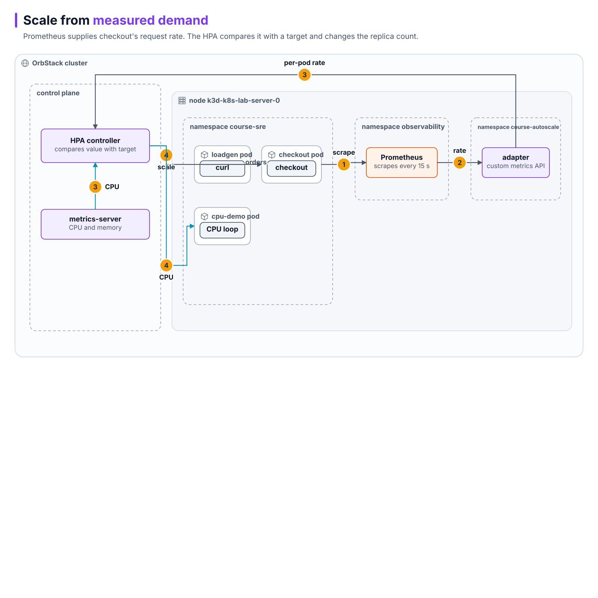
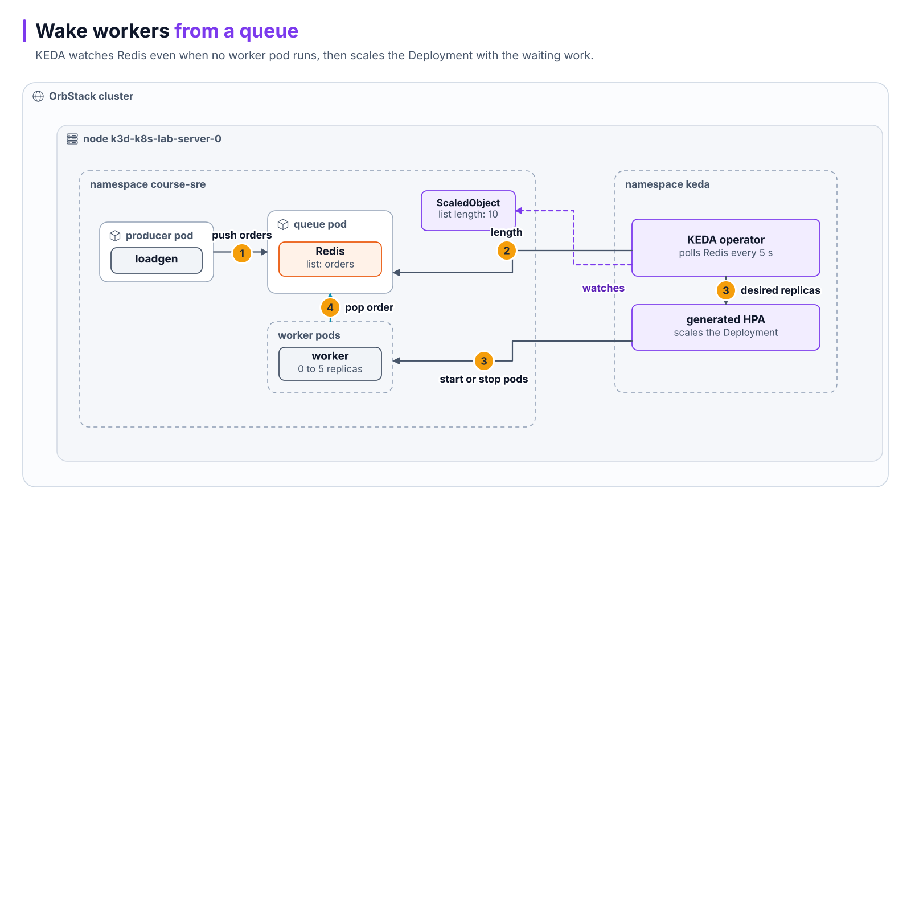

# Module 6.3: Autoscaling

> New to a term here, like HorizontalPodAutoscaler or custom metric? The [glossary](../glossary.md#reliability-engineering) explains every term in this course.

**Before this module:** [module 6.1](01-slis-slos-and-error-budgets.md) for the service numbers and [module 6.2](02-grafana-in-depth.md) for the dashboards. No Istio needed: every workload here runs outside the mesh.

When order traffic rises, a fixed number of checkout pods either wastes room at quiet times or falls behind at busy ones. Autoscaling measures demand and adds or removes pods to match it, so this module uses CPU, request rate and a Redis work queue to show three different signals. The SLOs from module 6.1 stay in view: more pods help only when the service still meets its promise.

Time: about 45 minutes. Memory: the adapter and KEDA request about 208 MiB together; the demo, Redis and up to five workers bring the total to about 312 MiB of requests. At their limits they use up to about 1.2 GiB. Reset removes them all.

## Concept: scale from a metric that explains the load



A replica count is a guess about how much work one pod should handle. The HorizontalPodAutoscaler, or **HPA**, replaces that guess with a loop: it compares a measured value with a target, then changes the Deployment's replica count.

1. Checkout exposes its request counter, and Prometheus scrapes it every 15 seconds.
2. The adapter reads the counter from Prometheus and serves a per-pod request rate.
3. The HPA controller compares that rate, or the CPU reading from metrics-server, with the target in the HPA resource.
4. The controller changes the Deployment's replica count, and Kubernetes creates or removes pods.

CPU gives a useful first signal. The HPA reads each pod's CPU use and compares it with its CPU request, which acts like a reserved share. In this module a 50 millicore request and a 60% target mean the HPA adds pods when each pod uses more than 30 millicores on average. A small CPU-bound demo keeps that signal visible while the app handles ordinary orders.

CPU does not explain every kind of pressure. A service may spend most of its time waiting on a database, so its CPU stays low while requests queue up. We already count checkout's requests in Prometheus, which lets the adapter expose requests per second for each pod as a **custom metric**. The HPA then compares that rate with a target of five requests per second.

The HPA aims for this rough ratio:

`desired replicas = current replicas × current value ÷ target value`

In the test run, each checkout pod received about 8.2 requests per second after we raised traffic from one to three load generators. With a target of five, the HPA moved checkout from two replicas to four, then five as the traffic settled. The loop gives the team a steady way to change capacity, much like opening another checkout counter when more customers arrive.

## Concept: scale a queue from zero



An HTTP service needs a pod ready before a request arrives, but a worker only needs to run when work waits. This module puts orders in a Redis list and leaves its worker Deployment at zero replicas when the list is empty.

1. The producer adds orders to the Redis list.
2. KEDA reads the list length every five seconds, using a **ScaledObject** that names the Deployment and the queue signal.
3. KEDA changes the worker replica count, from zero to at most five, as the list grows or empties.
4. Each worker removes an order, does one second of work, and asks Redis for another.

The same worker takes one order, waits a second to represent work, and then takes another. In the test run, adding 100 orders started four workers first; they rose to five while the queue remained long, and KEDA stopped them after the list emptied. The queue length tells us work is waiting, while the HPA's request rate tells us how busy checkout is, so each signal answers a different question.

KEDA watches the queue through the ScaledObject. It checks the Redis list every five seconds, starts one worker for each ten waiting orders, and stops at five workers. After the list stays empty for 30 seconds, it returns the worker count to zero.

## The bigger picture: choose the signal before the scaler

Autoscaling does not fix a slow dependency or a poor algorithm. It buys room while demand grows, which gives the team time to understand why the service needs more capacity. That is why a good dashboard pairs the replica count with latency, errors and resource use.

The Kubernetes HPA handles CPU, memory and custom metrics, while KEDA adds event sources such as queues, streams and cloud messages. Both still change Kubernetes replica counts, so the Deployment stays the source of truth for the workload and the scaler owns only its size. Production teams also set minimum and maximum replicas, keep enough spare capacity for new pods, and test that the signal arrives before the service misses its SLO.

## Why this way

**Why use a CPU-bound demo instead of loading checkout?** The demo makes the CPU signal clear and repeatable, without making order latency depend on the laptop's speed.

**Why use requests per second as a second signal?** CPU describes how much compute checkout uses, while request rate describes how much traffic each pod receives. A database wait may raise the request rate without using much CPU.

**Why add Prometheus Adapter?** The HPA reads CPU and memory through the built-in metrics API, but it does not read Prometheus directly. The adapter translates the Prometheus series into the custom metrics API the HPA already understands.

**Why let KEDA scale the worker to zero?** A queue worker has no reason to occupy memory while the queue stays empty. KEDA also watches the queue while no worker runs, so it wakes the Deployment when orders arrive.

## Do it

### 1. Let CPU demand change the replica count

First deploy checkout, which provides the request metrics for the next step, then add a small CPU-bound Deployment and its HPA:

```console
$ kubectl apply -f platform-engineering/manifests/6.1-checkout.yaml
namespace/course-sre created
configmap/checkout-code created
deployment.apps/checkout created
service/checkout created
podmonitor.monitoring.coreos.com/checkout created
deployment.apps/payments created
service/payments created
podmonitor.monitoring.coreos.com/payments created
deployment.apps/loadgen created

$ kubectl -n course-sre rollout status deploy/checkout
deployment "checkout" successfully rolled out

$ kubectl apply -f platform-engineering/manifests/6.3-cpu-demo.yaml
deployment.apps/cpu-demo created

$ kubectl apply -f platform-engineering/manifests/6.3-hpa-cpu.yaml
horizontalpodautoscaler.autoscaling/cpu-demo created

$ kubectl -n course-sre get hpa cpu-demo --no-headers | awk '{print $3 $4}'
cpu:500%/60%

$ kubectl -n course-sre get deployment cpu-demo
NAME       READY   UP-TO-DATE   AVAILABLE   AGE
cpu-demo   6/6     6            6           46s
```

**What you should see.** The demo stays above its 60% target, so the HPA reaches six replicas, its configured maximum. The test run measured 500% of the CPU request, which means each pod used five times its requested share before the HPA hit that cap.

### 2. Scale checkout from request rate

Prometheus first needs to discover checkout's PodMonitor. The new scrape configuration may take up to four minutes to reach Prometheus, and the adapter refreshes its metric list once a minute. Install the adapter, then poll for checkout's actual per-pod values before applying the HPA:

```console
$ helm upgrade --install prometheus-adapter prometheus-community/prometheus-adapter --version 5.3.0 \
  -n course-autoscale --create-namespace -f platform-engineering/manifests/6.3-adapter-values.yaml --wait --timeout 180s
Release "prometheus-adapter" does not exist. Installing it now.
NAME: prometheus-adapter
NAMESPACE: course-autoscale
STATUS: deployed

$ for i in $(seq 1 72); do
    kubectl get --raw '/apis/custom.metrics.k8s.io/v1beta1/namespaces/course-sre/pods/*/http_requests_per_second' 2>/dev/null \
      | grep -q 'checkout-' && break
    sleep 5
  done

$ kubectl get --raw '/apis/custom.metrics.k8s.io/v1beta1/namespaces/course-sre/pods/*/http_requests_per_second' \
  | python3 -c 'import json,sys; print(sum(1 for x in json.load(sys.stdin)["items"] if x["describedObject"]["name"].startswith("checkout-")))'
2

$ kubectl apply -f platform-engineering/manifests/6.3-hpa-rps.yaml
horizontalpodautoscaler.autoscaling/checkout created

$ kubectl -n course-sre scale deployment/loadgen --replicas=3
deployment.apps/loadgen scaled

$ kubectl -n course-sre get hpa checkout -o jsonpath='{.status.currentMetrics[0].pods.current.averageValue} {.status.desiredReplicas}'
8177m 4
```

**What you should see.** The adapter exposes a value for each checkout pod, and the HPA raises the desired count when the average passes five requests per second. In the test run the average reached 8.177 requests per second, so the desired count rose to four; after traffic settled, checkout reached five replicas. If the custom metric stays empty, check the PodMonitor target in Prometheus before changing the HPA.

### 3. Wake workers when orders wait

KEDA checks the queue even when no worker pod runs. Install KEDA, apply the Redis queue and its ScaledObject, then add 100 orders:

```console
$ helm upgrade --install keda kedacore/keda --version 2.17.2 -n keda --create-namespace \
  -f platform-engineering/manifests/6.3-keda-values.yaml --wait --timeout 180s
Release "keda" does not exist. Installing it now.
NAME: keda
NAMESPACE: keda
STATUS: deployed

$ kubectl apply -f platform-engineering/manifests/6.3-queue.yaml \
  -f platform-engineering/manifests/6.3-scaledobject.yaml
deployment.apps/queue created
service/queue created
deployment.apps/worker created
scaledobject.keda.sh/worker created

$ kubectl -n course-sre rollout status deploy/queue
deployment "queue" successfully rolled out

$ kubectl -n course-sre exec deploy/queue -- sh -c \
  'for i in $(seq 1 100); do redis-cli lpush orders "order-$i" >/dev/null; done; redis-cli llen orders'
100

$ kubectl -n course-sre get scaledobject worker
NAME     SCALETARGETKIND      SCALETARGETNAME   MIN   MAX   READY   ACTIVE   TRIGGERS
worker   apps/v1.Deployment   worker            0     5     True    True     redis

$ kubectl -n course-sre get deployment worker
NAME     READY   UP-TO-DATE   AVAILABLE   AGE
worker   4/4     4            4           22s
```

**What you should see.** KEDA starts workers while the list contains orders, then scales them back to zero after the queue stays empty for 30 seconds. In the test run, four workers appeared first, the count rose to five, and the Deployment returned to zero after the workers drained the list.

## Tasks

Each task gives you a goal without the commands. `./lab.sh task setup` prepares it, you solve it in `./lab.sh shell`, and `./lab.sh task check` tells you what still fails. The reference solution sits under each task, and `./lab.sh task solve` runs it for you.

### Task 6.3.1: scale a CPU-bound Deployment

<!-- norun -->
```console
$ ./lab.sh task setup 6.3.1
== setup task 6.3.1
cpu-demo is running two CPU-bound pods, but no HPA controls it.
Scale it between two and six replicas when average CPU exceeds 60% of its request.
```

> Scale `cpu-demo` between two and six replicas when average CPU use rises above 60% of the CPU request.

The first check fails because no HPA controls the Deployment:

<!-- norun -->
```console
$ ./lab.sh task check 6.3.1
== check task 6.3.1
  FAIL  the CPU HPA targets cpu-demo with a 60% threshold and a 2-to-6 range
  FAIL  the HPA adds replicas while CPU stays above target
== task 6.3.1: 0 passed, 2 failed
```

<details>
<summary>Solution</summary>

Apply the CPU HPA and check its target and replica range:

<!-- norun -->
```console
$ ./lab.sh task solve 6.3.1
== solve task 6.3.1
$ kubectl apply -f platform-engineering/manifests/6.3-hpa-cpu.yaml
horizontalpodautoscaler.autoscaling/cpu-demo created
$ kubectl -n course-sre get hpa cpu-demo
NAME       REFERENCE             TARGETS              MINPODS   MAXPODS   REPLICAS   AGE
cpu-demo   Deployment/cpu-demo   cpu: <unknown>/60%   2         6         0          0s
```

</details>

<!-- norun -->
```console
$ ./lab.sh task check 6.3.1
== check task 6.3.1
  PASS  the CPU HPA targets cpu-demo with a 60% threshold and a 2-to-6 range
  PASS  the HPA adds replicas while CPU stays above target
== task 6.3.1: 2 passed, 0 failed
```

### Task 6.3.2: scale workers from a queue

<!-- norun -->
```console
$ ./lab.sh task setup 6.3.2
== setup task 6.3.2
Redis holds 300 orders, but the worker deployment has zero replicas.
Create a KEDA ScaledObject that wakes one worker for every 10 waiting orders, up to five.
```

> Redis holds 300 orders while the worker Deployment has zero replicas. Configure KEDA to start one worker per 10 waiting orders, up to five.

The check fails until the ScaledObject exists:

<!-- norun -->
```console
$ ./lab.sh task check 6.3.2
== check task 6.3.2
  FAIL  KEDA watches the worker and the Redis list with a 0-to-5 range
  FAIL  KEDA starts workers for the queued orders
== task 6.3.2: 0 passed, 2 failed
```

<details>
<summary>Solution</summary>

Apply the ScaledObject. It may show `Unknown` for a few seconds while KEDA reads the queue:

<!-- norun -->
```console
$ ./lab.sh task solve 6.3.2
== solve task 6.3.2
$ kubectl apply -f platform-engineering/manifests/6.3-scaledobject.yaml
scaledobject.keda.sh/worker created
$ kubectl -n course-sre get scaledobject worker
NAME     SCALETARGETKIND      SCALETARGETNAME   MIN   MAX   READY     ACTIVE    FALLBACK   PAUSED    TRIGGERS   AUTHENTICATIONS   AGE
worker   apps/v1.Deployment   worker            0     5     Unknown   Unknown   Unknown    Unknown   redis                        0s
$ kubectl -n course-sre get deployment worker
NAME     READY   UP-TO-DATE   AVAILABLE   AGE
worker   0/0     0            0           7s
```

</details>

<!-- norun -->
```console
$ ./lab.sh task check 6.3.2
== check task 6.3.2
  PASS  KEDA watches the worker and the Redis list with a 0-to-5 range
  PASS  KEDA starts workers for the queued orders
== task 6.3.2: 2 passed, 0 failed
```

## Investigate

1. Why does the CPU HPA compare usage with the pod's request instead of the node's total CPU?
2. What happens to checkout if Prometheus stops serving the custom request-rate metric?
3. Why does the HTTP service start with two replicas while the queue worker starts at zero?
4. The worker scales down after the queue empties. What would happen if new orders arrived while the workers shut down?

<details>
<summary>Answers</summary>

1. The request describes the CPU share the scheduler reserved for the pod. Comparing usage with that share keeps the target meaningful when the pod moves to a node with a different size. In this lab, 60% of 50 millicores means 30 millicores.
2. The HPA reports the metric as unavailable and keeps its current replica count rather than guessing that demand fell. The team should check Prometheus' target and the adapter's discovery before changing the target value.
3. A client request may arrive at any time, so checkout needs ready pods before traffic arrives. The worker only serves orders already in the queue, and KEDA watches that queue while its worker count remains zero.
4. KEDA polls every five seconds and starts workers again when the list grows. The short delay means the queue waits briefly, so a production system sets its queue target and polling interval to fit its latency SLO.

</details>

## Clean up

```console
$ ./platform-engineering/reset.sh
Removing course rules from the shop namespace
Applying the baseline Istio config from manifests/istio
Turning off the backend experiment settings
Asking ArgoCD to sync istio-config from Git
Done. Baseline: 100% of backend traffic to v1, no faults, no extra rules.
```

The reset deletes the ScaledObject while KEDA still runs, then uninstalls KEDA and the Prometheus adapter. It removes their APIs and CRDs, the namespaces `keda` and `course-autoscale`, and `course-sre`, including the HPAs, queue and CPU demo.
