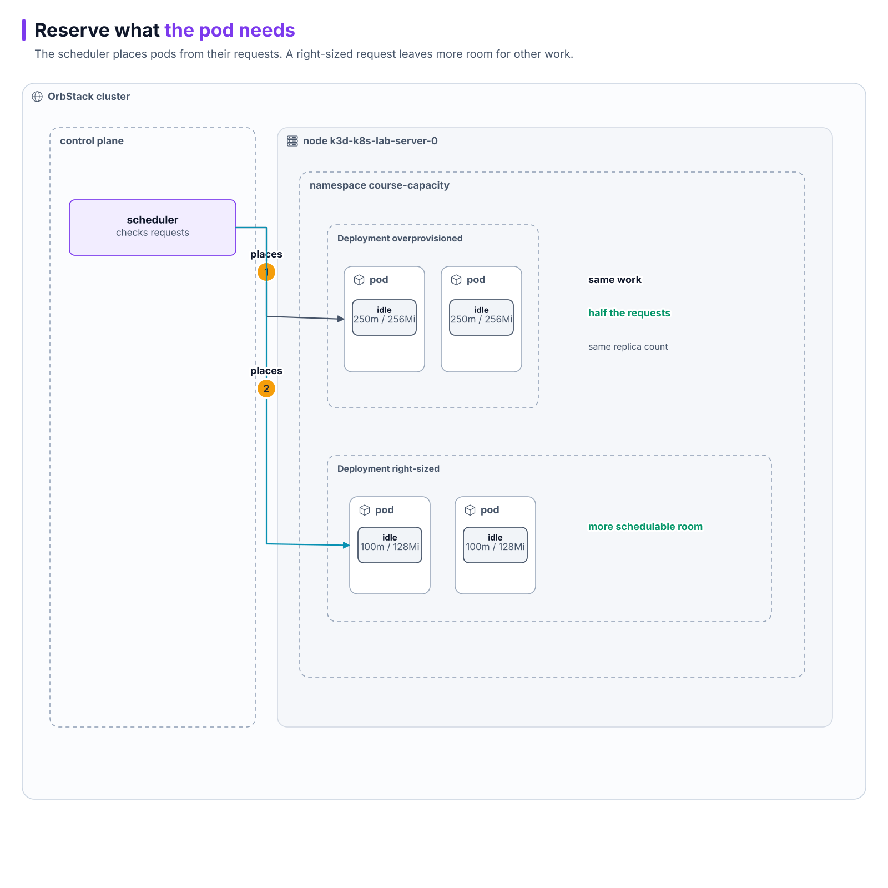
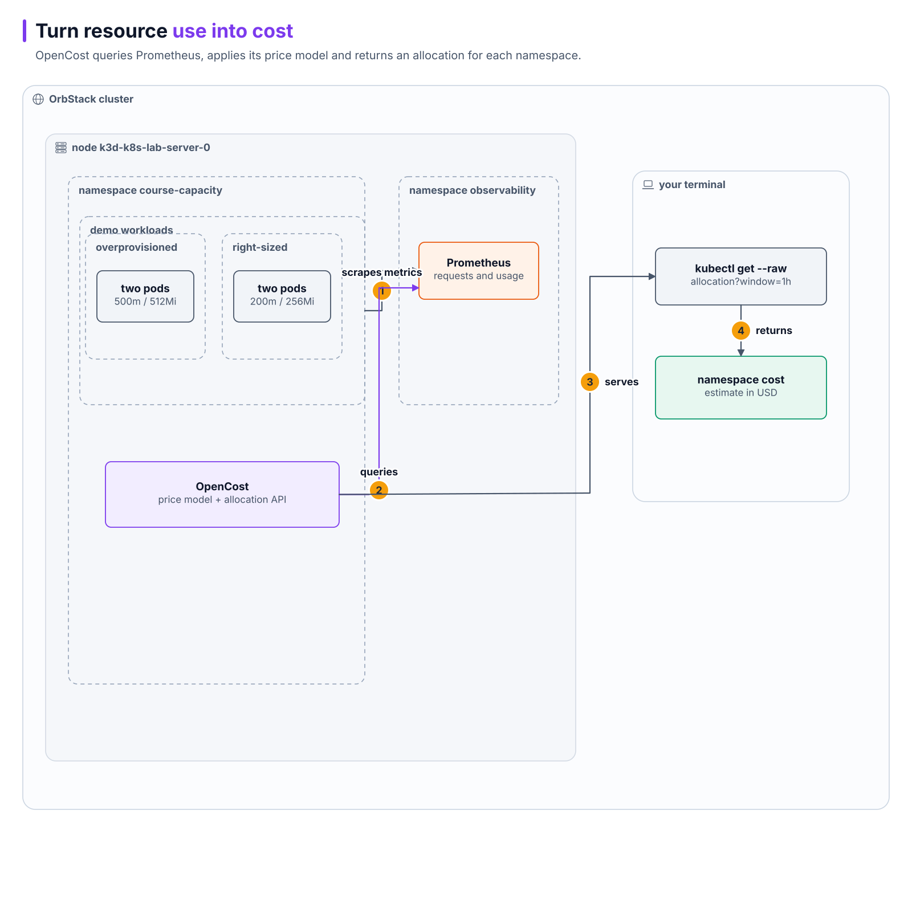

# Module 6.6: Capacity and cost

> New to a term here, like resource request or allocation? The [glossary](../glossary.md#reliability-engineering) explains every term in this course.

**Before this module:** [module 6.1](01-slis-slos-and-error-budgets.md) for the service targets, and [module 6.3](03-autoscaling.md) for changing replica counts as demand changes. No Istio needed.

When pods reserve more CPU and memory than they use, the scheduler may leave room unused while another workload waits for a node. This module compares two identical Deployments with different requests, then checks how OpenCost turns Kubernetes resource data into a namespace allocation.

Time: about 30 minutes. Memory: the four demo pods request 768 MiB together, and OpenCost adds about 160 MiB, for about 928 MiB of requests. Their combined limits reach about 2.1 GiB. Reset removes the workloads, OpenCost and its cluster-wide permissions.

## Concept: requests decide where pods fit



A pod's **request** tells the scheduler how much CPU and memory to reserve when it places that pod. Its **limit** caps how much it may use, so a good request leaves enough room for normal work without claiming space the app rarely needs.

The demo runs two replicas of each Deployment. Both have the same limits and do no useful work, but the requests differ:

| Deployment | CPU per pod | Memory per pod | Two-pod total |
|---|---:|---:|---:|
| `overprovisioned` | 250m | 256 MiB | 500m CPU, 512 MiB |
| `right-sized` | 100m | 128 MiB | 200m CPU, 256 MiB |

The smaller Deployment cuts both reservations by 60% while keeping the replica count unchanged. A team should make that change only after it checks real usage and load; an idle lab demo teaches the comparison, not the right production request.

## Concept: turn reservations into an estimate



Teams also need to know what those reservations cost. **OpenCost** reads Kubernetes resource metrics from Prometheus, applies a price model, and returns an allocation grouped by namespace or workload. This works like splitting a shared utility bill: the price model supplies the rate, and the allocation says which part belongs to each team.

The lab configures a CPU rate of $0.031611 per core-hour and a memory rate of $0.004237 per GiB-hour. With those rates, the two overprovisioned pods reserve about $0.01792 per hour; the right-sized pair reserves about $0.00738 per hour. This model estimates the cost of the requested capacity, not a cloud provider's invoice.

Across local test runs, OpenCost returned a numeric allocation with `totalCost` from zero to `1e-05`; its rounded CPU and memory cost fields read zero. Its log reported a failed match between the local k3d node and its cluster record. The API proves that allocation data arrives, but this short local window does not give a useful bill. The explicit rate calculation above makes the comparison clear, and production teams should confirm their provider's pricing and allocation data before using them for budgets.

## The bigger picture: capacity is a team decision

Right-sizing affects more than a cloud bill. Requests also guide placement and autoscaling, so a request that stays far above normal use makes the cluster look fuller than it is. A request that falls below a service's normal needs may let the scheduler pack more pods than the node should serve comfortably.

Teams combine historical usage, peak traffic, latency objectives and cost reports before they change requests. They also review the result after deployment: a lower reservation helps only if the service still meets its SLO under load.

## Why this way

**Why keep two Deployments with the same limits?** The experiment changes only the requests, so the learner compares how Kubernetes reserves capacity without changing replica count or the work each pod performs.

**Why calculate an hourly estimate from requests?** A short test does not collect enough history for a trustworthy bill. The configured rates make the arithmetic visible, while the OpenCost API shows where a longer-running cluster reports its allocations.

**Why treat OpenCost's local result as an estimate?** The local cluster has one k3d node, not a cloud bill with provider metadata. Its allocation output is useful for checking the data path, but production teams need a validated price model and enough history before they make financial decisions.

## Do it

### 1. Compare the reservations

Apply the two Deployments and inspect the requests Kubernetes stores:

```console
$ kubectl apply -f platform-engineering/manifests/6.6-capacity-demo.yaml
namespace/course-capacity created
deployment.apps/overprovisioned created
deployment.apps/right-sized created

$ kubectl -n course-capacity rollout status deploy/overprovisioned
deployment "overprovisioned" successfully rolled out

$ kubectl -n course-capacity rollout status deploy/right-sized
deployment "right-sized" successfully rolled out

$ kubectl -n course-capacity get deploy -o custom-columns=NAME:.metadata.name,REPLICAS:.status.readyReplicas,CPU_REQUEST:.spec.template.spec.containers[0].resources.requests.cpu,MEMORY_REQUEST:.spec.template.spec.containers[0].resources.requests.memory
NAME              REPLICAS   CPU_REQUEST   MEMORY_REQUEST
overprovisioned   2          250m          256Mi
right-sized       2          100m          128Mi
```

**What you should see.** Both Deployments have two ready pods, but `right-sized` reserves 200m CPU and 256 MiB in total instead of 500m and 512 MiB. The test run confirmed those requests directly from the Deployment specs.

### 2. Install OpenCost

The lab already runs Prometheus, so point OpenCost at that Service and install its pinned chart:

```console
$ helm upgrade --install opencost opencost --repo https://opencost.github.io/opencost-helm-chart \
  --version 2.5.20 -n course-capacity --create-namespace \
  -f platform-engineering/manifests/6.6-opencost-values.yaml --wait --timeout 5m
Release "opencost" does not exist. Installing it now.
NAME: opencost
NAMESPACE: course-capacity
STATUS: deployed

$ kubectl -n course-capacity rollout status deploy/opencost
deployment "opencost" successfully rolled out
```

**What you should see.** The API becomes available on the in-cluster Service `opencost:9003`. The values file sets the lab's CPU and memory rates, points OpenCost at the shared Prometheus Service, and gives each OpenCost container a request and limit.

### 3. Read the namespace allocation

Ask the API for one hour of allocation data, grouped by namespace:

```console
$ kubectl get --raw '/api/v1/namespaces/course-capacity/services/opencost:9003/proxy/allocation?window=1h&aggregate=namespace&includeIdle=true' \
  | python3 -c 'import json,sys; r=json.load(sys.stdin)["data"][0]["course-capacity"]; print("totalCost=%s cpuCost=%s ramCost=%s" % (r["totalCost"], r["cpuCost"], r["ramCost"]))'
totalCost=1e-05 cpuCost=0 ramCost=0
```

**What you should see.** OpenCost returns an allocation for `course-capacity`, which confirms that its API reads the namespace data. In this test run, its cost fields rounded down over the short local sample, so use the configured rates and the request totals from step 1 for the comparison rather than treating this value as a bill.

## Tasks

### Task 6.6.1: right-size a Deployment

Run the task setup, change only the `overprovisioned` Deployment's requests to 100m CPU and 128 MiB, keep two replicas, and leave the limits above those requests:

```console
$ ./lab.sh task setup 6.6.1
== setup task 6.6.1
Both Deployments run two idle pods. overprovisioned requests 250m CPU and 256Mi per pod.
Set its requests to 100m CPU and 128Mi. Keep two replicas and limits above the requests.
```

The check fails until the Deployment's resources match the goal:

```console
$ ./lab.sh task check 6.6.1
== task 6.6.1:   FAIL  it keeps two replicas and lowers requests to 100m and 128Mi
  FAIL  limits remain above the requests
== task 6.6.1: 0 passed, 2 failed
```

<details>
<summary>Solution</summary>

Set the requests to half the original values and leave the limits higher:

```console
$ ./lab.sh task solve 6.6.1
== solve task 6.6.1
== solve task 6.6.1
$ kubectl -n course-capacity set resources deployment/overprovisioned --requests=cpu=100m,memory=128Mi --limits=cpu=500m,memory=512Mi
deployment.apps/overprovisioned resource requirements updated
$ kubectl -n course-capacity get deployment overprovisioned
NAME              READY   UP-TO-DATE   AVAILABLE   AGE
overprovisioned   2/2     1            2           1s
```

</details>

The final check confirms the smaller request and unchanged replica count:

```console
$ ./lab.sh task check 6.6.1
== check task 6.6.1
  PASS  it keeps two replicas and lowers requests to 100m and 128Mi
  PASS  limits remain above the requests
== task 6.6.1: 2 passed, 0 failed
```

## Investigate

1. The right-sized pods reserve less than half the CPU and memory of the other Deployment. Why should a team still check peak usage before lowering a production request?
2. The CPU limit stays at 500m after the request falls to 100m. What does the limit protect, and what happens when the container reaches it?
3. OpenCost reports a tiny total cost and zero rounded CPU and memory fields. What does that output tell you, and what remains unknown?
4. The same application runs in two namespaces with separate teams. Which labels or allocation grouping would help you compare their cost fairly?

<details>
<summary>Answers</summary>

1. The idle demo does not represent peak traffic. A team needs load tests and historical metrics to learn whether the lower request still leaves enough CPU and memory when the service reaches its normal peak.
2. The limit caps the container's use. The kernel throttles CPU after the container uses its CPU quota, and Kubernetes may kill it if memory usage passes its memory limit.
3. The output confirms that OpenCost returned allocation data for the namespace. The short local sample and rounded fields do not prove that the configured rates match a cloud invoice.
4. Group by namespace and workload, then compare the same time window and price model. Teams should also check that labels identify their workloads consistently, much like keeping the same units on both sides of a ledger.

</details>

## Clean up

```console
$ ./platform-engineering/reset.sh
```

The reset uninstalls OpenCost before it deletes `course-capacity`, then removes the `opencost` ClusterRole and ClusterRoleBinding. The shared Prometheus and Loki services stay in place.
