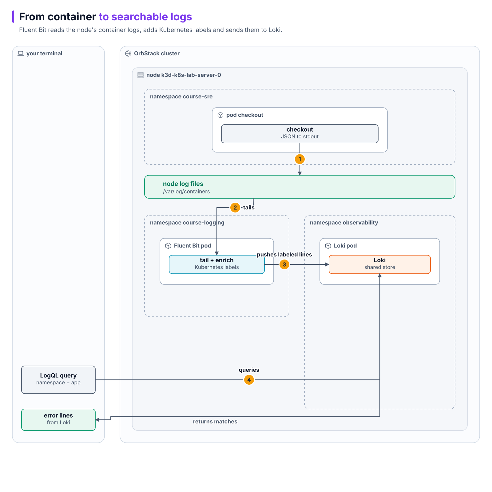

# Module 6.7: Centralized logs with Fluent Bit and Loki

> New to a term here, like log collector or label? The [glossary](../glossary.md#reliability-engineering) explains every term in this course.

**Before this module:** [module 6.2](02-grafana-in-depth.md) introduces Loki and log alerts. This module sends application logs to the shared Loki service. No Istio needed.

When checkout fails, its logs help explain why, but `kubectl logs` only shows one pod at a time and the pod may disappear before an incident ends. A node-level collector reads container logs and sends them to a shared store, where one query searches every replica. This module installs Fluent Bit, forwards checkout's JSON logs to the lab's Loki service, and checks that a real error arrives with useful labels.

Time: about 30 minutes. Memory: Fluent Bit requests 64 MiB and has a 128 MiB limit. Checkout, payments and loadgen request about 136 MiB together, for about 200 MiB total. Reset removes the collector and course workloads but keeps shared Loki.

## Concept: logs leave the pod through the node



The application writes a JSON line to standard output each time it handles an order. Kubernetes stores that line under `/var/log/containers` on the node, and Fluent Bit tails those files from a **DaemonSet**, which runs one collector pod on each node. A filter adds the pod's namespace and application labels, then the collector sends the line to Loki.

The path has four parts:

1. checkout writes the request result and duration as JSON.
2. The node's container log records the line.
3. Fluent Bit reads the file, attaches Kubernetes metadata and sends it to Loki.
4. A LogQL query selects the checkout logs from Loki, even when either checkout pod restarts.

This design keeps log storage outside the application. The same collector handles every pod on a node, while labels let a query narrow the shared stream to one workload.

## Concept: labels make logs searchable

Loki stores each line with a small set of indexed labels. The module labels streams with `collector`, `namespace` and `app`, then searches the JSON message for `internal error`. This is much like sorting letters by address before reading their contents: labels narrow the pile first, and the query text finds the message you need.

Labels should describe a stable workload, not each request. A request ID or user ID would create a new stream for every value and make Loki use far more memory. Keep those details inside the JSON line, where a query inspects them without indexing each value.

## The bigger picture: collect once, route to many stores

Teams often run an agent on every node because it sees logs from every pod without changing each application. Fluent Bit and Vector do this job with a small footprint; larger systems may use OpenTelemetry Collector or a managed agent. The important choice is the boundary: the app writes a useful event, the node agent enriches it, and the central store keeps and searches it.

Logs complement metrics rather than replace them. Metrics show how many requests failed and how quickly; logs show the details of individual failures. A useful incident workflow starts with the SLO, follows the failing service, then uses a log query to find a cause.

## Why this way

**Why read the node's container log instead of changing checkout?** The runtime already writes standard output to a file on the node. Fluent Bit collects it without adding a logging library or changing the application image.

**Why keep Loki in `observability`?** Other modules already use that shared service. A single store lets teams query logs across course namespaces while each module resets its own collector.

**Why index only a few labels?** Loki builds an index for each label combination. Stable labels make queries fast without creating thousands of short-lived streams.

**Why remove the chart's machine-id mount?** The k3d node image in this lab has no `/etc/machine-id` file. The chart's default `hostPath` requires that file, so the pod remains stuck in `ContainerCreating`. The values file keeps the needed `/var/log` mount and omits the unused machine-id path.

## Do it

### 1. Start checkout and install Fluent Bit

Deploy checkout and its continuous load generator, then install the pinned Fluent Bit chart:

```console
$ kubectl apply -f platform-engineering/manifests/6.1-checkout.yaml
namespace/course-sre created
configmap/checkout-code created
deployment.apps/checkout created
service/checkout created
podmonitor.monitoring.coreos.com/checkout created
deployment.apps/payments created
service/payments created
podmonitor.monitoring.coreos.com/payments created
deployment.apps/loadgen created

$ helm upgrade --install fluent-bit fluent-bit --repo https://fluent.github.io/helm-charts \
  --version 0.58.3 -n course-logging --create-namespace \
  -f platform-engineering/manifests/6.7-fluent-bit-values.yaml --wait --timeout 3m
Release "fluent-bit" does not exist. Installing it now.
NAME: fluent-bit
NAMESPACE: course-logging
STATUS: deployed

$ kubectl -n course-logging get ds fluent-bit
NAME         DESIRED   CURRENT   READY   UP-TO-DATE   AVAILABLE
fluent-bit   1         1         1       1            1
```

The values file tails `/var/log/containers/*_course-sre_*.log`, parses the container format, and attaches Kubernetes labels. It points the Loki output at the shared `observability/loki` service.

**What you should see.** One Fluent Bit pod runs on the one-node lab, and its DaemonSet reports one ready pod. The chart stays healthy because the values file does not mount the missing `/etc/machine-id` path.

### 2. Create error lines and query Loki

Set checkout to return an error for each order. The load generator keeps sending requests, so Fluent Bit has new lines to forward:

```console
$ kubectl -n course-sre set env deployment/checkout ERROR_PERCENT=100
deployment.apps/checkout env updated

$ kubectl -n course-sre rollout status deployment/checkout
deployment "checkout" successfully rolled out

$ NOW=$(date +%s)
$ Q=$(python3 -c 'import sys,urllib.parse; print(urllib.parse.quote(sys.argv[1]))' \
  '{collector="fluent-bit",namespace="course-sre",app="checkout"} |= "internal error"')
$ kubectl get --raw "/api/v1/namespaces/observability/services/loki:3100/proxy/loki/api/v1/query_range?query=$Q&start=$((NOW-600))000000000&end=${NOW}000000000&limit=100" \
  | python3 -c 'import json,sys; print(sum(len(s["values"]) for s in json.load(sys.stdin)["data"]["result"]))'
100
```

**What you should see.** In the test run, Loki returned 100 checkout error lines with Fluent Bit labels. The API query confirms the data path from the container log to Loki; it does not depend on either checkout pod name.

### 3. Restore checkout

Return checkout to its normal response rate, then check a new request:

```console
$ kubectl -n course-sre set env deployment/checkout ERROR_PERCENT=0
deployment.apps/checkout env updated

$ kubectl -n course-sre rollout status deployment/checkout
deployment "checkout" successfully rolled out
```

**What you should see.** New orders succeed again, while Loki retains the earlier error lines until its retention policy removes them. Reset removes Fluent Bit and `course-sre`, but it leaves the shared Loki service in place.

## Tasks

Each task gives you a goal without the commands. `./lab.sh task setup` prepares it, you solve it in `./lab.sh shell`, and `./lab.sh task check` tells you what still fails. The solution sits under the task, and `./lab.sh task solve` runs it for you.

### Task 6.7.1: repair Fluent Bit's Loki output

<!-- norun -->
```console
$ ./lab.sh task setup 6.7.1
== setup task 6.7.1
Checkout logs internal errors, but Fluent Bit sends them to an invalid Loki host.
Repair the output and find at least five checkout error lines in Loki (task 6.7.1).
```

> Checkout logs errors, but Fluent Bit sends them to an invalid Loki host. Repair the output and find at least five checkout error lines in Loki.

<details>
<summary>Solution</summary>

Install the corrected values file, then keep the error workload running while Fluent Bit forwards its logs:

```console
$ helm upgrade --install fluent-bit fluent-bit --repo https://fluent.github.io/helm-charts --version 0.58.3 -n course-logging --create-namespace -f platform-engineering/manifests/6.7-fluent-bit-values.yaml --wait --timeout 3m
NAME: fluent-bit
NAMESPACE: course-logging
STATUS: deployed

$ kubectl -n course-sre set env deployment/checkout ERROR_PERCENT=100
deployment.apps/checkout env updated
```

</details>

<!-- norun -->
```console
$ ./lab.sh task check 6.7.1
== task 6.7.1: 1 passed, 0 failed
```

## Investigate

1. Fluent Bit runs, but a query returns no checkout logs. Which two places would you inspect before changing the query?
2. Why should a request ID stay in the log line rather than become a Loki label?
3. If Fluent Bit is unavailable for five minutes, what happens to the logs, and what would you monitor?
4. The collector reads every container log on the node. What access does that require, and how would you limit the impact of a compromised agent?

<details>
<summary>Answers</summary>

1. Check the Fluent Bit output host and its pod logs, then confirm the node log path contains checkout files and that the `kubernetes` filter adds the expected labels. A query misses any label the collector never sent.
2. Request IDs change on every order. Turning each one into a label creates a stream for each request and grows Loki's index; keeping it in the JSON line preserves the detail without indexing it.
3. Fluent Bit buffers some records in memory, but a longer outage may lose them when the buffer fills or the pod restarts. Monitor collector health, output retry counts, buffer pressure and whether new lines reach Loki.
4. The agent needs access to node log files and Kubernetes metadata, so its permissions and mounts matter. Run one collector per node with read-only mounts, minimal cluster permissions and resource limits, then keep its image and chart version pinned.

</details>

## Clean up

```console
$ ./platform-engineering/reset.sh
```

The reset uninstalls Fluent Bit before deleting its namespace and cluster-wide permissions. It removes `course-sre` but keeps Loki in `observability`.
