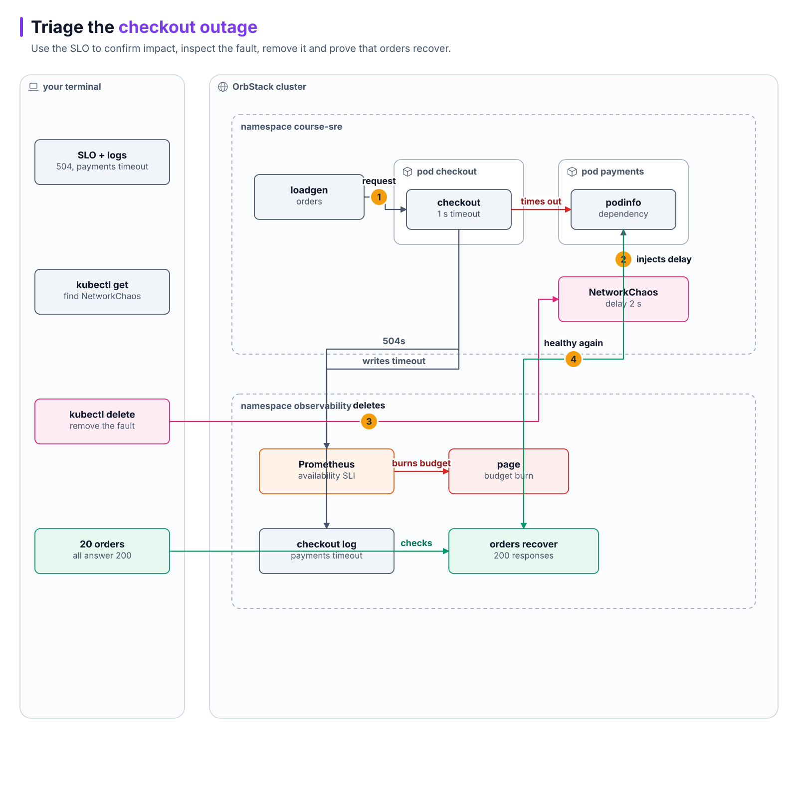

# Module 6.8: Run an SRE game day

> New to a term here, like incident triage or alert fatigue? The [glossary](../glossary.md#reliability-engineering) explains every term in this course.

**Before this module:** [module 6.1](01-slis-slos-and-error-budgets.md) for the checkout SLO, [module 6.2](02-grafana-in-depth.md) for its dashboards, and [module 6.4](04-chaos-engineering.md) for controlled faults. No Istio needed.

When a service breaks, the person on call needs to separate a bad release from a failing dependency before making changes. A game day rehearses that work while the team still has time to stop the experiment. In this module, a timed network fault makes checkout return 504; you use the SLO, logs and Kubernetes state to find the cause, restore orders without editing either Deployment, and prove the recovery with 20 requests.

Time: about 25 minutes. Memory: checkout, payments and loadgen request about 136 MiB together; Chaos Mesh adds about 160 MiB, for about 296 MiB total. Reset removes both.

## Concept: use each signal for one question



During an incident, three signals answer different questions. The **SLI** shows whether failures hurt users, the checkout log says what failed inside the request, and the Kubernetes object shows which experiment changed the network. Start with the SLI because it confirms impact, then use the other signals to identify a cause before changing the system.

The game day follows a short incident loop:

1. **Send an order:** loadgen calls checkout, which calls payments.
2. **Inject the fault:** the active NetworkChaos delays payments long enough for checkout to return 504.
3. **Remove the fault:** use the SLO, log and Kubernetes state to find the cause, then delete the NetworkChaos.
4. **Verify recovery:** send 20 orders and confirm all 20 return 200.

This keeps the response tied to evidence. Deleting a Deployment might also restore orders, but it would hide the real cause and change the system the task asks you to leave untouched.

## Concept: contain the experiment before it starts

The game-day fault has a 30-minute duration, which limits how long it may affect checkout if the operator loses the terminal. The namespace and pod selector keep the fault on payments only. The checkout timeout turns a dropped dependency call into a 504 after one second instead of holding each request open indefinitely.

That safety net does not replace active monitoring. The availability SLO watches the user-facing result and pages when enough orders fail; the duration and selector limit the experiment's reach. A written abort condition and a person watching the dashboard complete the control.

## The bigger picture: rehearse the decision, not just the tool

A game day tests the team's response as well as the service. Production teams practice roles, escalation, customer updates and recovery steps, then record what slowed the response. Mature teams automate safe experiments, but a human still needs to know which signals justify an action and how to confirm the system recovered.

This track used the pieces one at a time: define reliability, view it in Grafana, scale, inject faults, restore a database, estimate capacity and search logs. The game day joins them into one response. It is the last module in the SRE track.

## Why this way

**Why inspect the SLO before the Deployment?** The SLO shows whether users are hurt, while a Deployment diff only says whether an application rollout changed. A dependency fault may hurt users without changing either Deployment.

**Why delete the NetworkChaos instead of restarting checkout?** The experiment object created the fault. Deleting it asks Chaos Mesh to undo the network rule while keeping the application and its replica history unchanged.

**Why check 20 orders instead of one?** One success may arrive just before a fault returns or reach a healthy replica by chance. A short sequence gives stronger evidence that the dependency path recovered.

**Why leave an automatic duration on the fault?** A forgotten terminal should not leave a network experiment running forever. The duration is a backstop, while the SLO and the operator provide the active stop condition.

## Do it

### 1. Start the game day

Run the setup. It installs checkout and Chaos Mesh, applies the SLO rules, injects a two-second delay into payments, and waits for both the 504 and the availability page:

```console
$ ./lab.sh task setup 6.8.1
== setup task 6.8.1
Installing Chaos Mesh 2.8.7 (about a minute)
Checkout returns 504s. No release changed, and the 30-minute game day has started.
Use the SLO, logs and cluster state to restore orders without changing either Deployment.
```

**What you should see.** The setup confirms that checkout returns 504, neither Deployment changed, and the 30-minute game-day window started. The verifier observed the availability SLO page while the injected delay was active.

### 2. Triage the incident

Check the user-facing signal, the application log and the fault object:

```console
$ kubectl get --raw '/api/v1/namespaces/observability/services/kube-prometheus-stack-prometheus:9090/proxy/api/v1/query?query=ALERTS%7Balertname%3D%22CheckoutAvailabilityBudgetBurn%22%2Cseverity%3D%22page%22%2Calertstate%3D%22firing%22%7D' \
  | python3 -c 'import json,sys; print(json.load(sys.stdin)["data"]["result"][0]["value"][1])'
1

$ kubectl -n course-sre get networkchaos -o name
networkchaos.chaos-mesh.org/payments-maintenance-window

$ kubectl -n course-sre logs deploy/checkout --tail=5 | grep 'payments timed out' | tail -1
{"level": "error", "path": "/api/checkout", "code": 504, "duration_ms": 1001.2, "msg": "payments timed out"}

$ kubectl -n course-sre get deploy checkout payments
NAME       READY   UP-TO-DATE   AVAILABLE
checkout   2/2     2            2
payments   2/2     2            2
```

The log points at the payments timeout, while both Deployments remain available. The NetworkChaos object is the changed part of the system, so remove it:

```console
$ kubectl -n course-sre delete networkchaos payments-maintenance-window
networkchaos.chaos-mesh.org "payments-maintenance-window" deleted
```

**What you should see.** The fault disappears without changing checkout or payments. In the verifier run, the same deletion restored a 200 response.

### 3. Prove the recovery

Send a sequence of orders, then check the generations recorded before the game day:

```console
$ kubectl -n course-sre exec deploy/loadgen -- sh -c 'for i in $(seq 1 20); do curl -s -o /dev/null -m 3 -w "%{http_code}\n" http://checkout:8080/api/checkout; done' | sort | uniq -c
     20 200
```

**What you should see.** All 20 requests return 200, and the task checker confirms that the fault is gone and the checkout and payments Deployment generations match their starting values.

## Tasks

### Task 6.8.1: triage a checkout outage

The setup above creates the incident. Solve it without editing either Deployment.

```console
$ ./lab.sh task check 6.8.1
== task 6.8.1: 3 passed, 0 failed
```

<details>
<summary>Solution</summary>

Inspect the active experiment, then delete the network fault:

```console
$ ./lab.sh task solve 6.8.1
$ kubectl -n course-sre get networkchaos
NAME                          ACTION   DURATION
payments-maintenance-window   delay    30m
$ kubectl -n course-sre describe networkchaos payments-maintenance-window
  Latency:      2s
  Duration:     30m
  Namespaces:
    course-sre
  App:          payments
$ kubectl -n course-sre delete networkchaos payments-maintenance-window
networkchaos.chaos-mesh.org "payments-maintenance-window" deleted

$ ./lab.sh task check 6.8.1
  PASS  the maintenance-window fault is gone
  PASS  20 orders in a row answer 200 ( 20 200 )
  PASS  checkout and payments were not changed
== task 6.8.1: 3 passed, 0 failed
```

</details>

## Investigate

1. The availability SLO pages, but both Deployments show all replicas ready. How do both facts fit?
2. The log says `payments timed out`, while the NetworkChaos object names payments. What evidence connects these signals?
3. What would change if the game-day fault had no duration and the person running it lost access to the terminal?
4. The 20 requests all return 200, but the availability page remains firing briefly. Is that proof the recovery failed?

<details>
<summary>Answers</summary>

1. Readiness reports whether pods pass their health checks, not whether checkout reaches every dependency. A network fault may leave all pods ready while orders fail.
2. The object selects payments and injects a delay; checkout's one-second dependency timeout turns that delay into a 504 and writes the reason to its log. Removing the object restores the path.
3. The fault may stay active until someone finds and removes it. A duration is a safety limit, but the operator still needs a dashboard and an explicit abort plan.
4. Not by itself. The SLO uses rolling windows, so failed requests from before recovery may keep the alert active after new requests succeed. Check the current error ratio and new orders, then let the older window clear.

</details>

## Clean up

```console
$ ./platform-engineering/reset.sh
```

Reset removes the NetworkChaos objects before it uninstalls Chaos Mesh, then deletes `course-sre` and the Chaos Mesh CRDs. The shared Prometheus service stays in place.
