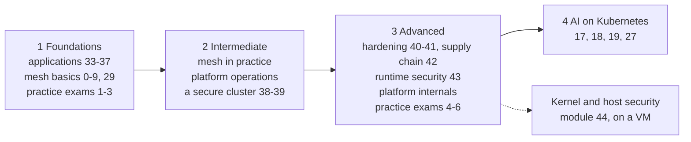
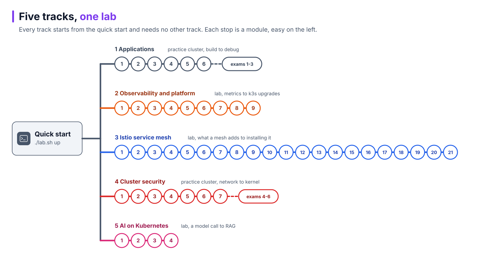

# Kubernetes Platform Engineering

A hands-on course in running applications and a platform on Kubernetes, built on this lab, in four levels from foundations to AI. It covers how to build, ship, configure and debug an application, then the Istio service mesh, which touches every request, then a platform team's daily work: cluster operations, GitOps, alerting, dashboards, OpenTelemetry, policy as code and profiling, then securing a cluster from its nodes to its supply chain, and finally AI workloads. Every module explains what a tool does, why its design took that shape rather than another, and how to watch it work.

**New to Istio? Read [Start here: Istio in one picture](start-here.md) first.** It takes 15 minutes, needs no cluster, and shows every resource the mesh modules use on one diagram, while the [glossary](glossary.md) gives every term a plain explanation, so keep it open in a tab.

## The course on one page

The course has four levels, and each level groups its modules into domains, such as service mesh basics or supply chain security. A level spans several domains, so you climb in difficulty without finishing one topic before you start the next. One domain sits outside the levels, because its tasks need a virtual machine with a kernel of its own.



The modules run on three kinds of machine, and each module names its machine at the top:

| Where it runs | Modules | How to start it |
|---|---|---|
| The k3d lab on your Mac, with Istio, the shop and every UI | 0 to 32, and 45 | `./scripts/provision.sh`, as [Before you start](#before-you-start) shows |
| The [practice cluster](practice-cluster.md), two kubeadm nodes on OrbStack or on your own VMs | 33 to 43, practice exams 1 to 6 | `./platform-engineering/practice/cluster/create.sh` |
| A VM with a kernel of its own, Lima on a Mac | 44, and three tasks of practice exams 5 and 6 | `./platform-engineering/practice/cluster/lima.sh create`, as the [VM page](kernel-and-host/README.md) shows |

The lab modules take 30 to 60 minutes each. The modules on the practice cluster open with theory and then hand you timed tasks of 3 to 10 minutes each, which the [timed tasks page](timed-tasks.md) explains. Module numbers stay fixed, so a module keeps its number in every folder, and `verify.sh 4` still checks module 4.

## Modules by level

### [1. Foundations](1-foundations/README.md)

The basics that every later module builds on: how an application gets built, shipped, configured, reached and debugged, and how the mesh adds identity, policy and routing on top. The application modules run on the practice cluster, and the mesh modules on the k3d lab, which module 0 checks.

| Module | You learn | Tools you use |
|---|---|---|
| **Building and running applications** | | |
| [33. Building and running applications](1-foundations/33-building-and-running-applications.md) | Images, Jobs and CronJobs, init and sidecar containers, volumes | `podman`, `kubectl` |
| **Deploying and updating applications** | | |
| [34. Deploying and updating applications](1-foundations/34-deploying-and-updating-applications.md) | Rolling updates and rollbacks, blue-green and canary, Helm, Kustomize | `helm`, `kubectl` |
| **Observing and debugging applications** | | |
| [35. Observing and debugging applications](1-foundations/35-observing-and-debugging-applications.md) | Probes, logs, `kubectl top`, debugging containers without a shell, API deprecations | `kubectl debug`, `kubectl-convert` |
| **Configuration and secrets** | | |
| [36. Configuration and secrets](1-foundations/36-configuration-and-secrets.md) | ConfigMaps and Secrets, requests, limits and quotas, ServiceAccounts and RBAC, security contexts, CRDs | `kubectl` |
| **Services and networking** | | |
| [37. Services and networking](1-foundations/37-services-and-networking.md) | Services, NodePorts, Ingress, NetworkPolicies | `kubectl`, `curl` |
| **Service mesh basics** | | |
| [0. Setup](1-foundations/00-setup.md) | Check the lab and install `istioctl` | `kubectl`, `istioctl` |
| [1. What a mesh adds](1-foundations/01-what-a-mesh-adds.md) | What Kubernetes networking leaves out, and the two Istio data plane designs | Kiali, `istioctl` |
| [2. Identity and mTLS](1-foundations/02-identity-and-mtls.md) | Where workload identity comes from and how the tunnel works | Kiali, ztunnel logs |
| [3. Authorization](1-foundations/03-authorization.md) | L4 and L7 policy, and why you need both | `curl`, Kiali, ztunnel logs |
| [4. Traffic routing](1-foundations/04-traffic-routing.md) | Weighted and content-based routing with the Gateway API | Kiali, Grafana |
| [5. Resilience](1-foundations/05-resilience.md) | Timeouts, faults, circuit breaking, rate limiting | Grafana, Jaeger, access logs |
| [6. Observability](1-foundations/06-observability.md) | What the mesh measures by itself, and how to follow one request | Grafana, Jaeger, Loki, Kiali |
| [8. Incidents](1-foundations/08-incidents.md) | Find and fix four broken setups without being told the cause | everything |
| [9. Command reference](1-foundations/09-command-reference.md) | Troubleshooting commands for the cluster and for Istio | |
| [29. The life of a request](1-foundations/29-life-of-a-request.md) | Internals: kubectl to API server (authentication, RBAC, admission, kine), controllers, scheduler decisions, kubelet, CRI and CNI; then one request without a mesh and one through ambient Istio, hop by hop, with a large diagram | `kubectl -v`, `iptables`, `conntrack`, `istioctl` |
| **Timed practice exams** | | |
| [Practice exam 1](1-foundations/practice-exam-1.md), [2](1-foundations/practice-exam-2.md) and [3](1-foundations/practice-exam-3.md) | Modules 33 to 37 against a 2-hour clock, each harder than the one before | `practice-exam.sh` |

### [2. Intermediate](2-intermediate/README.md)

More of Istio, the everyday platform tools, and the first steps in securing a cluster. The Istio and platform modules run on the k3d lab and list what they need at the top, while modules 38 and 39 run on the practice cluster.

| Module | You learn | Tools you use |
|---|---|---|
| **Mesh in practice** | | |
| [7. Sidecar mode](2-intermediate/07-sidecar-mode.md) | The classic design, side by side with ambient | `istioctl`, Kiali |
| [11. TLS at the edge](2-intermediate/11-edge-tls.md) | HTTPS on the ingress gateway, cert-manager, redirects, renewal without downtime | `curl`, `openssl`, Grafana |
| [12. Egress](2-intermediate/12-egress.md) | ServiceEntry, TLS origination, L7 rules on outbound calls, locking a pod in | `curl`, Kiali, Prometheus |
| [13. JWT](2-intermediate/13-jwt.md) | End-user identity: RequestAuthentication, rules on token claims, 401 versus 403 | `curl`, Prometheus |
| [15. Outlier detection and retries](2-intermediate/15-outlier-detection-and-retries.md) | One bad pod out of three: retries hide it, outlier detection removes it, zone failover in theory | `curl`, `kubectl logs` |
| [16. The Istio API](2-intermediate/16-istio-api.md) | The same ingress and canary with Istio's Gateway, VirtualService and subsets; translating between the two APIs | `helm`, `curl`, `istioctl analyze` |
| **Platform operations** | | |
| [20. Nodes, drains and cleanup](2-intermediate/20-nodes-and-cleanup.md) | Ops: a second node, drains under traffic, PodDisruptionBudgets that protect and block, Jobs, ReplicaSets and images that pile up | `kubectl drain`, `crictl` |
| [22. GitOps with ArgoCD](2-intermediate/22-gitops-with-argocd.md) | Platform: your own Git server, drift and self-heal, `git revert` rollbacks, hooks and sync waves, an AppProject that fences a team in, the retry trap, ApplicationSets | `git`, ArgoCD |
| [23. Prometheus and alerting](2-intermediate/23-prometheus-and-alerting.md) | Platform: PromQL from `rate()` to percentiles, recording rules, an SLO with a multi-window burn-rate alert, Alertmanager routing, cardinality | Prometheus, Alertmanager |
| [24. Grafana as code](2-intermediate/24-grafana-as-code.md) | Platform: dashboards from ConfigMaps, variables and thresholds, why Grafana refuses edits, Grafana-managed alerts that reach nobody, trace-to-logs links | Grafana, Jaeger, Loki |
| [26. Kyverno, policy as code](2-intermediate/26-kyverno-policy-as-code.md) | Platform: Audit then Enforce, the silent rollout hang, written exceptions, mutation, generated tenant defaults, a CEL policy, PolicyReports | `helm`, `kubectl` |
| **Building a secure cluster: setup and hardening** | | |
| [38. Setting up a secure cluster](2-intermediate/38-setting-up-a-secure-cluster.md) | NetworkPolicies and default deny, the metadata endpoint, CIS checks with kube-bench, Ingress with TLS, binary checksums, TLS settings, the kubelet's API | `kube-bench`, `kubectl` |
| [39. Hardening access to the API](2-intermediate/39-hardening-access-to-the-api.md) | RBAC, service account tokens, anonymous access, a kubeadm upgrade, repairing a broken API server and etcd | `kubeadm`, `crictl`, `kubectl auth can-i` |

### [3. Advanced](3-advanced/README.md)

Hardening the nodes, the workloads and the supply chain, catching attacks at runtime, and the internals of the mesh and the platform tools. Modules 40 to 43 run on the practice cluster. Modules 14 and 21 upgrade the k3d lab one way, so you rebuild it afterwards, and module 32 runs on its own throwaway cluster.

| Module | You learn | Tools you use |
|---|---|---|
| **Hardening nodes and workloads** | | |
| [40. Hardening nodes](3-advanced/40-hardening-nodes.md) | Services nobody needs, users with too much power, NodeRestriction, sshd, admin credentials on disk | `ss`, `systemctl`, `sshd -T` |
| [41. Hardening workloads](3-advanced/41-hardening-workloads.md) | Pod Security Standards, Secrets encrypted at rest and key rotation, Secrets as files, gVisor sandboxes | `kubectl`, `etcdctl`, `runsc` |
| **Supply chain security** | | |
| [42. Supply chain security](3-advanced/42-supply-chain-security.md) | Small images, vulnerability scans, SBOMs, static analysis, allowed registries with an admission webhook | `trivy`, `bom`, `kubesec` |
| **Runtime security and auditing** | | |
| [43. Runtime security and auditing](3-advanced/43-runtime-security-and-auditing.md) | Audit logs, Falco rules, immutable containers, seccomp, investigating an attack | Falco, audit logs, `crictl` |
| **Platform internals** | | |
| [10. eBPF and Cilium](3-advanced/10-ebpf-and-cilium.md) | The other sidecarless design, compared with ambient. Theory, no install. | `docker exec`, `kubectl top` |
| [14. Upgrading Istio](3-advanced/14-upgrading-istio.md) | Canary upgrade from 1.24 to 1.25: revisions, tags, rollback, measured downtime. One-way: rebuild the lab afterwards | `helm`, `istioctl`, `kubectl` |
| [21. k3s certificates, backups, upgrades](3-advanced/21-k3s-lifecycle.md) | Ops: certificate checks and rotation, a datastore backup and restore, a k3s patch upgrade that breaks the mesh. The upgrade is one-way | `k3s certificate`, system-upgrade-controller |
| [25. OpenTelemetry Collector and Tempo](3-advanced/25-opentelemetry-and-tempo.md) | Platform: a Collector between apps and back ends, Kubernetes attributes, fixing service names centrally, span metrics, Tempo and TraceQL | `helm`, Grafana, TraceQL |
| [28. Continuous profiling with Pyroscope](3-advanced/28-continuous-profiling.md) | Platform: annotation opt-in, flame graphs, self against total time, memory allocations, the cost of profiling | `helm`, Grafana |
| [30. Sidecar mode in depth](3-advanced/30-sidecar-in-depth.md) | The four injection webhooks, iptables traffic capture, excluded ports, the Sidecar resource (measured: 62 clusters down to 16), proxy resources, sidecar against ambient in latency and memory | `istioctl`, `iptables`, `kubectl top` |
| [31. Debugging Envoy with istioctl](3-advanced/31-debugging-envoy.md) | Listener, route, cluster, endpoint; SYNCED and STALE (a frozen Envoy); `analyze` and `x describe` on broken config; causing `NC`, `URX`, `NR`, `UH`, `UF` and `UO` on purpose; runtime log levels; four break-and-fix exercises | `istioctl proxy-config`, access logs |
| [32. Installing Istio with istioctl](3-advanced/32-installing-istio.md) | On a throwaway k3d cluster: install profiles, an IstioOperator file with meshConfig, components and values, `manifest generate` and `translate`, reconfiguring in place, switching to ambient, uninstalling. Never touches the lab's Istio | `k3d`, `istioctl` 1.24.2 |
| [45. The life of an outbound request](3-advanced/45-life-of-an-outbound-request.md) | Module 29 in the other direction: one call from a pod to the internet through ztunnel's passthrough, the veth pair, the bridge, flannel's masquerade, Docker's NAT in the OrbStack VM, OrbStack and your router, with tcpdump and conntrack at every layer; then controlled egress through a waypoint | `tcpdump`, `conntrack`, `iptables`, `nsenter` |
| **Timed practice exams** | | |
| [Practice exam 4](3-advanced/practice-exam-4.md), [5](3-advanced/practice-exam-5.md) and [6](3-advanced/practice-exam-6.md) | Modules 38 to 43 against a 2-hour clock, each harder than the one before; exams 5 and 6 also need the VM | `practice-exam.sh` |

### [4. AI on Kubernetes](4-ai/README.md)

AI workloads on Kubernetes, on the k3d lab. Modules 17 to 19 build on the foundations, and module 27 needs only module 0. Modules 17 and 19 need Ollama on your machine or a Claude API key, as [Choosing the model](../docs/ai-models.md) explains. Module 27 needs Ollama for its search even when Claude writes the answers, and module 18 downloads about 900 MB of models into the cluster.

| Module | You learn | Tools you use |
|---|---|---|
| [17. An LLM as a mesh service](4-ai/17-llm-in-the-mesh.md) | AI: a shop assistant calling your local Ollama; identity, a locked-down model API, token metrics and GenAI traces, LLM timeouts | `curl`, Jaeger, Prometheus |
| [18. Serving models in the cluster](4-ai/18-serving-models.md) | AI: two small models on llama.cpp; startup and readiness, why LLM load balancing is hard (measured), routing between models, the Inference Extension | `llm-load.sh`, Prometheus |
| [19. AI agents and their tools](4-ai/19-ai-agents.md) | AI: kagent with your Ollama, MCP and A2A, an intruder calling tools directly, mesh policy and RBAC around agents, agents that misreport | `agent-ask.sh`, `kubectl auth can-i` |
| [27. RAG on Kubernetes](4-ai/27-rag-on-kubernetes.md) | AI: Qdrant, embeddings from your Ollama, ingesting the course, retrieval misses and wrong answers, top-k against tokens. Needs Ollama | `docker`, `k3d`, `curl` |

### [Kernel and host security (runs on a VM)](kernel-and-host/README.md)

The seven tasks that change the kernel itself, so they need a VM with a kernel of its own instead of the shared OrbStack kernel. Take each task after the module it comes from.

| Module | You learn | Tools you use |
|---|---|---|
| [44. Kernel and host security](kernel-and-host/44-kernel-and-host-security.md) | Cilium policies at layers 3, 4 and 7, keeping kernel modules out, WireGuard between pods, AppArmor profiles | `cilium`, `modprobe`, `apparmor_parser` |

## If you are preparing for CKAD or CKS

These modules cover the curricula of the Certified Kubernetes Application Developer (CKAD) and the Certified Kubernetes Security Specialist (CKS) exams for Kubernetes v1.37, as read in November 2026. Both exams last 2 hours with 15 to 20 tasks on live clusters, the CKAD has no prerequisite and passes at 66%, and the CKS asks for a passed CKA first. The browser in both exams opens the Kubernetes docs, so practise finding an example on kubernetes.io quickly. The timed tasks, the practice exams and the [terminal habits](timed-tasks.md#working-fast-at-the-terminal) train the exam rhythm.

| Exam domain (weight) | Modules |
|---|---|
| CKAD: Application design and build (20%) | 33 |
| CKAD: Application deployment (20%) | 34 |
| CKAD: Application observability and maintenance (15%) | 35 |
| CKAD: Application environment, configuration and security (25%) | 36 |
| CKAD: Services and networking (20%) | 37 |
| CKAD: mock exams | practice exams 1 to 3 |
| CKS: Cluster setup (15%) | 38, and 44 tasks 1 to 3 |
| CKS: Cluster hardening (15%) | 39 |
| CKS: System hardening (10%) | 40, and 44 task 4 |
| CKS: Minimize microservice vulnerabilities (20%) | 41, and 44 task 5 |
| CKS: Supply chain security (20%) | 42 |
| CKS: Monitoring, logging and runtime security (20%) | 43, and 44 tasks 6 and 7 |
| CKS: mock exams | practice exams 4 to 6 |

## Routes through the course



| Route | Modules |
|---|---|
| Applications | modules 33 to 37 in order on the practice cluster, then practice exams 1 to 3. They need no Istio and no k3d lab. |
| Istio | modules 0 to 8, then 11 to 16, then 30 and 31, and 45 after module 12. Module 9 is a reference, and 10 is theory you read any time after module 7. Module 32 installs Istio on a separate throwaway cluster, so take it any time after module 14. |
| Cluster security | modules 38 to 43 in order on the practice cluster, with each task of module 44 after the module it comes from, then practice exams 4 to 6. Module 36 is a good start, because it introduces RBAC and security contexts. |
| AI on Kubernetes | modules 17 to 19 build on the Istio route, mainly modules 3 to 6 and 12. Each module lists what it needs at the top. |
| Kubernetes operations | modules 20 and 21 need only module 0. As a CKA, you might take them first. |
| Platform tools | modules 22 to 26 and 28 need only module 0, though 23 builds on module 6 and 24 on 23. They cover what DevOps and platform job adverts ask for most: GitOps, alerting, dashboards, OpenTelemetry, policy as code and profiling. |
| AI without Istio | module 27 (RAG) needs only module 0 and Ollama on your Mac. |

The diagram shows the lab routes. The application and security routes run on the practice cluster next to them, so you take them in parallel with any lab route.

## Recommended order

1. [Start here](start-here.md), then module 0.
2. Modules 33 to 37, then practice exams 1 to 3, on the practice cluster.
3. Modules 1 to 7, then 29 (the life of a request) to tie them together, then 8 to test yourself.
4. Modules 11, 12, 13, 15 and 16, then 30 and 31, then 45 (the life of an outbound request).
5. Modules 38 and 39, then 40 to 43 with module 44 alongside, then practice exams 4 to 6.
6. Modules 17 to 19, the AI track.
7. Modules 22 to 28, the platform tools (27 is AI and needs Ollama).
8. Module 20.
9. Module 14, then rebuild the lab: `./scripts/teardown.sh --yes && ./scripts/provision.sh`.
10. Module 32, on its own throwaway cluster.
11. Module 21, then rebuild again.

Module 9 is a reference to keep open, and module 10 is reading for any time after module 7. Modules 14 and 21 come last because they upgrade the lab and there's no way back except a rebuild.

## Versions

| | Course baseline | After module 14 | After module 21 |
|---|---|---|---|
| k3s (Kubernetes) | v1.31.5 | v1.31.5 | **v1.31.14** |
| Istio | 1.24.2 | **1.25.5** | 1.24.2 |

Every lab module except 14 and 21 runs on the baseline. Neither module downgrades anything: to get back, you rebuild. The test runs covered each upgrade on its own, never both on one lab, so rebuild between them.

## How the exercises work

Every lab module has the same parts, and the modules on the practice cluster keep the concepts and add timed tasks, as the [timed tasks page](timed-tasks.md) explains:

| Part | What it holds |
|---|---|
| Concept | What problem the feature solves, with a diagram. |
| The bigger picture | Where the idea comes from and how teams use it in real life, in modules 1 to 7. |
| Why this way | The design choice and the alternatives Istio did not take. |
| Do it | Commands to run, each followed by what you should see. |
| Investigate | Questions you answer with the UIs, not with the manifests. |
| Clean up | How to return the lab to its starting state. |

Course files live in this folder:

| Path | What it is |
|---|---|
| `platform-engineering/1-foundations/` to `4-ai/` | The modules, one folder per level, each with a README that lists its modules |
| `platform-engineering/kernel-and-host/` | Module 44 and the page on the VM it needs |
| `platform-engineering/task.sh` | Prepares and checks the timed tasks of modules 33 to 44 |
| `platform-engineering/practice-exam.sh` | Sets up and scores the six timed practice exams |
| `platform-engineering/practice/` | The practice cluster scripts, the application extras, and the task and exam scripts behind `task.sh` and `practice-exam.sh` |
| `platform-engineering/manifests/` | Every manifest the exercises apply, numbered by module |
| `platform-engineering/reset.sh` | Returns routing, policies and experiment settings to the Git baseline |
| `platform-engineering/load.sh` | Sends steady traffic so Grafana and Kiali have something to draw |
| `platform-engineering/incident.sh` | Breaks the lab on purpose for module 8 |
| `platform-engineering/verify.sh` | Replays every module's key exercise and checks the results |

### Your outputs won't match the numbers exactly

"What you should see" shows real output from one test run. Some values change on every run:

- Pod IPs, Service IPs and pod name suffixes (`hello-76fb6c6b6f-zzn5j`): Kubernetes assigns them fresh whenever it creates a pod or a Service.
- Timings, token counts and request counts: they depend on your machine and on timing.

Other values never change: resource names, namespaces, ports, the pod range `10.42.0.0/16` and the Service range `10.43.0.0/16`. So compare the shape of the output and the names, not the exact numbers. Commands never hard-code an IP. They look it up first. For module 29 and the [life of a request](../docs/life-of-a-request.md), `./platform-engineering/my-values.sh` prints your current addresses under the names the text uses.

## Before you start

For the lab modules, the lab must be running (`./scripts/provision.sh`, or `./scripts/start.sh` after a reboot) and the UIs open (`./scripts/port-forward.sh` in a spare terminal).

| UI | URL | Login |
|---|---|---|
| Shop | http://localhost:8080 | none |
| Kiali | http://localhost:20001 | none |
| Headlamp | http://localhost:4466 | none |
| Grafana | http://localhost:3000 | `admin` / `k8s-lab-admin` |
| Jaeger | http://localhost:16686 | none |
| Prometheus | http://localhost:9090 | none |
| ArgoCD | http://localhost:8081 | `admin` / `k8s-lab-admin` |

## A note on ArgoCD

The course changes Istio resources by hand, with `kubectl apply`. ArgoCD manages the same resources from Git. The `istio-config` Application does not self-heal, so your changes stay until you run `./platform-engineering/reset.sh`. ArgoCD shows that Application as `OutOfSync` while an exercise is active. That is expected. One catch: when a new commit lands on `main`, ArgoCD syncs `istio-config` once and wipes the exercise you're in the middle of. Re-apply the step's manifests if that happens. `./platform-engineering/reset.sh` restores the Git baseline and asks ArgoCD to sync, so it ends `Synced` again.

## Check that the course works

```bash
./platform-engineering/verify.sh        # every module that is safe to repeat, about 40 minutes
./platform-engineering/verify.sh 4      # one module
./platform-engineering/verify.sh 14     # the Istio upgrade, one-way, not part of the full run
./platform-engineering/verify.sh 17 18 19  # the AI modules: 17 and 19 need Ollama on your machine, 18 downloads about 900 MB
./platform-engineering/verify.sh 27        # RAG: needs Ollama with nomic-embed-text and qwen2.5:3b
./platform-engineering/verify.sh 21     # the k3s upgrade, one-way, not part of the full run
./platform-engineering/verify.sh 32     # creates and deletes its own k3d cluster and downloads istioctl 1.24.2, not part of the full run
```

The script covers the lab modules 0 to 32 and 45. It applies each module's manifests, checks the results and restores the baseline. It was run against this lab before the course was published. The [last section of module 0](1-foundations/00-setup.md#what-the-verification-run-showed) has the results.

The modules on the practice cluster check themselves task by task: `./platform-engineering/task.sh check 38.3` checks one task, and `./platform-engineering/practice-exam.sh score 4` scores a whole practice exam.
