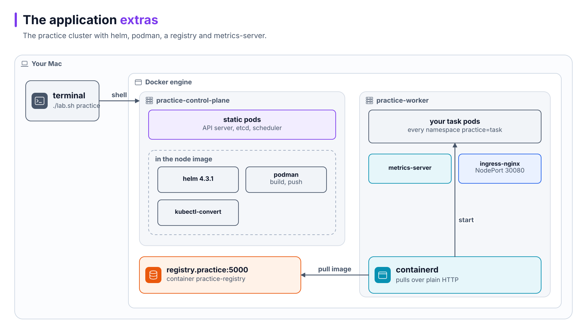

# The practice cluster in depth

> New to a term here, like kubeadm, kind or static pod? The [glossary](glossary.md#the-practice-cluster-and-the-security-modules) explains every term the practice cluster and the security modules use.

Modules 1.2 to 1.6 and 4.1 to 4.6 and the six timed practice exams run on a second cluster, the practice cluster, instead of the k3d lab. The k3d lab is built for watching a platform work, so it runs the shop, Istio and every UI on one k3s node that you drive from your Mac. The application and security modules train a different skill, fixing a given problem on a live cluster from a terminal inside its time budget, and that skill needs a cluster that looks like the ones teams build by hand.

| | k3d lab (modules 1.1, 2.1 and 2.2, 2.4 to 2.9, 3.1 to 3.15, 3.17 to 3.21 and 5.1 to 5.4) | Practice cluster (modules 1.2 to 1.6 and 4.1 to 4.6) |
|---|---|---|
| Cluster | k3d on your Mac, one k3s node, Istio and the shop | kubeadm on two kind nodes in Docker, no mesh |
| You work | from your Mac, with `kubectl` and the UIs | inside a node, with `kubectl`, `vim`, `systemctl` and `journalctl` |
| A module is | 30 to 60 minutes that explain one idea in depth | course-style theory, concepts and diagrams, then timed tasks of 3 to 10 minutes each |
| You finish when | you understand why the platform behaves as it does | you solve each task inside its time budget without opening the solution |

The practice cluster comes from kubeadm, the official tool that turns plain Linux machines into a Kubernetes cluster. kubeadm runs the control plane as **static pods**, which are pods that the kubelet starts from YAML files in `/etc/kubernetes/manifests` with no API server involved. Many security tasks edit those files, while the k3s cluster of the lab keeps its control plane inside one binary, so those tasks have nothing to edit there. The [timed tasks page](timed-tasks.md) explains how a task works, and the [VM page](../README.md#the-vm-for-the-kernel-tasks) explains the third machine that the kernel tasks of module 4.7 need.

## Two nodes in Docker

The cluster needs two Linux machines, because many tasks change a node: they edit a static pod, restart the kubelet, add a systemd unit or read the journal. Two virtual machines would give you that, but they cost memory, take minutes to install, and tie the course to one hypervisor. **kind** gets the same result inside the Docker engine that the k3d lab already uses. kind starts each node as a privileged container that runs systemd, containerd and the kubelet, so from the inside a node behaves like a small Linux machine, and kubeadm builds the cluster on top exactly as it would on two servers. The only things you need on your Mac are Docker and this repo.


The picture shows the two nodes inside the Docker engine on your Mac:

1. `practice-control-plane` runs the control plane: API server, etcd, scheduler and controller manager, all as static pods. It also holds `etcdctl`, `trivy`, `kube-bench`, `kubesec`, `bom` and a small image policy service for the supply chain tasks.
2. `practice-worker` runs the workloads. It holds gVisor, a second container runtime for sandboxed pods, and Falco, which watches system calls.

Both nodes run Kubernetes 1.37.1. That is one patch release below the newest 1.37, so the upgrade task has somewhere to go. Calico 3.32.3 connects the pods and enforces NetworkPolicy, and ingress-nginx 1.15.1 serves Ingress objects on NodePorts 30080 and 30443, which also answer on your Mac at `localhost:30080` and `localhost:30443`.

Every tool comes from one **node image**. kind publishes a node image per Kubernetes version, and its newest, for 1.37.0, is the base. A Dockerfile in `platform-engineering/practice/cluster/kind/` adds the kubeadm, kubelet and kubectl packages at 1.37.1 from the Kubernetes package repository, so `apt` upgrades them in module 4.2 the way it does on any kubeadm node, and then every scanner, runtime and helper that the tasks use. The first `./lab.sh practice up` builds that image once. After that Docker keeps it, so a new cluster downloads nothing but the Kubernetes images, and you carry the whole toolbox with you wherever Docker runs.

### Create, open, reset, delete

The guide's [Practice cluster and timed tasks](../README.md#practice-cluster-and-timed-tasks) section has the commands: `./lab.sh practice up` builds the node image once and then the cluster, `./lab.sh practice shell` opens a root shell on the control plane with the `k` alias set, and `./lab.sh practice shell worker` opens one on the worker. `./lab.sh practice reset` deletes both nodes and builds a fresh cluster at 1.37.1, and `./lab.sh practice down` deletes the cluster and the registry while Docker keeps the node image.

In the test run on a Mac with 24 GB of memory and OrbStack, `./lab.sh practice up` took 2 minutes 38 seconds from nothing, including the download of kind's node image and the build of the practice image on top. A second `up` on a finished cluster took 3 seconds, and `./lab.sh practice reset` took between 64 and 95 seconds. A reset deletes the two node containers and starts new ones from the cached image, which is faster and cleaner than undoing every task by hand.

The cluster fits next to the running k3d lab. With the cluster idle, `practice-control-plane` used about 0.95 GB of memory and `practice-worker` about 0.6 GB, while the k3d lab used between 3.3 and 4.0 GB, all inside OrbStack's Docker engine with its limit of 11.7 GB. Through all 108 tasks of modules 1.2 to 1.6 and 4.1 to 4.6 the two nodes together peaked at 2.6 GB, so the k3d lab and the practice cluster ran side by side the whole time.

kind writes the cluster's kubeconfig to `~/.kube/practice-kind.yaml` instead of your main kubeconfig, so the current context of your `kubectl` stays on the k3d lab. You rarely need it, because the tasks run inside a node, and in a toolbox shell `kubectl --context kind-practice get nodes` reaches the cluster, because the toolbox adds that context to its own kubeconfig. The file lands in your Mac's home only when `./lab.sh practice up` runs on your Mac instead of in the toolbox, which happens when kubectl, helm and k3d are installed there.

### What a shared kernel changes

A kind node is a container, so both nodes share one Linux kernel with each other, with the k3d lab and with every other container on your Mac. Most security controls live above the kernel and work the same as on a server. Four consequences matter for the security modules:

- The kernel has no AppArmor. The kubelet accepts AppArmor fields in a pod but refuses to start the pod: `Cannot enforce AppArmor: AppArmor is not enabled on the host`. So the AppArmor tasks run on the [Lima VM](../README.md#the-vm-for-the-kernel-tasks), which has a kernel of its own.
- The kernel has no WireGuard module, so Calico and Cilium node-to-node encryption don't run here. Pod-to-pod encryption points to Istio, which the course already runs, or to the Lima VM.
- Cilium would load its eBPF programs into the kernel that every container shares. The Cilium tasks run on the Lima VM for that reason, and the practice cluster keeps Calico.
- Falco sees every system call on the shared kernel, including the ones from the k3d lab and other containers. Filter its output by `k8s.ns.name` or container name to see only your cluster.

gVisor and Falco still run on the worker. gVisor brings its own user-space kernel inside the sandbox, and Falco's eBPF probe only watches system calls, so neither needs a kernel to itself, and both passed every task in the test run. The [kernel and host page](../README.md#the-vm-for-the-kernel-tasks) collects the tasks that do need one.

Two kubeadm settings in `platform-engineering/practice/cluster/kind/cluster.yaml` exist because of the shared kernel. kube-proxy doesn't set the kernel's connection tracking table size (`conntrack.maxPerCore: 0`), because a container may not change a value the whole kernel shares. And the kubelet tolerates swap (`failSwapOn: false`), because the Docker engine's VM may have swap that every container sees.

## The application extras



The application modules 1.2 to 1.6 run on the same two nodes as the security modules, but building and shipping an app needs a few tools that hardening a cluster doesn't:

1. On `practice-control-plane`: helm 4.3.1 to install charts, podman to build and push images, and `kubectl-convert` for API version changes. All three sit in the node image.
2. Next to the nodes: a local image registry at `registry.practice:5000`, which runs as the container `practice-registry` on kind's Docker network. Both nodes and every pod reach it by that name, and containerd on both nodes pulls from it over plain HTTP.
3. In the cluster: metrics-server 0.9.1, so that `kubectl top` works.

`./lab.sh practice up` starts the registry with the cluster, so only metrics-server is left for `extras.sh`, and `app-extras/reset.sh` removes everything the application tasks and exams created. The guide's [Practice cluster and timed tasks](../README.md#practice-cluster-and-timed-tasks) section shows when to run each one.

In the test run, `extras.sh` took 25 seconds, most of it for metrics-server to report its first numbers.

The application and security modules share one cluster, so each keeps out of the other's way. Every namespace an application task creates carries the label `practice=task`, and every practice exam namespace `practice=mock`, so `reset.sh` finds and deletes them all. Cluster-wide objects that the tasks create start with `ckad-`, and Custom Resource Definitions sit in the `ckad.io` group, so the reset finds those too. The reset also empties the registry and removes metrics-server, which the security modules don't use, and the tasks that need it install it again. It does that last, after the namespaces are gone, because a namespace only finishes deleting while every API group answers, and the metrics API stops answering when metrics-server goes. In the test run the reset took between 42 and 57 seconds.

`./lab.sh practice reset` builds the cluster from scratch, so run `extras.sh` again after it.

## Other platforms: OrbStack machines and your own VMs

The scripts keep two other homes for the same cluster. Both build two Ubuntu 24.04 machines called `cks-cp` and `cks-w1`, install containerd and kubeadm on them, and then run the same tasks and practice exams. One environment variable picks the platform, and every script reads it, `./lab.sh`, `task.sh` and `practice-exam.sh` included:

| `PRACTICE_PLATFORM` | The nodes | Reached with |
|---|---|---|
| `kind`, the default | two containers, `practice-control-plane` and `practice-worker` | `docker exec` |
| `orbstack` | two OrbStack Linux machines, `cks-cp` and `cks-w1` | `orb -m <node> -u root` |
| `vms` | two VMs you reach over SSH, `cks-cp` and `cks-w1` | `ssh` and `sudo` |

The older names `CKS_PLATFORM`, `CKS_CP_HOST` and so on still work when the new `PRACTICE_*` name is unset. Inside the task scripts, the node names come from two variables, `CP` and `W1`, which every node shell receives, so one script serves all three platforms.

### OrbStack machines

An OrbStack machine is a lightweight Ubuntu system that shares OrbStack's kernel, so it brings the same kernel limits as kind, but each node is a full Ubuntu install that keeps its state across `orb stop` and `orb start`:

```bash
export PRACTICE_PLATFORM=orbstack
./lab.sh practice up              # creates cks-cp and cks-w1 and builds the cluster, about 4 minutes
./lab.sh practice shell           # the same as: orb -m cks-cp -u root
orb stop cks-cp cks-w1            # frees the memory; "orb start cks-cp cks-w1" brings the cluster back
./lab.sh practice reset           # kubeadm reset and a rebuild, machines and downloads kept
./lab.sh practice down --yes      # deletes both machines
```

In the earlier test runs, `create.sh` took 3 minutes 45 seconds from nothing and `reset.sh` 2 minutes 30 seconds, and the machines used 1.1 GB and 0.7 GB of memory. The application extras install helm, podman and kubectl-convert on `cks-cp` there, with the registry as the systemd service `practice-registry` on port 5000. After the move to kind, a sample of six tasks (1.2.1, 1.4.3, 4.1.4, 4.3.4, 4.4.4 and 4.6.2, which cover podman and the registry, a node label, Ingress, a systemd unit, gVisor and Falco) still failed after setup and passed after the solution on the OrbStack machines.

## The practice cluster on Proxmox VMs

On a Proxmox host, the course runs as a set of its own: the toolbox VM `pe-lab` runs the lab and the kind practice cluster, as the [guide](../README.md#proxmox) shows, and two more VMs, `cks-cp` and `cks-w1`, form a second practice cluster with kernels of their own. The scripts on `pe-lab` send every node command to those VMs through `ssh` and `sudo`, so the tasks, the checks and the practice exams stay the same. The kernel of `cks-w1` has AppArmor and loads modules, so the AppArmor and kernel module tasks of module 4.7 run there.

### What you need

`proxmox/create-vms.sh cks` builds both VMs from the Ubuntu 24.04 cloud image: VM 221 `cks-cp` at 192.168.1.221 with 2 CPUs, 3 GB of memory and 30 GB of disk, and VM 222 `cks-w1` at 192.168.1.222 with 2 CPUs, 2.5 GB and 30 GB, each with the user `ubuntu` and your public key. Their network must stay clear of the pod network `10.244.0.0/16` and the service network `10.96.0.0/12`. The VMs need no particular hostname, because `create.sh` renames them to `cks-cp` and `cks-w1`, the node names that kubeadm and the tasks expect.

### Settings and commands

Run these on `pe-lab`, inside `./lab.sh shell`. The toolbox reads the settings from `lab.env` and sees `~/.ssh` read-only, so put the private key for the two VMs at `~/.ssh/cks_proxmox` on `pe-lab`. Five variables tell the scripts where the VMs are, and all but the first have the defaults shown:

```bash
PRACTICE_PLATFORM=vms                  # without it, the scripts use kind on pe-lab
PRACTICE_CP_HOST=192.168.1.221         # the address of cks-cp
PRACTICE_W1_HOST=192.168.1.222         # the address of cks-w1
PRACTICE_SSH_USER=ubuntu               # the login user on both VMs
PRACTICE_SSH_KEY=~/.ssh/cks_proxmox    # the private key for that user
```

```bash
./lab.sh practice up             # builds the cluster on both VMs; safe to run again
./lab.sh practice shell          # ssh to cks-cp and sudo -i
./lab.sh practice reset          # back to a fresh cluster at 1.37.1
./lab.sh practice down --yes     # wipes the cluster with kubeadm reset and keeps both VMs
```

`down` never deletes a VM here, because the VMs belong to your hypervisor: it runs `kubeadm reset` and undoes the task changes. A sixth variable, `PRACTICE_SSH_OPTS`, passes extra options to `ssh`, such as a separate known hosts file. Remove `PRACTICE_PLATFORM=vms` from `lab.env` to go back to the kind cluster on `pe-lab`.

### What the test run measured

The test ran on a Proxmox host with an Intel i7-12700T and 15 GB of memory, so the nodes ran on amd64. On two new VMs, `create.sh` built the cluster in 3 minutes 26 seconds, after it had waited for cloud-init to finish the first-boot package upgrade, and `reset.sh` took between 2 minutes 35 seconds and 4 minutes 33 seconds. With the cluster idle, `cks-cp` used 1.0 GB of memory and `cks-w1` 0.6 GB. All 65 security tasks and the three security practice exams passed in this setup. If `apt` hangs on the VMs, change `http://` to `https://` in `/etc/apt/sources.list.d/ubuntu.sources`.

## Where each task runs

The kernel tasks need a kernel of their own. On a Mac every task of module 4.7 runs on the Lima VM `cks-lima`, which the [guide](../README.md#the-vm-for-the-kernel-tasks) builds. On Proxmox, `cks-w1` takes the AppArmor and kernel module tasks:

| Task | On a Mac | On Proxmox |
|---|---|---|
| 4.7.1 to 4.7.3, Cilium policies | `cks-lima` | not available |
| 4.7.4, a kernel module | `cks-lima` | `cks-w1` |
| 4.7.5, WireGuard with Cilium | `cks-lima` | not available |
| 4.7.6 and 4.7.7, AppArmor | `cks-lima` | `cks-w1` |
| Practice exam 5 task 9, AppArmor | `cks-lima` | `cks-w1` |
| Practice exam 6 task 10, a kernel module | `cks-lima` | `cks-w1` |
| Practice exams 5 and 6, task 3, Cilium | `cks-lima` | not available |

The task text says `cks-lima`, so on Proxmox read it as `cks-w1` for the AppArmor and kernel module tasks: load the profile or write the modprobe rule on `cks-w1`, and run `kubectl` on `cks-cp`. The pods land on `cks-w1` anyway, because the control plane keeps its taint, and AppArmor confines a container only on the node that loaded the profile.

The Cilium tasks need a cluster whose network plugin is Cilium, which only `cks-lima` has, so on Proxmox they stop with a message and every other task still works.
